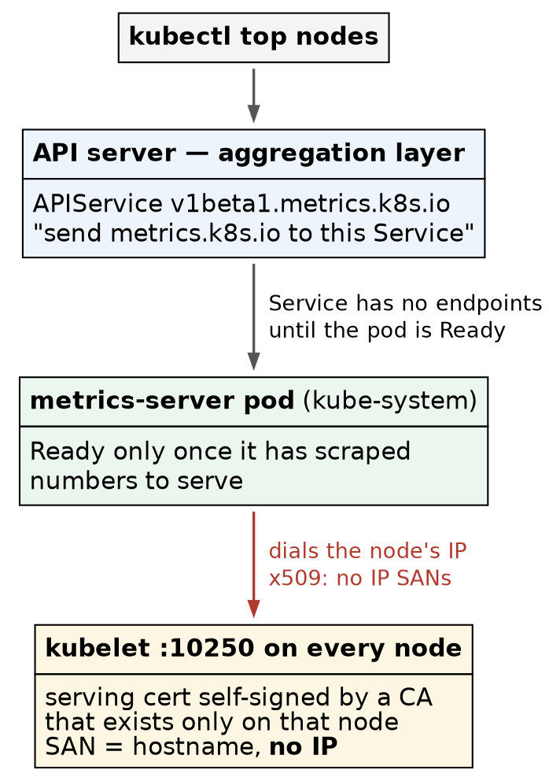
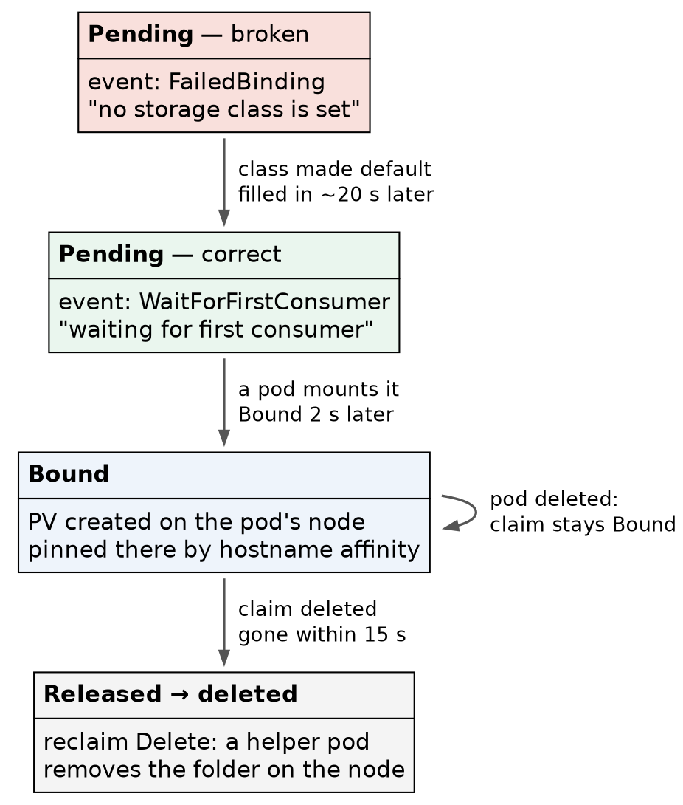

# Kubernetes (CKA) · Chapter 5 — What a Bare Cluster Cannot Do: Metrics and Storage

> **Series:** Home-Lab Education · Phase 18 (Kubernetes HA + CKA)
> **Built and verified:** November 4, 2026 on VMs 201–205 (`192.168.1.201–205`), every command run
> by hand on control-1
> **Versions at time of writing:** Kubernetes v1.35.8 · metrics-server v0.9.0 · local-path-provisioner
> v0.0.37 · Kustomize v5.7.1 (built into `kubectl`) · busybox 1.38.0
> **Files:** `manifests/ch05/metrics-server/` and `manifests/ch05/local-path/`, committed exactly as
> applied
> **Read this after:** Chapter 4 (the proven cluster) · **before:** Chapter 6 (traffic in)

---

## What this chapter covers

Chapter 4 ended with a cluster that is highly available, networked and proven — and that
[still cannot do half of what the exam's workload tasks assume]{custom-style="Key"}. Ask it for a
node's CPU and it has no idea. Ask it for a persistent volume and nothing answers. Ask it to route
HTTP from outside and nothing is listening.

None of that is a fault. **`kubeadm` builds a control plane and stops**, and every one of those
gaps is the same gap: [something has to be installed that `kubeadm` does not
give you]{custom-style="Key"}. This chapter closes the first two — metrics and storage. Chapter 6
closes the third.

Each part runs the same three beats, and the first beat is the one worth the most:

1. **Signature** — what the cluster looks like *without* the component. [Recognising absence is
   Troubleshooting]{custom-style="Key"}, the exam's 30% domain.
2. **Install** — [the simplest way that is still a real method]{custom-style="Key"}.
3. **Proof** — [an outcome, checked somewhere other than the install's own output]{custom-style="Key"}.

⭐ **Why the signature comes first.** The exam hands you clusters that are already built and
equipped, so [which component is installed is not what is examined]{custom-style="Key"} — the
objects are, and so is the look of a cluster with a piece missing. A message you have seen in the
lab is one you recognise in seconds under a clock.

### Where to run this

🚨 **On control-1, not on your workstation.** The first command of this chapter was run on the
workstation by accident and printed:

```
The connection to the server localhost:8080 was refused - did you specify the right host or port?
```

[That is not an outage]{custom-style="Key"}. With no kubeconfig, `kubectl` falls back to
`localhost:8080`, so the message means [*this machine has no cluster configured*]{custom-style="Key"}.
A real API outage names the real server — `https://192.168.1.206:6443` here. ⭐ **Check where you
are before reading what you got** — on the exam, that is the task's `ssh` line.

---

## Part A — metrics-server

### What it is, and the path a request takes

`kubectl top` does not talk to the kubelets. It asks the API server for the `metrics.k8s.io` API —
and [the API server does not serve that API itself]{custom-style="Key"}. An **APIService** object
registers it with the API server's **aggregation layer**: *requests for this group go to that
Service*. metrics-server is the pod behind the Service, and it gets its numbers by scraping
[every kubelet's port 10250]{custom-style="Key"}.



> Three hops, and each one fails with a different signature. Read them top to bottom: is the API
> registered, does its Service have an endpoint, and can the pod reach the kubelets.

⚠️ **metrics-server is not monitoring.** It keeps [a few seconds of CPU and memory, in memory, for
the autoscalers and `kubectl top`]{custom-style="Key"} — [no history, no alerting]{custom-style="Key"}. Monitoring is a
separate stack.

**Why Kustomize.** The fix below is one flag on an upstream file. Editing the downloaded YAML would
work, and would leave [a file that no longer matches the release it claims to be]{custom-style="Key"}.
A `kustomization.yaml` keeps `components.yaml` byte-identical to upstream — its sha256 checks against
the release — and states the change separately, where a reviewer can see it. ⭐
[Patching an upstream file without editing it]{custom-style="Key"} is exactly what Kustomize is for,
and it is on the syllabus.

### 1. Read the signature of "not installed"

```bash
kubectl top nodes
kubectl get apiservices | grep metrics
```

**Confirm:** `error: Metrics API not available`, and the `grep` prints nothing — [there is no
`v1beta1.metrics.k8s.io` at all]{custom-style="Key"}.

### 2. Install it as shipped — and watch it fail

```bash
mkdir -p ~/ch05/metrics-server && cd ~/ch05/metrics-server
curl -sLO https://github.com/kubernetes-sigs/metrics-server/releases/download/v0.9.0/components.yaml

cat > kustomization.yaml <<'EOF'
apiVersion: kustomize.config.k8s.io/v1beta1
kind: Kustomization
resources:
  - components.yaml
EOF

kubectl kustomize . | grep '^kind:'     # preview: nine objects, nothing applied yet
kubectl apply -k .
```

⭐ **`kubectl kustomize .` renders without applying.** [Preview what you are about to create, every
time]{custom-style="Key"} — it is free, and [it is the only moment the answer is cheap]{custom-style="Key"}.

Installing it unpatched is deliberate: it shows the second signature, which is the one people
misread.

```bash
kubectl -n kube-system get pods -l k8s-app=metrics-server
kubectl get apiservice v1beta1.metrics.k8s.io
kubectl -n kube-system logs deploy/metrics-server | tail -5
kubectl top nodes
```

**What it showed:**

| Check | Reading | Meaning |
|---|---|---|
| Pod | `Running`, `0/1` | the process is up, but readiness fails: `no metrics to serve` |
| APIService | `False (MissingEndpoints)` | registered, but its Service has no Ready pod behind it |
| Log | `x509: cannot validate certificate for 192.168.1.20x because it doesn't contain any IP SANs` | the real cause |
| `kubectl top` | `error: Metrics API not available` | 🚨 **the same words as before the install** |

🚨 **That last row is the lesson.** [*Not installed* and *installed but broken* print the identical
error]{custom-style="Key"}. The message never tells you which; the APIService does. Nothing listed
means absent; `False` with a reason means present and failing.

**Why the certificate fails.** Each kubelet's serving certificate,
`/var/lib/kubelet/pki/kubelet.crt`, is [self-signed by a CA that exists only on that
node]{custom-style="Key"}, and names only the hostname:

```bash
sudo openssl x509 -in /var/lib/kubelet/pki/kubelet.crt -noout -subject -issuer -ext subjectAltName
#   issuer=CN = vm-k8s-cka-control-1-ca@1789659917
#   DNS:vm-k8s-cka-control-1
```

metrics-server dials the node's **IP** (`--kubelet-preferred-address-types=InternalIP` comes first in
its arguments), and a certificate with [no IP in its SANs cannot match an IP]{custom-style="Key"}.
Even with the right name, nothing in the cluster trusts the issuing CA.

### 3. Patch it with Kustomize, not with an editor

```bash
cat > kustomization.yaml <<'EOF'
apiVersion: kustomize.config.k8s.io/v1beta1
kind: Kustomization
resources:
  - components.yaml
patches:
  - target:
      kind: Deployment
      name: metrics-server
    patch: |-
      - op: add
        path: /spec/template/spec/containers/0/args/-
        value: --kubelet-insecure-tls
EOF

kubectl kustomize . | grep -A8 ' args:'     # the new flag is the LAST arg
kubectl apply -k .
kubectl -n kube-system rollout status deploy/metrics-server
```

The patch is a **JSON 6902** operation: `add` to `args/-`, where [`-` means "append to the end of the
list"]{custom-style="Key"}. It does not need to know how many arguments upstream ships, so it keeps
working when the next release adds one.

**Confirm — the apply did exactly one thing:**

```
deployment.apps/metrics-server configured
...                              unchanged     (x8)
```

⭐ [One `configured` and eight `unchanged` is a diff you can read]{custom-style="Key"}: the patch
touched the Deployment and nothing else. ⚠️ `rollout status` printed `1 old replicas are pending
termination` for a while — [the broken pod stays until its replacement is Ready]{custom-style="Key"},
which is a rolling update working as designed.

### 4. Prove it with numbers

```bash
kubectl get apiservice v1beta1.metrics.k8s.io     # True
kubectl top nodes
kubectl top pods -A --sort-by=memory | head
```

**Confirm:** the APIService reads `True`, and all five nodes report CPU and memory. Ours, on the
idle equipped cluster: control planes at 41–49% memory, workers at 27–34%.

⭐ **Read the top of the pod list — it holds a lesson about leader election.** The API servers lead
the list (430–560 Mi each), and on our cluster [control-2's controller-manager sat near the
top while the other two did not appear]{custom-style="Key"}. control-2 held both the
`kube-controller-manager` and `kube-scheduler` leases:

```bash
kubectl -n kube-system get leases kube-controller-manager kube-scheduler
```

Three controller-managers run, and [only the lease holder does any work]{custom-style="Key"}; the
other two wait. [Memory usage is a quick way to see who is active]{custom-style="Key"}, and [the lease is the way to prove it]{custom-style="Key"}.

> **Lab vs PROD — metrics-server skipping kubelet certificate verification.** *In the lab:*
> `--kubelet-insecure-tls` makes metrics-server accept whatever certificate port 10250 presents.
> *Why it's acceptable here:* five nodes on one isolated LAN, one operator, and the numbers feed
> only `kubectl top` and practice autoscalers. *In production (recited, not run here):* the kubelets
> request serving certificates signed by the cluster CA (`serverTLSBootstrap: true`), someone
> approves those requests, and [an automated approver restricted to kubelet serving
> certificates]{custom-style="Key"} keeps approving them as they rotate. *If you carry the habit:*
> metrics-server [cannot tell a kubelet from anything else answering on that
> address]{custom-style="Key"} — and those numbers decide how many replicas your autoscalers run.
> Approve-by-hand without the automation fails the other way: the certificates rotate, and metrics
> break silently months later.

---

## Part B — storage

### The four objects, and who creates each

| Object | Scope | Who creates it |
|---|---|---|
| **PersistentVolumeClaim** (PVC) | namespace | you — *"I need 1 GiB, read-write, from this class"* |
| **PersistentVolume** (PV) | cluster | an administrator by hand, **or** a provisioner on demand |
| **StorageClass** | cluster | an administrator — names a provisioner and its rules |
| **provisioner** | a running pod | an installed component — the thing that makes PVs |

A claim binds to a volume. [Without a class and a provisioner, nothing ever makes the
volume]{custom-style="Key"}, so the claim waits forever. ⭐ **Static PVs need no provisioner at
all** — an administrator writes the PV by hand and a matching claim binds to it. That is a separate
exercise; this part is about *dynamic* provisioning.

**Why local-path.** It is [one file, needs no extra disks, and provisions for
real]{custom-style="Key"}: each volume is a directory on the node that runs the pod. It is not a
production storage system, and the callouts below say why.



> Two boxes say `Pending`, and only one of them is a problem. **The status cannot tell them apart;
> the event can.** Every time in the figure was measured.

### 5. Read the signature of "no storage"

```bash
mkdir -p ~/ch05/local-path && cd ~/ch05/local-path

cat > pvc-data.yaml <<'EOF'
apiVersion: v1
kind: PersistentVolumeClaim
metadata:
  name: data
  namespace: default
spec:
  accessModes: [ReadWriteOnce]
  resources:
    requests:
      storage: 1Gi
EOF

kubectl apply -f pvc-data.yaml
kubectl get storageclass
kubectl get pvc data
kubectl describe pvc data | tail -4
```

**Confirm:** `No resources found` for classes, the claim `Pending`, and the event:

```
Normal  FailedBinding  ...  no persistent volumes available for this claim and no storage class is set
```

⭐ [The claim names no class, and the cluster has no default to give it]{custom-style="Key"}. [That event is the
signature of a cluster with no dynamic storage]{custom-style="Key"}.

### 6. Install the provisioner — read the file first

```bash
curl -sLO https://raw.githubusercontent.com/rancher/local-path-provisioner/v0.0.37/deploy/local-path-storage.yaml
grep -nE '^kind:|image:|volumeBindingMode|reclaimPolicy' local-path-storage.yaml

kubectl apply -f local-path-storage.yaml
kubectl -n local-path-storage rollout status deploy/local-path-provisioner
kubectl get storageclass
kubectl get pvc data
```

**Confirm:** class `local-path`, provisioner `rancher.io/local-path`, `WaitForFirstConsumer`,
`Delete` — and **not** marked `(default)`. The claim is [still `Pending` with the same
event]{custom-style="Key"}.

⚠️ **Installing a class does not touch existing claims.** Ours named no class, and [a non-default
class is only used by claims that ask for it by name]{custom-style="Key"}. The fix is either `storageClassName:
local-path` on the claim, or making the class the default — which is what the workload tasks assume.

### 7. Make it the default — and wait before you judge

```bash
kubectl patch storageclass local-path \
  -p '{"metadata":{"annotations":{"storageclass.kubernetes.io/is-default-class":"true"}}}'
kubectl get storageclass
kubectl get pvc data -o custom-columns=NAME:.metadata.name,STATUS:.status.phase,SC:.spec.storageClassName
```

**Confirm:** `local-path (default)` in the class list.

🚨 **Five seconds later the claim still had no class.** That reads like "existing claims are not
updated", and it is wrong. Since Kubernetes 1.28 a new default class
[is filled in retroactively on class-less claims]{custom-style="Key"} — by the volume controller,
[on its next pass, about 20 seconds later]{custom-style="Key"} here. Read the events with their times
rather than polling the claim:

```bash
kubectl get events --field-selector involvedObject.name=data --sort-by=.lastTimestamp
```

The event changed from `FailedBinding` to:

```
Normal  WaitForFirstConsumer  ...  waiting for first consumer to be created before binding
```

⭐ **Still `Pending` — and now correctly.** `WaitForFirstConsumer` means [no volume is made until a
pod that uses the claim is scheduled]{custom-style="Key"}, so the volume can be created on the node
where that pod will run. The status reads exactly as it did when the cluster had no storage at all.
🚨 **[Read the event, not the status]{custom-style="Key"}** — it is the only place the two are
different.

### 8. Mount it, and see where the volume went

```bash
cat > pod-writer.yaml <<'EOF'
apiVersion: v1
kind: Pod
metadata:
  name: writer
spec:
  containers:
  - name: c
    image: busybox:1.38.0
    command: ["sh", "-c", "date >> /data/log; sleep 3600"]
    volumeMounts:
    - name: d
      mountPath: /data
  volumes:
  - name: d
    persistentVolumeClaim:
      claimName: data
EOF

kubectl apply -f pod-writer.yaml
kubectl wait --for=condition=Ready pod/writer --timeout=120s
kubectl get pvc data
kubectl get pv
kubectl get pod writer -o wide
```

**Confirm:** the claim went `Bound` [about two seconds after the pod was scheduled]{custom-style="Key"},
and a PV appeared that nobody wrote. Ours was created on **worker-2**, the pod's node.

Now ask the PV where it lives:

```bash
kubectl get pv <name> -o jsonpath='{.spec.hostPath.path} {.spec.nodeAffinity.required.nodeSelectorTerms[0].matchExpressions[0]}{"\n"}'
#   /opt/local-path-provisioner/pvc-<uid>_default_data
#   {"key":"kubernetes.io/hostname","operator":"In","values":["vm-k8s-cka-worker-2"]}
```

🚨 **Two facts in one line, and the second one matters more.** The volume is [a plain directory on
one node]{custom-style="Key"} (`drwxrwxrwx root`), and the PV carries a **node affinity** that pins
[every future pod using this claim to that node]{custom-style="Key"}. The scheduler will not place
the pod anywhere else — not by preference, by rule.

### 9. Prove the data outlives the pod

```bash
kubectl delete pod writer --now
kubectl get pvc data                        # still Bound
kubectl apply -f pod-writer.yaml
kubectl wait --for=condition=Ready pod/writer --timeout=120s
kubectl get pod writer -o wide              # worker-2 again
kubectl exec writer -- cat /data/log        # TWO lines
```

**Confirm:** the claim stayed `Bound` with no pod, the new pod landed on worker-2 again, and the log
held [both timestamps — one from each pod]{custom-style="Key"}.

⭐ **The claim belongs to the namespace, not to the pod.** Deleting a pod releases nothing. And
"landed on worker-2 again" was [the affinity at work, not luck]{custom-style="Key"}.

### 10. Delete the claim — and check the disk, not the API

```bash
kubectl delete pod writer --now
kubectl delete pvc data
kubectl get pv                                    # Released, briefly
kubectl -n local-path-storage get pods            # helper-pod-delete-pvc-...
sleep 15
kubectl get pv                                    # gone
```

Then, **on the node** (worker-2 here):

```bash
sudo ls -la /opt/local-path-provisioner/          # empty
```

**Confirm:** the PV went `Released`, a `helper-pod-delete-pvc-…` pod ran in `local-path-storage`,
and [within 15 seconds the PV and the folder were both gone]{custom-style="Key"}.

⭐ **`kubectl` cannot see a node's disk.** "The PV is gone" is the API's claim; [the empty directory
on the node is the outcome]{custom-style="Key"}. Check from the layer that would fail.

⚠️ **The delete helper is an unpinned image.** It runs `docker.io/library/busybox` with
[no tag, pulled from Docker Hub on every volume delete]{custom-style="Key"} — so [a Docker Hub
rate limit or outage stalls deletes]{custom-style="Key"}, and [the image it runs can change under you]{custom-style="Key"}.

> **Lab vs PROD — volumes that live in a directory on one node.** *In the lab:* every PV is a
> `hostPath` folder under `/opt/local-path-provisioner` on whichever node first ran the pod, pinned
> there by node affinity. *Why it's acceptable here:* the cluster holds nothing worth keeping, and
> the point is to practise claims, classes and binding modes. *In production (reasoning, not tested
> here):* stateful data sits on storage that survives a node — an existing storage array through its vendor's
> CSI driver, or replicated block storage — or, for systems that replicate themselves, on local disks
> through a CSI local-volume driver that tracks capacity. *If you carry the habit:* [losing the node
> is losing the data]{custom-style="Key"}, and the pod cannot be rescheduled anywhere else because the
> affinity forbids it — the measured pin is what turns a node failure into an application outage.
> (What a *drain* does to such a pod has not been run here yet.)

> **Lab vs PROD — reclaim `Delete` as the default.** *In the lab:* `kubectl delete pvc data`
> destroyed the volume and its folder [in under 15 seconds, with no confirmation]{custom-style="Key"}.
> *Why it's acceptable here:* the data is test timestamps. *In production (standard practice, not
> run here):* classes that hold anything valuable use `reclaimPolicy: Retain`, so a deleted claim
> leaves a `Released` volume for a human to inspect, back up, and reclaim deliberately. *If you
> carry the habit:* [one mistyped namespace in a cleanup script]{custom-style="Key"} deletes
> production data as fast as it deletes test data — and the API reports it as a success.

---

## Honest limitations

All five nodes are VMs on one physical host, so "the data lives on worker-2" is [still one disk pool
underneath]{custom-style="Key"}. There is no CSI storage driver here — the only CSI driver in the cluster is Calico's
`csi.tigera.io`, registered for `Ephemeral` volumes only: a per-pod mount for Calico's own use, not
storage. [Whether local-path enforces the requested
size was not tested]{custom-style="Key"}. And metrics-server ran with the kubelet certificate check switched off, so the
[proper certificate fix is described, not demonstrated]{custom-style="Key"}.

---

## Commands to know by heart

| Question | Command |
|---|---|
| Is there a metrics API at all? | `kubectl get apiservices \| grep metrics` — nothing = absent; `False` = broken |
| Why is metrics-server not Ready? | `kubectl -n kube-system logs deploy/metrics-server \| tail -5` |
| What would this kustomization create? | `kubectl kustomize .` — renders, applies nothing |
| Apply a kustomization | `kubectl apply -k .` |
| Who is the active controller-manager / scheduler? | `kubectl -n kube-system get leases` |
| Which StorageClass is the default? | `kubectl get storageclass` — `(default)` after the name |
| Why is this claim `Pending`? | `kubectl describe pvc <name> \| tail -4` — **read the event** |
| What happened to an object, in order? | `kubectl get events --field-selector involvedObject.name=<n> --sort-by=.lastTimestamp` |
| Make a class the default | `kubectl patch storageclass <n> -p '{"metadata":{"annotations":{"storageclass.kubernetes.io/is-default-class":"true"}}}'` |
| Where does this volume live, and is it pinned? | `kubectl get pv <n> -o jsonpath='{.spec.hostPath.path} {.spec.nodeAffinity}'` |
| Is the data really gone? | on the node: `sudo ls -la /opt/local-path-provisioner/` |

---

## Glossary

**aggregation layer** — the API server's mechanism for [serving an API group from somewhere
else]{custom-style="Key"}. An **APIService** says which Service answers for which group.

**metrics-server** — scrapes CPU and memory from every kubelet and serves them as
`metrics.k8s.io`. Feeds `kubectl top` and autoscalers; keeps no history.

**kubelet serving certificate** — the certificate on port 10250. Under kubeadm's defaults it is
[self-signed by a node-local CA]{custom-style="Key"} and names only the hostname.

**Kustomize** — overlays changes on unmodified YAML. Built into `kubectl` (`-k`).

**JSON 6902 patch** — a list of operations (`add`, `replace`, `remove`) addressed by path. `-` at the
end of a list path appends.

**StorageClass** — names a provisioner and its rules: binding mode, reclaim policy, expansion.

**`WaitForFirstConsumer`** — [no volume until a pod using the claim is
scheduled]{custom-style="Key"}, so the volume is made where the pod will run.

**default StorageClass** — the class given to claims that name none; marked by the
`is-default-class` annotation. [Applied retroactively to existing class-less claims]{custom-style="Key"} since 1.28.

**reclaim policy** — what happens to a volume when its claim is deleted. `Delete` destroys it;
[`Retain` keeps it `Released` for a human]{custom-style="Key"}.

**node affinity (on a PV)** — [the rule that pins every pod using the volume to one
node]{custom-style="Key"}.

---

## Check yourself

Answer these out loud. Section references, not answers.

1. `kubectl top nodes` prints `Metrics API not available`. Name the two different states that print
   this, and the one command that tells them apart. (§2)
2. The metrics-server log says `doesn't contain any IP SANs`. Which certificate is it complaining
   about, who signed it, and why does an IP not match? (§2)
3. Why patch metrics-server with Kustomize rather than editing `components.yaml`? What does the
   apply output prove about the patch? (Part A intro, §3)
4. Three controller-managers are running. How do you find the one doing the work? (§4)
5. Two claims are `Pending`. How do you tell, in one command each, which is broken? (§5, §7)
6. You made a class the default and the existing claim still shows no class. What do you do? (§7)
7. A pod using a local-path volume is deleted and recreated, and lands on the same node every time.
   Luck, or a rule? Where would you read the rule? (§8, §9)
8. You deleted a pod and its claim is still `Bound`. Is that a leak? (§9)
9. The PV has disappeared from `kubectl get pv`. How do you prove the data is actually gone? (§10)
10. Name one thing local-path does that would be dangerous in production, and what production uses
    instead. (Lab vs PROD callouts)

Timed, exam-shaped versions of Parts A and B are in [`exercises.md`](exercises.md) (X01, X12).
