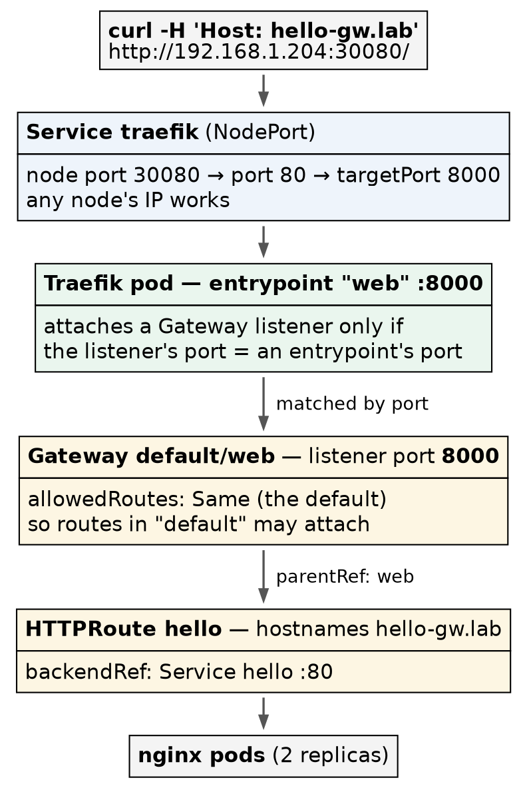

# Kubernetes (CKA) · Chapter 6 — Traffic In: Gateway API, Helm, Traefik, and the Ready Baseline

> **Series:** Home-Lab Education · Phase 18 (Kubernetes HA + CKA)
> **Built and verified:** November 4, 2026 on VMs 201–205 (`192.168.1.201–205`). Every cluster
> command was run by hand on control-1; the version research, the snapshot and the backup work on
> the Proxmox host were run by the AI and are marked where they appear
> **Versions at time of writing:** Kubernetes v1.35.8 · Gateway API v1.6.3 (standard channel) · Helm
> v4.3.1 · Traefik chart 42.3.0 = Traefik v3.7.17 · nginx 1.27 (test app) · etcd 3.6.6
> **Files:** `manifests/ch05/gateway-api/` and `manifests/ch05/traefik/` (the folder keeps the plan's
> numbering), committed exactly as applied
> **Read this after:** Chapter 5 (metrics and storage) · **before:** Chapter 7 (the anatomy reference)

---

## What this chapter covers

Chapter 5 gave the cluster metrics and storage. This chapter gives it [a way for HTTP to get
in]{custom-style="Key"}, then [freezes the result as the snapshot every exercise starts from]{custom-style="Key"}.

Three installs, each one teaching something the exam asks for directly:

- **Gateway API CRDs** — [a CRD is API, not code]{custom-style="Key"}. Installing one teaches more
  than any explanation of it.
- **Helm** — the package manager most vendors ship for, and the exam's way of installing anything
  substantial.
- **Traefik** — one controller that [serves both the old `Ingress` API and the new Gateway
  API]{custom-style="Key"}, so both syllabus items run side by side on one install.

Then the cluster is checked, shut down and snapshotted as **`c03-equipped-cluster`** — and checking
it turned up [a nightly etcd election that nobody had noticed]{custom-style="Key"}.

---

## Ingress and Gateway API, in one page

**Ingress** is one object: a host and path, mapped to a Service. A cluster-wide **IngressClass** says
which controller handles it. It is simple, frozen (no new features), and [the job of who owns the
entry point and who owns the route is all in one object]{custom-style="Key"}.

**Gateway API** splits that one object by **role**:

| Object | Scope | Owned by | Says |
|---|---|---|---|
| **GatewayClass** | cluster | the infrastructure provider | *"controller X implements gateways of this class"* (`controllerName`) |
| **Gateway** | namespace | the cluster operator | *"listen on this port and protocol, and accept routes from these namespaces"* |
| **HTTPRoute** | namespace | the application team | *"send this hostname and path to my Service"* — and attaches to a Gateway by `parentRefs` |

⭐ **The split is the point.** An application team [can change its routes without touching the
entry point]{custom-style="Key"}, and the operator [decides which namespaces may
attach]{custom-style="Key"} — which is exactly where the refusal in step 10 comes from.

**Neither API does anything on its own.** Both are just objects in the API server until a
**controller** reads them and configures a proxy. That is the theme of the whole chapter: [the API
server accepts objects that nothing will ever act on]{custom-style="Key"}, and the only sign is what
is *missing* from their status.

---

## Part A — the Gateway API CRDs

### 1. Read the signature of "no such API"

```bash
mkdir -p ~/ch05/gateway-api && cd ~/ch05/gateway-api
kubectl api-resources | grep gateway.networking.k8s.io; echo "grep exit: $?"
kubectl get crd | grep -c gateway.networking.k8s.io
kubectl get gatewayclass
```

**Confirm:** the `grep` prints nothing and exits `1`; zero CRDs; and

```
error: the server doesn't have a resource type "gatewayclass"
```

⭐ **Compare that with chapter 5's metrics error, because they are different absences.**
`Metrics API not available` meant [the type was known but nothing was serving
it]{custom-style="Key"}. `doesn't have a resource type` means [the type does not exist at
all]{custom-style="Key"} — no CRD has ever been applied. ⚠️ **Calico's operator installs none**,
despite owning a `gatewayapis.operator.tigera.io` resource of its own (chapter 3).

### 2. Choose the version your controller was built against

The newest Gateway API release was **v1.7.0**, six days old. We installed **v1.6.3**, and the reason
generalises:

🚨 **A controller is compiled against one version of the API it implements.** Traefik's stable v3.7
line [declares `sigs.k8s.io/gateway-api v1.6.3` in its `go.mod`]{custom-style="Key"}; v1.7 appeared
only in the v3.8 release candidates. Installing CRDs newer than the controller understands invites
[fields it ignores and behaviour nobody tested]{custom-style="Key"}. (This research was run by the AI, reading each
release's `go.mod` from the project's source.)

⭐ **The rule: pick the controller first, then [install the CRD version it was built
against]{custom-style="Key"}.** It is the same "one release back" discipline as kube-vip in chapter 2,
with [a better reason]{custom-style="Key"}.

### 3. Install them — server-side

```bash
curl -fsSLO https://github.com/kubernetes-sigs/gateway-api/releases/download/v1.6.3/standard-install.yaml
sha256sum standard-install.yaml
kubectl apply --server-side -f standard-install.yaml
```

⚠️ **`--server-side` is not optional for large CRD bundles.** Client-side `apply` stores the entire
object in a `last-applied-configuration` annotation, and [CRDs this large can exceed the annotation
size limit]{custom-style="Key"}. [Server-side apply keeps that bookkeeping in the API server]{custom-style="Key"} instead.
The output reads `serverside-applied`.

**Confirm — and count, because the count was a surprise:**

```bash
kubectl get crd | grep gateway.networking.k8s.io
kubectl api-resources --api-group=gateway.networking.k8s.io
kubectl get gatewayclass                                  # No resources found
kubectl get pods -A | grep -i gateway; echo "grep exit: $?"   # nothing
```

🔻 **Ten CRDs, not three.** The "standard" bundle also brings GRPCRoute, ReferenceGrant,
BackendTLSPolicy, ListenerSet, and TCP, TLS and UDP routes — all served at `v1`. And one object that
is not a CRD at all: a **ValidatingAdmissionPolicy**, `safe-upgrades.gateway.networking.k8s.io`,
which [refuses to install v0.x, v1.0–v1.5 and release-candidate bundles over these]{custom-style="Key"}.
⭐ **The CRDs defend themselves against a downgrade** — remember that in step 8.

⭐ **`No resources found` is a new message and it means something specific:** [the type exists and
holds no objects]{custom-style="Key"}. And the last `grep` finds no pod — [installing a CRD starts
nothing]{custom-style="Key"}. [A CRD teaches the API server a new noun]{custom-style="Key"}; it does not add a single
process to the cluster.

`api-resources` also shows the short names you will type under a clock — `gc`, `gtw`, `httproute`,
`refgrant` — and that **GatewayClass is cluster-scoped** (`NAMESPACED false`) [while the rest are not]{custom-style="Key"}.

### 4. Read a CRD the way the exam lets you

```bash
kubectl get crd httproutes.gateway.networking.k8s.io \
  -o jsonpath='{range .spec.versions[*]}{.name} served={.served} storage={.storage}{"\n"}{end}'
kubectl explain httproute.spec.rules.backendRefs | head -15
```

**Confirm:** `v1 served=true storage=true` and `v1beta1 served=true storage=false`.

⭐ **Served and stored are different things.** A CRD can [answer on several versions while keeping
exactly one on disk]{custom-style="Key"}; objects written as `v1beta1` are stored as `v1`. And
`kubectl explain` [works on CRDs exactly as it does on built-in types]{custom-style="Key"} — the
field reference you can use on the exam without opening a browser.

### 5. Prove there is no controller — with an object the API accepts anyway

```bash
cat > no-controller.yaml <<'EOF'
apiVersion: gateway.networking.k8s.io/v1
kind: GatewayClass
metadata:
  name: demo
spec:
  controllerName: example.com/nobody
---
apiVersion: gateway.networking.k8s.io/v1
kind: Gateway
metadata:
  name: demo
  namespace: default
spec:
  gatewayClassName: demo
  listeners:
  - name: http
    protocol: HTTP
    port: 80
EOF

kubectl apply -f no-controller.yaml
sleep 10
kubectl get gc,gtw -A
kubectl get gtw demo -o jsonpath='{range .status.conditions[*]}{.type}={.status} {.reason}: {.message}{"\n"}{end}'
kubectl delete -f no-controller.yaml
```

**Confirm:** both `created`. Then:

```
Accepted=Unknown Pending: Waiting for controller
Programmed=Unknown Pending: Waiting for controller
```

and no ADDRESS.

🚨 **`apply` succeeded and nothing will ever happen.** The API server checks the schema; [it never
checks that the named `controllerName` exists]{custom-style="Key"}. ⭐ **And no controller wrote
those conditions.** [`Unknown` / `Waiting for controller` are defaults in the CRD's
schema]{custom-style="Key"}, filled in by the API server when the object was created. Only a
controller ever sets `True` or `False`. **A status that has never moved from its default is the
signature of a missing controller.**

---

## Part B — Ingress, Helm and Traefik

### 6. Read the signature of "no Ingress controller"

A test application first — two nginx pods and a Service:

```bash
mkdir -p ~/ch05/traefik && cd ~/ch05/traefik
kubectl create deployment hello --image=nginx:1.27 --replicas=2
kubectl expose deployment hello --port=80
kubectl rollout status deployment hello

cat > ingress-hello.yaml <<'EOF'
apiVersion: networking.k8s.io/v1
kind: Ingress
metadata:
  name: hello
spec:
  rules:
  - host: hello.lab
    http:
      paths:
      - path: /
        pathType: Prefix
        backend:
          service:
            name: hello
            port:
              number: 80
EOF

kubectl apply -f ingress-hello.yaml
kubectl get ingressclass
kubectl get ingress hello
kubectl describe ingress hello | tail -8
kubectl run t --rm -i --restart=Never --image=busybox:1.38.0 -- \
  wget -qO- -T3 http://hello | grep -c 'Welcome to nginx'
```

**Confirm:** `No resources found` for IngressClass; the Ingress `created`, CLASS `<none>`, ADDRESS
blank; the describe ends `Events: <none>`; and the in-cluster `wget` counts `2`.

⭐ **`Events: <none>` is the loudest silence in the cluster.** [Only a controller writes an
Ingress's events]{custom-style="Key"}, so with none installed [nothing reports anything — not even an
error]{custom-style="Key"}. The `wget` proves the Service works from inside, which isolates the gap:
[the application is fine, and nothing is listening at the edge]{custom-style="Key"}.

⚠️ **`2`, not `1`.** The nginx welcome page has the phrase in both its `<title>` and its `<h1>`. A
check that expects `1` [fails on a page that is working]{custom-style="Key"}.

### 7. Install Helm — a pinned binary with its checksum checked

```bash
curl -fsSLO https://get.helm.sh/helm-v4.3.1-linux-amd64.tar.gz
curl -fsSL https://get.helm.sh/helm-v4.3.1-linux-amd64.tar.gz.sha256sum | sha256sum -c -
tar -xzf helm-v4.3.1-linux-amd64.tar.gz linux-amd64/helm
sudo install -m 0755 linux-amd64/helm /usr/local/bin/helm
rm -rf linux-amd64 helm-v4.3.1-linux-amd64.tar.gz
helm version
```

**Confirm:** `helm-v4.3.1-linux-amd64.tar.gz: OK`, then `v4.3.1`.

⭐ **Not `curl | bash`.** The install script is convenient and [runs whatever the server sends you
as your user]{custom-style="Key"}. A pinned tarball whose checksum you verified is a known binary.
⚠️ The `.sha256sum` file names the tarball, so `sha256sum -c` must run in the tarball's directory.

Helm lives **on control-1 only** — it is a client, like `kubectl`, and it uses the same kubeconfig.

```bash
helm repo add traefik https://traefik.github.io/charts
helm repo update
helm search repo traefik/traefik --versions | head -4
helm list -A                                             # empty
```

⭐ **`helm repo add` touches nothing in the cluster** — [it writes a file under your home
directory]{custom-style="Key"}. And read the two version columns: **CHART VERSION 42.3.0 ships APP
VERSION v3.7.17**. [They are different numbers on different schedules]{custom-style="Key"}; pin the
chart, and know which application it carries.

### 8. Read the chart before you install it

Three things were checked before anything was applied, and each one changed a decision. (The first
two reads were run by the AI, against the chart's source at tag `v42.3.0`.)

**The real values keys.** The values file needs the Service type. The obvious key is wrong:

```bash
curl -fsSL https://raw.githubusercontent.com/traefik/traefik-helm-chart/v42.3.0/traefik/values.yaml \
  | grep -n -A6 '^service:'
```

🚨 **It is `service.spec.type`, not `service.type`.** [Helm silently ignores a key the chart does not
read]{custom-style="Key"}, so the wrong one would have installed cleanly with the default type,
`LoadBalancer` — which on a cluster with no load balancer [sits at `EXTERNAL-IP <pending>`
forever]{custom-style="Key"}.

**Whether the chart ships Gateway API CRDs of its own.** Its `crds/` folder holds only Traefik's own
`traefik.io` and `hub.traefik.io` types — [no Gateway API CRDs that could overwrite step 3's
v1.6.3]{custom-style="Key"}.

**What it will create:**

```bash
cat > values-traefik.yaml <<'EOF'
service:
  spec:
    type: NodePort
ports:
  web:
    nodePort: 30080
  websecure:
    nodePort: 30443
providers:
  kubernetesGateway:
    enabled: true
EOF

helm template traefik traefik/traefik --version 42.3.0 -n traefik -f values-traefik.yaml \
  | grep '^kind:' | sort | uniq -c
```

**Confirm:** eight kinds, including [its own GatewayClass and Gateway]{custom-style="Key"}.
⭐ **`helm template` renders locally and installs nothing** — chapter 5's `kubectl kustomize .`,
for Helm. NodePorts 30080 and 30443 were checked as unused first.

### 9. Install Traefik, and prove both APIs route

```bash
helm install traefik traefik/traefik --version 42.3.0 -n traefik --create-namespace -f values-traefik.yaml
kubectl -n traefik rollout status deploy/traefik
helm list -A
kubectl get ingressclass
kubectl -n traefik get svc traefik
kubectl get gc,gtw -A
kubectl get ingress hello
curl -s -H 'Host: hello.lab' http://192.168.1.204:30080/ | grep -c 'Welcome to nginx'
curl -s -o /dev/null -w '%{http_code}\n' -H 'Host: other.lab' http://192.168.1.204:30080/
```

**Confirm:**

| Check | Reading |
|---|---|
| IngressClass | `traefik` (`traefik.io/ingress-controller`), marked default |
| GatewayClass | `traefik` (`traefik.io/gateway-controller`), `ACCEPTED True` |
| Gateway | `traefik/traefik-gateway`, `PROGRAMMED True` |
| Service | `NodePort 80:30080/TCP,443:30443/TCP` |
| `hello.lab` via worker-1 | `2` — served (the pods ran on worker-2: [a NodePort answers on every node]{custom-style="Key"}) |
| an unknown host | `404` — Traefik answering, with no route for it |

🚨 **The install's NOTES told us to apply Gateway API v1.5.1.** They say the chart no longer ships
the CRDs and print a `kubectl apply` for the v1.5.1 bundle. [That text is stale, and against our
v1.6.3 it is a downgrade]{custom-style="Key"} — the one the `safe-upgrades` policy from step 3 is
written to refuse. ⭐ **Read a tool's suggested command before pasting it.**

**Three readings that look wrong and are not:**

- ⚠️ **`hello` still shows CLASS `<none>`.** [A default IngressClass is stamped onto an Ingress only
  when it is created]{custom-style="Key"}; ours existed first. It routes anyway because Traefik, with
  no class filter in its arguments, [serves every class-less Ingress]{custom-style="Key"}. Set
  `ingressClassName` explicitly rather than lean on that leniency.
- ⚠️ **ADDRESS stays blank on both the Ingress and the Gateway.** Traefik publishes its own Service's
  load-balancer address, and [a NodePort Service has none]{custom-style="Key"}. In step 6 blank meant
  "no controller"; here it means "no load balancer". **Same reading, different cause — test the route
  with `curl`.**
- ⚠️ **`kubectl get svc` shows no EXTERNAL-IP.** Correct for NodePort.

### 10. Attach an HTTPRoute to the chart's Gateway — and read the refusal

```bash
cat > httproute-on-chart-gw.yaml <<'EOF'
apiVersion: gateway.networking.k8s.io/v1
kind: HTTPRoute
metadata:
  name: hello
  namespace: default
spec:
  parentRefs:
  - name: traefik-gateway
    namespace: traefik
  hostnames: ["hello-gw.lab"]
  rules:
  - matches:
    - path:
        type: PathPrefix
        value: /
    backendRefs:
    - name: hello
      port: 80
EOF

kubectl apply -f httproute-on-chart-gw.yaml
sleep 5
kubectl get httproute hello
kubectl get httproute hello -o jsonpath='{range .status.parents[*].conditions[*]}{.type}={.status} {.reason}: {.message}{"\n"}{end}'
curl -s -o /dev/null -w '%{http_code}\n' -H 'Host: hello-gw.lab' http://192.168.1.204:30080/
```

**What it showed:** `404`; `Accepted=False` with reason `NotAllowedByListeners` and an **empty
message**; and `ResolvedRefs=True`.

⚠️ **`kubectl get httproute` has no status column** — it prints hostnames and age, so
[a refused route and a working one look identical]{custom-style="Key"} until you ask for the
conditions. Make the `jsonpath` above a habit.

**Reading the two conditions together is the skill:** `ResolvedRefs=True` says [the route itself is
valid and its backend exists]{custom-style="Key"}; `Accepted=False NotAllowedByListeners` says the
Gateway would not take it. So ask the Gateway who it accepts:

```bash
kubectl -n traefik get gtw traefik-gateway \
  -o jsonpath='{.spec.listeners[0].allowedRoutes}{"\n"}{.status.listeners[0].attachedRoutes}{"\n"}'
```

**Confirm:** `{"namespaces":{"from":"Same"}}` and `0`. The chart's Gateway accepts routes
[only from its own namespace, `traefik`]{custom-style="Key"}; ours is in `default`. ⭐ **And the
Gateway reports no error at all** — just zero attached routes. [The refusal is written on the route,
not on the Gateway]{custom-style="Key"}.

Two fixes exist: widen the chart's `allowedRoutes`, or **give the application its own Gateway**. The
first edits an object another team (here, the chart) owns. We took the second — it is what the role
split in Gateway API is for.

### 11. Give the application its own Gateway — on port 8000, not 80

```bash
cat > gateway-web.yaml <<'EOF'
apiVersion: gateway.networking.k8s.io/v1
kind: Gateway
metadata:
  name: web
  namespace: default
spec:
  gatewayClassName: traefik
  listeners:
  - name: http
    protocol: HTTP
    port: 8000
EOF

cat > httproute-hello.yaml <<'EOF'
apiVersion: gateway.networking.k8s.io/v1
kind: HTTPRoute
metadata:
  name: hello
  namespace: default
spec:
  parentRefs:
  - name: web
  hostnames: ["hello-gw.lab"]
  rules:
  - matches:
    - path:
        type: PathPrefix
        value: /
    backendRefs:
    - name: hello
      port: 80
EOF

kubectl apply -f gateway-web.yaml
kubectl apply -f httproute-hello.yaml
sleep 5
kubectl get gtw -A
kubectl get httproute hello -o jsonpath='{range .status.parents[*]}{.parentRef.name}: {range .conditions[*]}{.type}={.status} {.reason}  {end}{"\n"}{end}'
kubectl get gtw web -o jsonpath='{.status.listeners[0].attachedRoutes}{"\n"}'
curl -s -H 'Host: hello-gw.lab' http://192.168.1.204:30080/ | grep -c 'Welcome to nginx'
curl -s -H 'Host: hello.lab'    http://192.168.1.204:30080/ | grep -c 'Welcome to nginx'
```



> Four port numbers for one request. The client knows **30080**; the Service maps it to **80** and on
> to the pod's **8000**; and Traefik attaches a Gateway listener [only when its port equals one of
> its own entrypoints]{custom-style="Key"}.

🚨 **Why 8000 and not 80.** Traefik matches a Gateway's listeners to its **entrypoints by port**, and
its `web` entrypoint listens on **8000** inside the pod (`--entryPoints.web.address=:8000/tcp` in its
arguments). Port 80 belongs to the *Service*, a layer above. [A listener on 80 matches no
entrypoint]{custom-style="Key"} — the chart's own Gateway uses 8000 for the same reason.
⚠️ **This is Traefik's convention, not the Gateway API's.** Another controller maps listeners
differently; [read the controller's own Gateway before writing yours]{custom-style="Key"}.

**Confirm:** `web` `PROGRAMMED True`; the route `Accepted=True` with only one parent listed —
[the controller removed the stale refusal]{custom-style="Key"} against `traefik-gateway`; one attached
route; and **both** curls count `2`. ⭐ **The Gateway route and the Ingress route served on the same
port at the same time**, from one controller.

### 12. Change a release with Helm — then undo it

```bash
helm get values traefik -n traefik
helm upgrade traefik traefik/traefik --version 42.3.0 -n traefik -f values-traefik.yaml --set deployment.replicas=2
kubectl -n traefik rollout status deploy/traefik
kubectl -n traefik get pods -o wide
helm history traefik -n traefik
helm rollback traefik 1 -n traefik
kubectl -n traefik rollout status deploy/traefik
helm history traefik -n traefik
kubectl -n traefik get deploy traefik
kubectl -n traefik get secrets -l owner=helm
curl -s -H 'Host: hello-gw.lab' http://192.168.1.204:30080/ | grep -c 'Welcome to nginx'
```

**Confirm:**

- `helm get values` shows [only USER-SUPPLIED VALUES]{custom-style="Key"} — your overrides, not the
  chart's hundreds of defaults.
- The upgrade wrote **revision 2**, and [one pod was *added* with the same ReplicaSet
  hash]{custom-style="Key"}: replicas live outside the pod template, so nothing was replaced.
- `helm rollback traefik 1` wrote **revision 3, "Rollback to 1"**. ⭐ **History only grows** —
  [a rollback is a new revision with old contents]{custom-style="Key"}, never a deletion.
- Three Secrets, `sh.helm.release.v1.traefik.v1` to `v3`: [Helm keeps its history as Secrets in the
  release's namespace]{custom-style="Key"}.
- Back to one replica, and the route still serving.

🚨 **`-f values-traefik.yaml` on the upgrade is the part people drop.** An upgrade computes values
from what you pass *this time*; without `-f` (or `--reuse-values`) [the NodePort and Gateway settings
would revert to the chart's defaults]{custom-style="Key"}. *(Standard Helm behaviour; we passed `-f`
and did not run the failing case.)*

⚠️ **`helm list -A` shows only what Helm installed.** metrics-server, local-path and the Gateway
CRDs were applied with `kubectl` and [are invisible to Helm]{custom-style="Key"}. Know which tool owns
each component before you try to upgrade it.

### 13. Clean up the test objects

```bash
kubectl delete httproute hello
kubectl delete gateway web
kubectl delete ingress hello
kubectl delete service hello
kubectl delete deployment hello
kubectl get all,ingress,gtw,httproute -n default          # only service/kubernetes
```

The add-ons stay; the test application goes. **[The baseline should hold the equipment, not the
experiments]{custom-style="Key"}.**

> **Lab vs PROD — the entry point is a NodePort, and the dashboard is on.** *In the lab:* traffic
> enters on ports 30080/30443 of any node, there is no load balancer in front, and the chart's
> defaults leave Traefik's dashboard API on (`--api.dashboard=true`, served on its internal
> `traefik` entrypoint, not exposed through the Service). *Why it's acceptable here:* one LAN, no
> real users, and nothing behind the routes. *In production (reasoning, not tested here):* a load
> balancer — cloud, hardware, or a BGP/ARP implementation inside the cluster — owns a stable
> address on 80/443 and health-checks the nodes, and the dashboard is either off or behind
> authentication. *If you carry the habit:* [clients pin to one node's IP]{custom-style="Key"}, so
> draining that node is an outage for them, and [every node becomes an entry point that has to be
> firewalled individually]{custom-style="Key"}.

---

## Part C — the "ready" baseline

`c03-equipped-cluster` is the state every exercise starts from: **built, equipped, healthy, and
holding no experiments.** Each exercise adds its own setup on top; a bad afternoon ends with a
rollback to here.

### 14. Check health before freezing it — and read the raft term

```bash
kubectl get nodes
kubectl get pods -A --no-headers | grep -vE 'Running|Completed'; echo "not-running grep exit: $?"
helm list -A
kubectl get sc,ingressclass,gc -A
kubectl get gtw -A
kubectl top nodes
kubectl -n kube-system exec etcd-vm-k8s-cka-control-1 -- etcdctl \
  --cacert /etc/kubernetes/pki/etcd/ca.crt --cert /etc/kubernetes/pki/etcd/server.crt \
  --key /etc/kubernetes/pki/etcd/server.key endpoint status --cluster -w table
```

**Confirm:** five `Ready`, the `grep` finds nothing (exit `1`), release `traefik` at revision 3,
`local-path (default)`, `traefik` IngressClass and GatewayClass, the chart's Gateway, numbers from
`top`, and three etcd members with matching indices.

🚨 **And the raft term read 54.** On September 28 it had been 6, and [nobody had used the cluster in
between]{custom-style="Key"}. A term only rises when etcd holds an election, so roughly 48 elections
had happened on an idle cluster — and [every one had healed itself]{custom-style="Key"}. [Nothing in
`kubectl get nodes` or the pod list showed a thing]{custom-style="Key"}.

**Finding when — the etcd log is timestamped JSON** (this search was run by the AI):

```bash
kubectl -n kube-system logs etcd-vm-k8s-cka-control-1 \
  | grep -E 'elected leader|lost leader|leader changed|became leader' | grep '2026-11-04T07'
```

The elections clustered [in the 07:00 UTC hour on both nights the logs still
covered]{custom-style="Key"}: on November 4, control-1 logged 17 leader-change lines at
**07:34:26 UTC — 02:34:26 local time**, with 77 `apply request took too long` and 46 `leader failed to
send out heartbeat on time` warnings in the same hour. That second is [inside VM 201's nightly
backup window]{custom-style="Key"} on the Proxmox host (02:33:44–02:34:37).

### 15. Understand why a backup can start an election

etcd is a write-ahead-log database: [every write is `fsync`ed to disk before it is
acknowledged]{custom-style="Key"}. Its leader sends a heartbeat every **100 ms**, and a follower that
hears nothing for **1000 ms** starts an election — both defaults read from the v3.6.6 binary:

```bash
kubectl -n kube-system exec etcd-vm-k8s-cka-control-1 -- etcd --help 2>&1 \
  | grep -A1 -E '^\s+--(heartbeat-interval|election-timeout) '
```

The backup's filesystem freeze is sub-second; what hurts is [about fifty seconds of the backup
reading the member's whole disk]{custom-style="Key"}. That slows etcd's own `fsync`s, [the leader
misses heartbeats, and a follower calls an election]{custom-style="Key"}.

**How close to the edge is it on a normal day?** etcd publishes its disk latency as histograms on a
local metrics port (`--listen-metrics-urls=http://127.0.0.1:2381` in its manifest). Two samples 15
minutes apart, differenced, give the steady-state picture without the boot-time noise (run by the AI,
read-only, after the nightly job was changed):

```bash
curl -s http://127.0.0.1:2381/metrics \
  | grep -E '^etcd_disk_(wal_fsync|backend_commit)_duration_seconds_(bucket|sum|count)|^etcd_server_leader_changes_seen_total'
```

| Idle cluster, per member, 15 minutes | `wal_fsync` | `backend_commit` |
|---|---|---|
| Operations | ~3,640 (~4 a second) | ~2,045 |
| Median | ≤ 4 ms | ≤ 4 ms |
| 99th percentile | **≤ 128 ms** | ≤ 64 ms |
| Worst | ≤ 512 ms | ≤ 128 ms |
| Leader changes | 0 | |

🚨 **On a quiet day, the slowest 1% of WAL writes [already take longer than a heartbeat
interval]{custom-style="Key"}, and the worst is half the election timeout.** etcd's own guidance is a
99th percentile under 10 ms *(from its documentation, not tested here)*, and this disk misses it by
an order of magnitude while [everything looks healthy]{custom-style="Key"}. [A backup only has to
stretch that tail past one second, once]{custom-style="Key"}. ⚠️ The histogram buckets double (1, 2, 4 … ms), so every
figure is an upper bound. All three members share one storage pool, so their numbers move together —
[no member is "the slow one"]{custom-style="Key"}.

**What was decided (Andrew, November 4):** take the five nodes **out of the nightly backup job**,
delete their older nightly archives, and keep one **final** backup of each taken in **stop mode with
all five powered off together** (run by the AI on the Proxmox host). ⭐ **"Together" is the
load-bearing word.** Stop mode on five *running* VMs [cycles them one at a time, minutes
apart]{custom-style="Key"}, which gives [five etcd members captured at five different moments]{custom-style="Key"} — the
same mistake as rolling one member back to a different snapshot from the others.

> **Lab vs PROD — protecting etcd with hypervisor backups.** *In the lab:* the members were backed
> up nightly as whole running VMs, and the measured cost was [an etcd election most
> nights]{custom-style="Key"}, invisible from `kubectl`. *Why it's acceptable here:* it no longer
> runs; the cluster is restored from offline snapshots, and the final backup set was taken with all
> five members stopped together. *In production (standard practice, not yet run here):* etcd is
> backed up with `etcdctl snapshot save` from one live member on a schedule, [the file is copied off
> the host, and a restore is drilled]{custom-style="Key"}; disk latency is graphed, with an alert on `wal_fsync` p99.
> *If you carry the habit:* the backup window becomes [a nightly control-plane wobble that nobody
> connects to the backup]{custom-style="Key"}, and on a busier cluster the election lands in the
> middle of a deploy — with a whole-VM restore that rewinds every member's certificates and OS as
> well as its data.

### 16. Shut down, snapshot all five together, and check both layers

On the Proxmox host (run by the AI at Andrew's go-ahead — routine lab plumbing, as in chapter 4).
Workers first, and [refuse to snapshot until every one has stopped]{custom-style="Key"}:

```bash
for id in 204 205 201 202 203; do qm shutdown $id --timeout 180; done
for id in 201 202 203 204 205; do qm status $id; done          # all: stopped

for id in 201 202 203 204 205; do
  [ "$(qm status $id)" = "status: stopped" ] || { echo "$id NOT stopped — abort"; break; }
  qm snapshot $id c03-equipped-cluster --description "..."
done

for id in 201 202 203 204 205; do qm listsnapshot $id | grep c03; done
zfs list -t snapshot -o name | grep '@c03-equipped-cluster'
```

**Confirm:** five, five and five — [`qm` records, ZFS snapshots, and one disk per VM config]{custom-style="Key"}.
⚠️ The graceful shutdown of five nodes [took about five minutes]{custom-style="Key"}, not the
fraction of that a single VM takes.

🚨 **ZFS can only roll back to the NEWEST snapshot.** With `c03` taken,
[`c02-virgin-cluster` is reachable only by deleting `c03` first]{custom-style="Key"}. The chain is
`c01` → `c02` → `c03`, and from now on a reset means:

```bash
for id in 201 202 203 204 205; do qm rollback $id c03-equipped-cluster; done
```

### 17. Cold-start it, and write down what "ready" looks like

Control planes first, then workers (chapter 4, step 6). About 100 seconds later:

| Check | Ready on this cluster (`c03`) |
|---|---|
| Nodes | 5 `Ready`, `v1.35.8` |
| Pods | **42**, all `Running` — the bare cluster's 39, plus metrics-server, local-path, Traefik |
| etcd | 3 members, indices equal; [term +1 from the boot's election]{custom-style="Key"} (54 → 55) |
| VIP | on exactly one control plane (control-3 at that cold start; it moves) |
| API | `/livez` `ok` through `192.168.1.206` |
| Metrics | APIService `True`; `kubectl top nodes` lists five |
| Storage | `local-path (default)`, no PVs |
| Gateway API | 10 CRDs; GatewayClass `traefik` `True`; Gateway `traefik-gateway` `True` |
| Traefik | `404` on `:30080` of both workers — answering, no routes |
| Helm | one release, `traefik`, revision 3 |

⭐ **A cold start costs one election — expect the term to rise by one.** [It is the rises *without* a
boot that need explaining]{custom-style="Key"}.

---

## Honest limitations

There is no load balancer, so [the `LoadBalancer` Service type and published addresses were not
exercised]{custom-style="Key"}. [TLS was not configured on either route]{custom-style="Key"}. Only `HTTPRoute` was used of the ten route and
policy types installed. The failing `helm upgrade` without `-f` was not run. The election cause is
well supported — timestamps that line up to the second, and a steady-state latency that leaves little
margin — but [it was not reproduced on demand]{custom-style="Key"} by running a backup against a
watched cluster.

---

## Commands to know by heart

| Question | Command |
|---|---|
| Does this API type exist at all? | `kubectl api-resources --api-group=<group>` · `doesn't have a resource type` = no CRD |
| Which versions does a CRD serve, and which does it store? | `kubectl get crd <n> -o jsonpath='{range .spec.versions[*]}{.name} served={.served} storage={.storage}{"\n"}{end}'` |
| A CRD's fields, offline | `kubectl explain <kind>.spec...` |
| Install a large CRD bundle | `kubectl apply --server-side -f <file>` |
| Has a controller ever touched this object? | its conditions: `Unknown` / `Waiting for controller` = never |
| Is an Ingress controller installed? | `kubectl get ingressclass` · `describe ingress` → `Events: <none>` |
| What would this chart create? | `helm template <rel> <chart> --version <v> -f values.yaml \| grep '^kind:'` |
| What did I customise? | `helm get values <rel> -n <ns>` |
| History, and undo | `helm history <rel> -n <ns>` · `helm rollback <rel> <rev> -n <ns>` |
| Why is this HTTPRoute not working? | `kubectl get httproute <n> -o jsonpath='{range .status.parents[*]}{.parentRef.name}: {range .conditions[*]}{.type}={.status} {.reason}  {end}{"\n"}{end}'` |
| Which namespaces may attach to this Gateway? | `kubectl get gtw <n> -o jsonpath='{.spec.listeners[0].allowedRoutes}'` |
| Does the route really work? | `curl -s -H 'Host: <host>' http://<any-node-ip>:<nodePort>/` |
| How many elections has etcd held? | the `RAFT TERM` column of `etcdctl endpoint status --cluster -w table` |
| Is etcd's disk fast enough? | `curl -s http://127.0.0.1:2381/metrics \| grep wal_fsync_duration` on a control plane |

---

## Glossary

**CRD (CustomResourceDefinition)** — teaches the API server a new object type. [Adds an API, starts
no process]{custom-style="Key"}.

**controller** — [the process that watches objects of a type and makes the world match them]{custom-style="Key"}. Writes
their status.

**GatewayClass / Gateway / HTTPRoute** — the Gateway API's three roles: who implements, where traffic
enters and who may attach, and where a given hostname goes.

**`allowedRoutes`** — a listener's rule for [which namespaces' routes it will
accept]{custom-style="Key"}. Defaults to `Same`.

**`parentRefs`** — [how a route names the Gateway it wants to attach to]{custom-style="Key"}.

**ValidatingAdmissionPolicy** — an in-API-server rule, written in CEL, that can refuse an object
before it is stored. The Gateway CRDs use one to refuse downgrades.

**server-side apply** — `apply` where the API server tracks field ownership, instead of a
`last-applied-configuration` annotation on the object.

**Helm chart / release / revision** — a package; one installed instance of it; one numbered change
to that instance. [Revisions are stored as Secrets]{custom-style="Key"}.

**entrypoint (Traefik)** — a port Traefik listens on inside its pod. [Gateway listeners attach to
entrypoints by port]{custom-style="Key"}.

**raft term** — etcd's election counter. [A rise without a reboot is an election someone should
explain]{custom-style="Key"}.

**`wal_fsync_duration_seconds`** — how long etcd waits for each write-ahead-log write to reach disk.
[The number to watch when etcd elects for no visible reason]{custom-style="Key"}.

---

## Check yourself

Answer these out loud. Section references, not answers.

1. `kubectl get gatewayclass` says `the server doesn't have a resource type`. A minute later it says
   `No resources found`. What changed, and did any pod start? (§1, §3)
2. The newest Gateway API release is a week old. How do you decide which version to install? (§2)
3. A Gateway was created successfully and reads `Programmed=Unknown`. Who wrote that condition, and
   what does it tell you? (§5)
4. An Ingress shows `Events: <none>`. What is the most likely state of the cluster? (§6)
5. Your Helm install created a `LoadBalancer` Service when you asked for a NodePort. What happened?
   (§8)
6. The chart's install notes tell you to apply a CRD bundle. What do you check first? (§9)
7. An HTTPRoute reads `ResolvedRefs=True` and `Accepted=False NotAllowedByListeners`. What is wrong
   and where do you look? (§10)
8. Why did the Gateway listener have to be port 8000 here, and why is that not a general rule? (§11)
9. You rolled a Helm release back to revision 1. Which revision is it now running, and why? (§12)
10. The etcd raft term rose by 48 with nobody using the cluster. How do you find out when, and what
    would you measure next? (§14, §15)
11. Why must the final backup of five etcd members be taken with all five stopped together? (§15)
12. After `c03` is taken, how do you get back to `c02`, and what does it cost? (§16)

Timed, exam-shaped versions are in [`exercises.md`](exercises.md) (X13, X14, X15).
