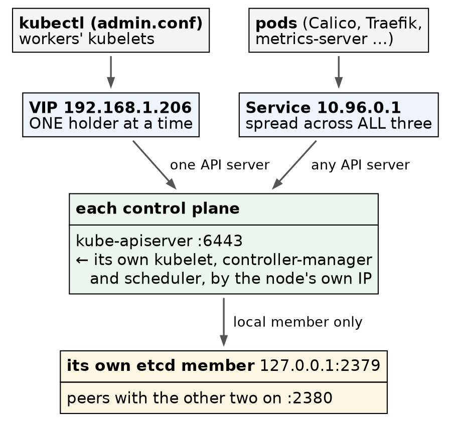

# Kubernetes (CKA) · Chapter 7 — Cluster Anatomy: Where Everything Lives, and How to Read It

> **Series:** Home-Lab Education · Phase 18 (Kubernetes HA + CKA)
> **Inventoried:** November 4, 2026, 18:34 UTC, on the equipped cluster (`c03`) — control-1 and
> worker-1 in full, the other three checked against them
> **Versions at time of writing:** Kubernetes v1.35.8 · containerd 2.3.5 · etcd 3.6.6 · Calico
> v3.32.2 · CoreDNS v1.13.1 · kube-vip v1.2.3 · Ubuntu 24.04.4 · kernel 6.8.0-142
> **Read this after:** Chapters 1–6 (it describes what they built) · **keep it beside you for:**
> every exercise

---

## How this chapter was made, and how to use it

⚠️ **This is a reference chapter, and it was collected differently from the others.** Chapters 1–6
were built by hand, one step at a time, by the person they are written for. **[The inventory below was
collected by the AI, read-only, in one pass]{custom-style="Key"}** — two scripts that list files, read configuration,
inspect certificates and query the API, run on control-1 and worker-1, then a consistency check across
all five nodes. **Nothing was changed, no private key was read, and no credential was printed.** Every
reading quoted is real output from this cluster on the date above. Where a sentence explains *why*
something is so rather than *what* was read, it says whether that reasoning was tested.

**Why a reference chapter at all.** The build chapters teach in the order things were built. An
incident does not arrive in that order. [At 3am the question is *where does this live, and what reads
it*]{custom-style="Key"} — and the answer should not depend on remembering which chapter mentioned it.
This chapter is organised by **layer, bottom up**, the same order the cluster starts in, so it doubles
as a troubleshooting order: [find the lowest layer that is wrong]{custom-style="Key"}.

⭐ **The habit it is meant to build: [when something is broken, read the file and the process]{custom-style="Key"}, not your
memory of them.** Every section gives the command that reads it.

---

## 1. Two systemd services, and everything else is a container

On every node, systemd runs exactly [two services that belong to Kubernetes: `containerd` and
`kubelet`]{custom-style="Key"}. Everything else — the API server, etcd, kube-proxy, Calico, CoreDNS,
Traefik — is a container that the kubelet asked containerd to run.

```bash
systemctl is-active containerd kubelet
systemctl cat kubelet --no-pager
```

The kubelet's command line is assembled from four places, and [knowing which one to edit is half of
fixing a kubelet]{custom-style="Key"}:

| Source | Holds (here) | Written by |
|---|---|---|
| `/usr/lib/systemd/system/kubelet.service` | `ExecStart=/usr/bin/kubelet`, `Restart=always`, `RestartSec=10` | the package |
| `.../kubelet.service.d/10-kubeadm.conf` | the real `ExecStart`: `--bootstrap-kubeconfig`, `--kubeconfig=/etc/kubernetes/kubelet.conf`, `--config=/var/lib/kubelet/config.yaml` | the package |
| `/var/lib/kubelet/kubeadm-flags.env` | `KUBELET_KUBEADM_ARGS=""` — **empty** | `kubeadm init` / `join` |
| `/etc/default/kubelet` | `KUBELET_EXTRA_ARGS=` — **empty** | you, as a last resort |

⭐ **[Nearly all kubelet settings live in one file]{custom-style="Key"}: `/var/lib/kubelet/config.yaml`.** Ours sets
`cgroupDriver: systemd`, `clusterDNS: 10.96.0.10`, `staticPodPath: /etc/kubernetes/manifests`,
`rotateCertificates: true`, `authentication.anonymous.enabled: false` and
`authorization.mode: Webhook`. `RestartSec=10` is the ten-second restart loop chapter 1 met on a node
with no role.

⚠️ **There are two copies, and editing the wrong one does nothing.** The ConfigMap
`kube-system/kubelet-config` holds the same configuration [as a template kubeadm reads at join and
upgrade time]{custom-style="Key"}; the running kubelet reads only the file on its own disk. Ours are
identical except one field (`containerRuntimeEndpoint`, blank in the ConfigMap). [Change the file and
restart the kubelet to change *this* node]{custom-style="Key"}; [change the ConfigMap to change *future* joins]{custom-style="Key"}.

✅ **Checked across all five nodes:** `/var/lib/kubelet/config.yaml` and `/etc/containerd/config.toml`
are [byte-identical on every node]{custom-style="Key"} (same md5). [Control planes and workers differ in
what the kubelet *runs*, not in how it is configured]{custom-style="Key"} — chapter 1's point, measured.

---

## 2. containerd: what the kubelet asks to run things

```bash
sudo grep -nE 'SystemdCgroup|sandbox|snapshotter =|disabled_plugins|^root|^state' /etc/containerd/config.toml
cat /etc/crictl.yaml
sudo crictl ps
sudo crictl images
```

| Setting | Value | Why it matters |
|---|---|---|
| `disabled_plugins` | `[]` | the CRI plugin is on — chapter 1, step 4 |
| `SystemdCgroup` | `true` | must match the kubelet's `cgroupDriver: systemd` |
| `snapshotter` | `overlayfs` | why the `overlay` module is required |
| `sandbox` | `registry.k8s.io/pause:3.10.2` | the image behind every pod's sandbox |
| `root` / `state` | `/var/lib/containerd` (2.2 GB here) / `/run/containerd` | images and layers / runtime sockets |

🔻 **Two pause images on control-1, one on the workers — and the second one is never used.**
`kubeadm config images list` names **`pause:3.10.1`**, so `kubeadm init` and control-plane joins pull
it. But containerd's own `sandbox` setting names **`3.10.2`**, and [containerd's setting is the one
that runs]{custom-style="Key"} — the etcd pod's sandbox reports `registry.k8s.io/pause:3.10.2`. Worker
joins pull no images, so workers hold only `3.10.2`. ⭐ **[When two components each name an image, ask
the one that actually starts it]{custom-style="Key"}.**

⚠️ **`ATTEMPT` in `crictl ps` is not a crash count here.** Our control-plane containers read 7–10:
[every cold start and snapshot rollback adds one]{custom-style="Key"}. Compare it with
`kubectl get pods`' `RESTARTS (… ago)` before calling anything unstable.

---

## 3. `/etc/kubernetes`: a control plane and a worker side by side

```bash
sudo ls -la /etc/kubernetes /etc/kubernetes/manifests /etc/kubernetes/pki
```

| Path | Control plane | Worker |
|---|---|---|
| `admin.conf`, `super-admin.conf` | ✅ (`super-admin.conf` on control-1 only) | — |
| `controller-manager.conf`, `scheduler.conf` | ✅ | — |
| `kubelet.conf` | ✅ | ✅ |
| `manifests/` | 5 files: etcd, kube-apiserver, kube-controller-manager, kube-scheduler, kube-vip | **empty** |
| `pki/` | three CAs with their keys, every serving and client certificate, `sa.key`/`sa.pub` | **`ca.crt` only** |

⭐ **A worker holds exactly one piece of the PKI: the cluster CA's certificate, so it can verify the
API server.** [No keys, no etcd certificates, no service-account key]{custom-style="Key"} — which is
why [losing a worker never leaks the cluster's identity]{custom-style="Key"}.

### The kubeconfigs: which identity, and which address

Each `.conf` file is a kubeconfig: a server address plus a client certificate. Read both without
printing the key:

```bash
for c in /etc/kubernetes/*.conf; do
  echo "$c: $(sudo grep -E '^\s+server:' $c | xargs) | $(sudo grep client-certificate-data $c \
    | awk '{print $2}' | base64 -d 2>/dev/null | openssl x509 -noout -subject 2>/dev/null)"
done
```

| File | Points at | Identity in the certificate |
|---|---|---|
| `admin.conf` | `https://192.168.1.206:6443` — **the VIP** | `O = kubeadm:cluster-admins, CN = kubernetes-admin` |
| `super-admin.conf` | the VIP | `O = system:masters, CN = kubernetes-super-admin` |
| `controller-manager.conf` | **this node's own IP**:6443 | `CN = system:kube-controller-manager` |
| `scheduler.conf` | this node's own IP:6443 | `CN = system:kube-scheduler` |
| `kubelet.conf` (control plane) | this node's own IP:6443 | none inline — points at `/var/lib/kubelet/pki/kubelet-client-current.pem` |
| `kubelet.conf` (worker) | **the VIP** | the same, `O = system:nodes, CN = system:node:<name>` |



> Three different paths into the API, and only one of them goes through the VIP.

🚨 **This table changes how you read a control-plane failure.** [The controller-manager and scheduler
on a node talk only to that node's API server]{custom-style="Key"}, and each API server talks only to
its own etcd member (`--etcd-servers=https://127.0.0.1:2379`). So a control plane is a **vertical
stack**: lose its etcd member and [that node's API server fails, even with etcd quorum
intact]{custom-style="Key"} — and the controllers on that node fail with it. *(Reasoning from the
configuration; not drilled here yet.)*

⭐ **The two admin files are not the same strength.** `admin.conf`'s group, `kubeadm:cluster-admins`,
is granted `cluster-admin` by an ordinary ClusterRoleBinding, so [it can be revoked by deleting that
binding]{custom-style="Key"}. `super-admin.conf`'s group, `system:masters`, is the group the API server
treats as all-powerful [regardless of RBAC]{custom-style="Key"} — no binding to delete. That is why
kubeadm split them in v1.29, and why [only the bootstrap node holds the second one]{custom-style="Key"}.

> **Lab vs PROD — a `system:masters` credential left on disk.** *In the lab:*
> `/etc/kubernetes/super-admin.conf` stays on control-1, mode `0600`, valid until September 2027.
> *Why it's acceptable here:* one operator, root on that node already means everything, and the
> cluster is rebuilt from snapshots. *In production (recited, not run here):* it is a break-glass
> credential — moved off the node into a vault after bootstrap, its use audited, and routine admin
> access goes through named identities bound by RBAC. *If you carry the habit:* anyone who reads one
> file on one node holds [a credential no RBAC change can take away]{custom-style="Key"}, for a year,
> and the only revocation is replacing the cluster CA.

---

## 4. The PKI: three CAs, a year of leaf certificates, and two that are not listed

```bash
sudo kubeadm certs check-expiration
sudo openssl x509 -in /etc/kubernetes/pki/apiserver.crt -noout -subject -issuer -enddate -ext subjectAltName
```

**[Three certificate authorities, each valid ten years]{custom-style="Key"}** (to September 14, 2036): `ca` (the cluster),
`etcd-ca` (etcd's own, separate world), and `front-proxy-ca` (the aggregation layer, chapter 5).
**[Every leaf certificate is valid one year]{custom-style="Key"}** (to September 17, 2027) — `kubeadm-config` records it as
`certificateValidityPeriod: 8760h` against `caCertificateValidityPeriod: 87600h`.

| Certificate | Signed by | Used for | Worth knowing |
|---|---|---|---|
| `apiserver` | `ca` | serving :6443 | SANs: `kubernetes`, `kubernetes.default[.svc[.cluster.local]]`, the hostname, `10.96.0.1`, the node IP, **`192.168.1.206`** |
| `apiserver-kubelet-client` | `ca` | API server → kubelets (`logs`, `exec`) | bound to `system:kubelet-api-admin` |
| `apiserver-etcd-client` | `etcd-ca` | API server → etcd | |
| `front-proxy-client` | `front-proxy-ca` | API server → aggregated APIs (metrics-server, Calico's API) | |
| `etcd/server`, `etcd/peer` | `etcd-ca` | etcd serving, and member ↔ member | SANs: `localhost`, hostname, node IP, `127.0.0.1`, `::1` |
| `etcd/healthcheck-client` | `etcd-ca` | probes and `etcdctl` | |
| `sa.key` / `sa.pub` | — (a key pair, not a certificate) | signing service-account tokens | **identical on all three control planes** (chapter 3) |

⭐ **The API server's SAN list is the irreversible part of `kubeadm init`** (chapter 2) — and here is
[the VIP in it, on every control plane]{custom-style="Key"}.

🚨 **Two certificates `check-expiration` never mentions — the kubelet's:**

```bash
sudo openssl x509 -in /var/lib/kubelet/pki/kubelet-client-current.pem -noout -subject -issuer -enddate
sudo openssl x509 -in /var/lib/kubelet/pki/kubelet.crt -noout -subject -issuer -enddate -ext subjectAltName
```

| | Client (`kubelet-client-current.pem`) | Serving (`kubelet.crt`) |
|---|---|---|
| Identity | `O = system:nodes, CN = system:node:<name>` | `CN = <name>@<timestamp>` |
| Issuer | the cluster `ca` | **`<name>-ca@<timestamp>`** — a CA that exists only on that node |
| Expires | September 2027 | September 2027 |
| Renewed | by the kubelet itself (`rotateCertificates: true`) — a symlink to the newest file | not automatically |

⭐ **The client certificate is a symlink for a reason:** rotation writes a new dated file and moves the
link, so [`kubelet-client-current.pem` is always the one in use]{custom-style="Key"}. [The serving
certificate is the self-signed one]{custom-style="Key"} chapter 5's metrics-server refused. `kubectl get csr` returns
nothing on this cluster: [the client certificates were approved automatically at
join]{custom-style="Key"}, and the serving certificates were never requested.

---

## 5. The static pods: the flags that matter

```bash
sudo grep -E '^\s+- --' /etc/kubernetes/manifests/kube-apiserver.yaml
```

| Component | Flags worth knowing by sight |
|---|---|
| **kube-apiserver** | `--advertise-address=<node IP>` · `--etcd-servers=https://127.0.0.1:2379` · `--service-cluster-ip-range=10.96.0.0/12` · `--authorization-mode=Node,RBAC` · `--enable-admission-plugins=NodeRestriction` · `--enable-bootstrap-token-auth=true` · `--service-account-issuer` / `-key-file` / `-signing-key-file` |
| **kube-controller-manager** | `--allocate-node-cidrs=true` · `--cluster-cidr=10.244.0.0/16` · `--cluster-signing-cert-file` / `-key-file` (it signs CSRs with the cluster CA) · `--controllers=*,bootstrapsigner,tokencleaner` · `--leader-elect=true` · `--bind-address=127.0.0.1` |
| **kube-scheduler** | `--leader-elect=true` · `--bind-address=127.0.0.1` |
| **etcd** | `--data-dir=/var/lib/etcd` · `--listen-client-urls=https://127.0.0.1:2379,https://<node IP>:2379` · `--listen-metrics-urls=http://127.0.0.1:2381` · `--initial-cluster=…` · `--snapshot-count=10000` |
| **kube-vip** | env: `address 192.168.1.206`, `vip_interface eth0`, `vip_leaseduration 15`, `vip_renewdeadline 10`, `vip_retryperiod 2`, `prometheus_server :2112` |

✅ **Checked across the three control planes:** with each node's own IP and hostname replaced by a
placeholder, the five manifests are [identical except for one etcd flag]{custom-style="Key"}:

| Node | `--initial-cluster` |
|---|---|
| control-1 | itself only |
| control-2 | control-1, itself — plus `--initial-cluster-state=existing` |
| control-3 | all three — plus `--initial-cluster-state=existing` |

⭐ **That flag is a record of the join order, not of the current membership.** etcd uses it
[only when it starts with an empty data directory]{custom-style="Key"}; after that the membership lives
in the data itself (`etcdctl member list`). 🚨 **The consequence worth carrying:** wipe control-1's
`/var/lib/etcd` and restart it, and its manifest still says "a cluster of one, new" — [it would try to
found a fresh cluster rather than rejoin]{custom-style="Key"}. [Replacing a member is a `member remove`,
`member add`, then a start with the *current* member list]{custom-style="Key"}. *(etcd's documented behaviour; not drilled
here.)*

⚠️ **The controller-manager runs `tokencleaner`, and you can see its work:** `kube-system` holds
[no Secrets at all]{custom-style="Key"}. The 24-hour join token has expired and been deleted, and the
two-hour `kubeadm-certs` Secret is gone too. [A join today needs a fresh `kubeadm token create`]{custom-style="Key"} — and,
for a control plane, a fresh `kubeadm init phase upload-certs --upload-certs`.

---

## 6. Ports: what listens where

```bash
sudo ss -tlnp | sort -k4
```

| Port | Bound to | Process | Notes |
|---|---|---|---|
| **6443** | all | kube-apiserver | control planes only |
| **2379** | `127.0.0.1` + node IP | etcd (clients) | |
| **2380** | node IP | etcd (peers) | member ↔ member |
| **2381** | `127.0.0.1` | etcd metrics, **plain HTTP** | chapter 6's latency numbers |
| **10250** | all | kubelet API | `logs`, `exec`, metrics — authenticated (`anonymous: false`) |
| 10248 | `127.0.0.1` | kubelet healthz | `curl -s localhost:10248/healthz` |
| 10249 / 10256 | `127.0.0.1` / all | kube-proxy metrics / healthz | |
| 10257 / 10259 | `127.0.0.1` | controller-manager / scheduler | secure ports, local only |
| **179** | all | `bird` — Calico's BGP | every node |
| 5473 | all | calico-typha | only on the three nodes running a typha pod |
| 9099 | `127.0.0.1` | calico-node health | |
| **2112** | all | kube-vip metrics, unauthenticated | control planes (chapter 2) |
| **9090** | all | Cockpit (`cockpit.socket`) | a lab addition, every node |
| 22 | all | sshd | |

⭐ **The `127.0.0.1` bindings are a design statement:** [the controller-manager, scheduler and etcd's
metrics are reachable only from their own node]{custom-style="Key"}. To probe them you `ssh` to the
node first — which is also exactly what the exam expects you to do.

🔻 **Port 179 adds a layer chapter 3 did not show.** "Pod traffic is routed directly" is true, and
[every node also runs a BGP full mesh]{custom-style="Key"} — `bird` inside calico-node holds four
`Mesh_<peer-IP>` sessions, all `Established`, and has learned every other node's `/26`. Each node's
kernel route table holds those four blocks `via <node IP> dev eth0 onlink` plus a `blackhole` for its
own, all marked `proto 80` — Calico's marker, **not** `proto bird`. Which Calico component writes them
in this mode was not traced. `ip route` on any node shows [the whole pod network's
map]{custom-style="Key"}.

```bash
ip route show proto 80
kubectl -n calico-system exec <calico-node-pod> -c calico-node -- \
  birdcl -s /var/run/calico/bird.ctl show protocols
```

> **Lab vs PROD — a web admin console on every node.** *In the lab:* Cockpit listens on 9090 on all
> five nodes, and the admin user has passwordless `sudo` (chapter 1). *Why it's acceptable here:* one
> isolated LAN, and it makes a node's journal and services readable from a browser. *In production
> (reasoning, not tested here):* cluster nodes expose SSH to a bastion and nothing else that grants a
> shell; consoles live on a management network, if anywhere. *If you carry the habit:* [every node
> carries a second login surface]{custom-style="Key"} — a password typed into a web page becomes a root
> shell on a node that holds etcd's data and the cluster's keys.

---

## 7. etcd on disk

```bash
sudo du -sh /var/lib/etcd
sudo ls -la /var/lib/etcd/member/wal /var/lib/etcd/member/snap
kubectl -n kube-system exec etcd-vm-k8s-cka-control-1 -- etcdctl \
  --cacert /etc/kubernetes/pki/etcd/ca.crt --cert /etc/kubernetes/pki/etcd/server.crt \
  --key /etc/kubernetes/pki/etcd/server.key endpoint status --cluster -w table
```

| Item | Reading | Meaning |
|---|---|---|
| `/var/lib/etcd` | 385 MB | almost all of it is the WAL |
| `member/wal/` | five 64 MB segments plus a pre-allocated `0.tmp` | the write-ahead log, replayed after a crash |
| `member/snap/db` | 34.7 MB file | the database itself |
| `snap/*.snap` | five, roughly 40 minutes apart | raft snapshots, every 10,000 commits (`--snapshot-count`) |
| `DB SIZE` / `IN USE` | 19 MB / 7.4 MB — **62 % not in use** | space freed inside the file but not returned |
| `QUOTA` | 2.1 GB | the default; past it etcd [goes read-only and the cluster stops accepting writes]{custom-style="Key"} |

⭐ **`DB SIZE` against `IN USE` is the number to watch, not the file size.** Deleted keys leave free
pages inside the file; [`etcdctl defrag` returns them, one member at a time]{custom-style="Key"}. A cluster that [hits the
quota with half its database free]{custom-style="Key"} needed a defrag, not more disk. *(etcd's
documented behaviour; defrag not run here.)*

---

## 8. Through the API: what the cluster holds

Run these on control-1 — `kubectl` reaches the API through the VIP with `admin.conf`'s identity.

### Namespaces and what runs in them

| Namespace | Holds | Kind |
|---|---|---|
| `kube-system` | etcd, kube-apiserver, controller-manager, scheduler, kube-vip (×3 each) | **static pods** |
| | kube-proxy (×5) | DaemonSet |
| | CoreDNS (×2), metrics-server | Deployments |
| `calico-system` | calico-node (×5), csi-node-driver (×5) | DaemonSets |
| | calico-typha (×3), calico-apiserver (×2), calico-kube-controllers | Deployments |
| `tigera-operator` | the operator that manages all of `calico-system` | Deployment |
| `local-path-storage` | local-path-provisioner | Deployment |
| `traefik` | Traefik | Deployment (Helm) |
| `default`, `kube-public`, `kube-node-lease` | no pods | |

**42 pods.** ⭐ **Static pods are named `<component>-<node>`**, and [deleting one through `kubectl`
only deletes its mirror]{custom-style="Key"} — the kubelet recreates it from the file. To stop a
static pod, move its manifest out of `/etc/kubernetes/manifests/`. *(Standard behaviour; not run
here.)*

### Services, and the one that bypasses the VIP

```bash
kubectl get svc -A
kubectl get endpointslices -A
```

| Service | ClusterIP | Endpoints |
|---|---|---|
| `default/kubernetes` | `10.96.0.1` | **`192.168.1.201`, `.202`, `.203` :6443** |
| `kube-system/kube-dns` | `10.96.0.10` | the two CoreDNS pods, ports 53/53/9153 |
| `kube-system/metrics-server` | `10.107.84.60` | the metrics-server pod :10250 |
| `calico-system/calico-api` | `10.99.193.24` | the two calico-apiserver pods |
| `calico-system/calico-typha` | `10.110.249.79` | three **node** IPs :5473 (host-networked) |
| `traefik/traefik` | `10.98.232.184` | NodePort 30080/30443 → the pod's 8000/8443 |

🚨 **`10.96.0.1` reaches all three API servers; `192.168.1.206` reaches one.** Chapter 4 said three
control planes do not share the load — [true for everything that comes in through the
VIP]{custom-style="Key"}: `kubectl` and the workers' kubelets. But every *pod* that talks to the API
(Calico, the operator, Traefik, metrics-server, CoreDNS) uses the `kubernetes` Service, and
kube-proxy [spreads those connections across all three]{custom-style="Key"}. So [the in-cluster load is
shared and the external load is not]{custom-style="Key"}.

### Extensions: what was added to the API

```bash
kubectl get apiservices | grep -v Local
kubectl get crd -o custom-columns=GROUP:.spec.group --no-headers | sort | uniq -c
kubectl get validatingadmissionpolicies
kubectl get validatingwebhookconfigurations,mutatingwebhookconfigurations
```

- **Two aggregated APIs:** `v1beta1.metrics.k8s.io` (metrics-server) and `v3.projectcalico.org`
  (Calico's API server — [why `kubectl get ippools` works without `calicoctl`]{custom-style="Key"}).
- **67 CRDs in six groups:** 22 `crd.projectcalico.org`, 9 `operator.tigera.io`, 10
  `gateway.networking.k8s.io`, 10 `traefik.io`, 15 `hub.traefik.io`, and 1 `policy.networking.k8s.io`
  (not exercised; where it came from was not traced). **155 resource types** in all, 17 of them core.
- **Admission:** one ValidatingAdmissionPolicy (the Gateway API's `safe-upgrades`), and
  [**no admission webhooks at all**]{custom-style="Key"} — so [a slow or dead webhook cannot be what is
  blocking your `apply`]{custom-style="Key"} on this cluster.

### Configuration kubeadm left in the cluster

```bash
kubectl -n kube-system get cm kubeadm-config -o jsonpath='{.data.ClusterConfiguration}'
kubectl -n kube-system get cm kube-proxy -o jsonpath='{.data.config\.conf}' | grep -E '^mode|clusterCIDR|bindAddress'
kubectl -n kube-system get cm coredns -o jsonpath='{.data.Corefile}'
```

**`kubeadm-config`** is [the record of what `init` was told]{custom-style="Key"}:
`controlPlaneEndpoint: 192.168.1.206:6443`, `podSubnet: 10.244.0.0/16`, `serviceSubnet: 10.96.0.0/12`,
`kubernetesVersion: v1.35.8`, `encryptionAlgorithm: RSA-2048`, and the two validity periods. ⭐ It is
what `kubeadm upgrade` reads, so [it must agree with reality]{custom-style="Key"}.

**`kube-proxy`**: `mode: ""` — [empty means the default, iptables]{custom-style="Key"}. Ours wrote
306 rules on control-1 and 448 on worker-1 — 26 `KUBE-SVC-*` chains on each, and most of the
difference is Calico's `cali-*` rules (84 against 206). `clusterCIDR: 10.244.0.0/16`, `bindAddress: 0.0.0.0`.

**CoreDNS's Corefile**, plugin by plugin:

| Plugin | Does |
|---|---|
| `kubernetes cluster.local in-addr.arpa ip6.arpa` | answers for Services and pods from the API |
| `forward . /etc/resolv.conf` | everything else goes to the node's upstream resolver |
| `cache 30` | caches answers — but `disable success/denial cluster.local`: [cluster names are not cached]{custom-style="Key"} |
| `loop` | detects a forwarding loop and stops CoreDNS rather than spin |
| `reload` | picks up Corefile edits without a restart |
| `health`, `ready`, `prometheus :9153` | probes and metrics |

⭐ **`forward . /etc/resolv.conf` is where external DNS failures live.** Chapter 4's external lookup
worked because the node's resolver did; [break the node's resolver and in-cluster names still
resolve]{custom-style="Key"} while everything outside fails.

### Identity, elections and RBAC

```bash
kubectl -n kube-system get leases
kubectl get clusterrolebinding cluster-admin kubeadm:cluster-admins -o wide
```

- **Leases:** `kube-controller-manager` and `kube-scheduler` held by **control-2**; `plndr-cp-lock`
  (kube-vip's VIP lease) by **control-3**; one `apiserver-…` identity lease per API server; and five
  node heartbeats in `kube-node-lease`. ⭐ **Three independent elections, three different answers** —
  and [the lease is the only authoritative record of each]{custom-style="Key"}.
- **RBAC:** 85 ClusterRoles and 72 ClusterRoleBindings, almost all built in. The two that grant
  everything: `cluster-admin` → group `system:masters`, and `kubeadm:cluster-admins` → group
  `kubeadm:cluster-admins`. The `kubeadm:node-autoapprove-*` bindings are why [join-time and rotated
  kubelet client certificates never wait for a human]{custom-style="Key"}.
- **Secrets:** none in `kube-system`; 4 in `calico-system`, 5 in `tigera-operator`, 3 Helm releases in
  `traefik`. ⭐ **No service-account token Secrets anywhere** — [pods get short-lived tokens projected
  into them]{custom-style="Key"}, not long-lived Secrets.

### Calico, as the operator configured it

```bash
kubectl get installation default -o jsonpath='{.spec.calicoNetwork}'
kubectl get felixconfiguration default -o yaml
```

`bgp: Enabled`, `linuxDataplane: Iptables`, pool `10.244.0.0/16` with `blockSize 26`,
`VXLANCrossSubnet`, `natOutgoing: Enabled`; `controlPlaneReplicas: 2` (the two calico-apiserver
pods); `nodeUpdateStrategy` `maxUnavailable: 1`. Felix: `bpfEnabled: false`,
`nftablesMode: Disabled`, VXLAN on port 4789, VNI 4096. ⭐ **The operator owns these objects** —
[edit the `Installation`, not the DaemonSets it generates]{custom-style="Key"}, or it reverts you.

---

## 9. The 3am map

The question first, then where to look. Bottom layer first.

| The question | Where it lives | Read it with |
|---|---|---|
| Is the kubelet running, and why not? | systemd, `/var/lib/kubelet/config.yaml` | `systemctl status kubelet` · `journalctl -u kubelet -n 30` |
| Can the runtime serve CRI? | `/etc/containerd/config.toml` | `sudo ctr plugin ls \| grep cri` · `sudo crictl ps -a` |
| Is a control-plane component down? | `/etc/kubernetes/manifests/*.yaml` | `sudo crictl ps -a --name kube-apiserver` · `sudo crictl logs <id>` |
| Which address does this component use? | the kubeconfigs in `/etc/kubernetes/` | `sudo grep server: /etc/kubernetes/*.conf` |
| Is a certificate expired? | `/etc/kubernetes/pki/`, `/var/lib/kubelet/pki/` | `kubeadm certs check-expiration` **and** `openssl x509 … -enddate` on the kubelet's |
| Is etcd healthy, and who leads? | `/var/lib/etcd`, the etcd static pod | `etcdctl endpoint status --cluster -w table` |
| Is etcd's disk keeping up? | `127.0.0.1:2381/metrics` | `curl -s … \| grep wal_fsync_duration` |
| What did `init` configure? | `kube-system/kubeadm-config` | `kubectl -n kube-system get cm kubeadm-config -o yaml` |
| Which controller instance is active? | Leases in `kube-system` | `kubectl -n kube-system get leases` |
| Why can't pods reach the API? | Service `kubernetes`, kube-proxy's rules | `kubectl get endpointslices -n default` · `sudo iptables-save \| grep KUBE-SVC` |
| Where do pod routes come from? | Calico: IPAM blocks, the BGP mesh, `proto 80` routes | `ip route` · `kubectl get ipamblocks` · `birdcl … show protocols` |
| Why does external DNS fail? | CoreDNS `forward`, the node's resolver | the Corefile · `resolvectl status` on the node |
| What has been added to the API? | APIServices, CRDs, admission | `kubectl get apiservices,crd,validatingadmissionpolicies` |
| Can a node join today? | bootstrap tokens (Secrets in `kube-system`) | `kubectl -n kube-system get secrets` — none here · `kubeadm token create --print-join-command` |

---

## Honest limitations

Control-1 and worker-1 were inventoried in full; the other three were compared by checksum and by the
items in §5 and §6, not read line by line. [The reasoning marked *not drilled*]{custom-style="Key"} — a control plane failing
as a vertical stack, a wiped etcd member refounding a cluster, defragmentation — follows from the
configuration and etcd's documentation but has not been run here. And because the AI collected this,
[it is a map to walk, not a walk already taken]{custom-style="Key"}: the commands in each section are
the ones to run yourself, on a node, before you rely on the reading.

---

## Commands to know by heart

| Question | Command |
|---|---|
| Which services does Kubernetes need from systemd? | `systemctl is-active containerd kubelet` |
| How is the kubelet started, really? | `systemctl cat kubelet` |
| Which identity and server does this kubeconfig use? | `grep server:` it, and decode `client-certificate-data` into `openssl x509 -noout -subject` |
| When do the kubelet's certificates expire? | `sudo openssl x509 -in /var/lib/kubelet/pki/kubelet-client-current.pem -noout -enddate` |
| What is listening, and as which process? | `sudo ss -tlnp` |
| Which API servers does the `kubernetes` Service reach? | `kubectl get endpointslices -n default` |
| What has been bolted onto the API? | `kubectl get apiservices \| grep -v Local` · `kubectl get crd` |
| What did kubeadm record at init? | `kubectl -n kube-system get cm kubeadm-config -o yaml` |
| Is etcd's database bloated? | `etcdctl endpoint status -w table` — `DB SIZE` against `IN USE` |
| Where do pod routes come from? | `ip route` on the node |

---

## Glossary

**kubeconfig** — a file naming a server, a CA to trust, and a client identity. Every component that
talks to the API has one.

**`system:masters`** — the group the API server [grants everything, without consulting
RBAC]{custom-style="Key"}.

**mirror pod** — the API's read-only reflection of a static pod. [Deleting it changes nothing on the
node]{custom-style="Key"}.

**`--initial-cluster`** — etcd's bootstrap membership list, [read only when the data directory is
empty]{custom-style="Key"}.

**defragmentation** — returning freed pages inside etcd's database file to the filesystem.

**aggregated API** — an API group served by a pod behind the API server (metrics, Calico), registered
by an APIService.

**projected service-account token** — [a short-lived token the kubelet mounts into a pod]{custom-style="Key"}, replacing the
old long-lived token Secrets.

**BGP mesh (here)** — every node's `bird` peers with every other node and learns their pod blocks.

---

## Check yourself

Answer these out loud. Section references, not answers.

1. You need to change one kubelet setting on one node. Which file, and why not the ConfigMap? (§1)
2. Control-1 has `pause:3.10.1` and every pod uses `3.10.2`. Why? (§2)
3. A worker is stolen. Which parts of the cluster's PKI went with it? (§3)
4. Control-2's etcd member is down but quorum holds. What happens to control-2's API server and its
   controller-manager? (§3)
5. Why is `super-admin.conf` more dangerous than `admin.conf`, and what would you do with it in
   production? (§3)
6. `kubeadm certs check-expiration` says everything is fine and a node still reads `NotReady` with
   TLS errors. What did the check not look at? (§4)
7. etcd's manifest on control-1 lists only control-1 in `--initial-cluster`. Is the cluster
   misconfigured? When does that flag matter? (§5)
8. You want the scheduler's metrics. Why does `curl` from your laptop fail, and from where would it
   work? (§6)
9. etcd reports `DB SIZE` 1.9 GB and `IN USE` 600 MB. What do you do before the quota is hit? (§7)
10. Three control planes: do they share the load? Answer separately for `kubectl` and for pods. (§8)
11. `kubectl apply` hangs on every object. What on this cluster can you rule out immediately? (§8)
12. In-cluster names resolve and external ones do not. Which Corefile line, and which layer below it?
    (§8)
