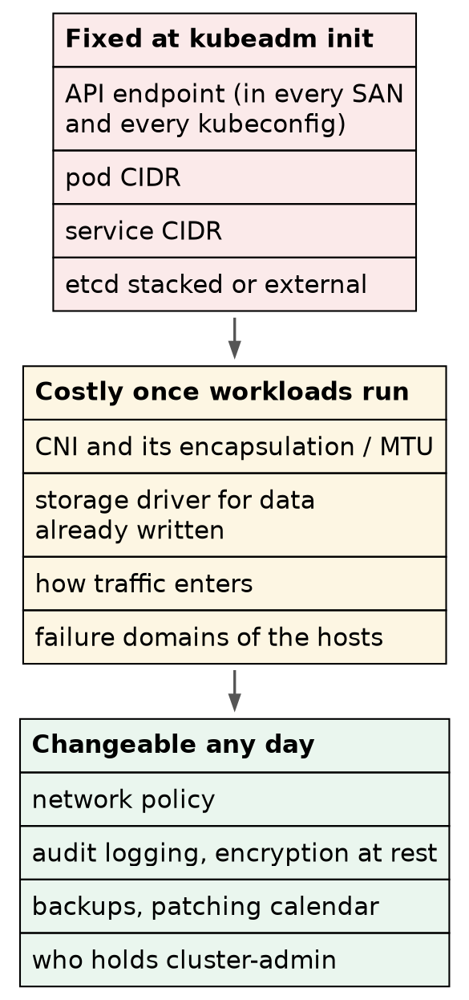

# Kubernetes (CKA) · Chapter 8 — Building It at Work: What Carries Over, What Changes, and What to Ask First

> **Series:** Home-Lab Education · Phase 18 (Kubernetes HA + CKA)
> **Written:** November 4, 2026, from what Chapters 1–7 measured on VMs 201–205. Nothing new was
> built for this chapter, and every claim is marked as measured or recited (see below)
> **Versions it describes:** Kubernetes v1.35.8 · containerd 2.3.5 · etcd 3.6.6 · Calico v3.32.2 ·
> kube-vip v1.2.3 · Traefik v3.7.17 · Ubuntu 24.04.4
> **Read this after:** Chapters 1–7 · **before:** the exercise chapters (9 onward)

---

## How this chapter was made, and how to read it

⚠️ **This chapter is reasoning, not a build.** [The AI wrote it from what Chapters 1–7 measured, and
from general practice]{custom-style="Key"}. Every claim carries one of two marks:

- **(measured)** — run or read on this cluster. The chapter that shows it is named, so you can rerun
  it.
- **(recited)** — general practice or upstream documentation as the AI knows it, [**not tested
  here**]{custom-style="Key"}. Treat it as a question to check against the current upstream docs and
  your employer's own standards, not as an answer.

The mix is deliberately visible, and the proportion is itself the lesson: [most of what makes a
production cluster production falls in the second category]{custom-style="Key"}, because a
one-operator lab cannot exercise it. Carrying a measured lesson to work is safe. [Carrying a recited
one unchecked is how a plausible opinion ends up in a design review]{custom-style="Key"} presented as
established practice.

---

## 1. Ask before you build

⭐ **The input that matters most is not in this lab: [what the existing lab at work already uses, and
why]{custom-style="Key"}.** Every production choice below has an alternative that a sensible team may
have picked for a reason this lab cannot see — a load balancer estate already owned, a storage array
already paid for, a deployment tool already audited. [Knowing the reason is what lets you evaluate the
choice]{custom-style="Key"} rather than simply accept it or replace it.

| Ask | Why it decides something | What this lab did |
|---|---|---|
| **What traffic enters the cluster?** | An HTTP gateway governs only HTTP. If much of what enters is long-lived TCP, UDP or multicast, the rest is layer-4 Services and a load balancer | HTTP only, on a NodePort (ch 6) |
| What load balancers exist? | Decides the API endpoint and how applications are reached | none — an ARP VIP for the API (ch 2) |
| What storage is already owned? | Decides the CSI driver, and therefore where data survives | local-path, one node's disk (ch 5) |
| Where do packages and images come from? | Decides whether a rebuild depends on the internet | public apt repositories and registries (ch 1) |
| How is configuration deployed? | Decides whether "the cluster" is the git repository or the running state | by hand, every file committed (ch 5, 6) |
| Who holds cluster-admin, and how is it audited? | Decides the identity model before anyone has a habit | one operator, `super-admin.conf` on disk (ch 7) |
| What is the patching calendar and change process? | Decides whether nodes can be drained on a schedule | updates frozen, patched in drills (ch 1) |
| What do the hosts share? | Decides how many real failure domains three control planes give you | one hypervisor, one storage pool (ch 4) |

⭐ **The first row decides more than the others put together.** [An ingress controller or gateway is
HTTP machinery]{custom-style="Key"} *(recited)*. A cluster whose important traffic is not HTTP needs
its gateway for the web front ends and its load balancer design for everything else — and that is a
question about the applications, which no amount of Kubernetes knowledge answers.

---

## 2. What carries over unchanged

[The method carries over more than the commands do]{custom-style="Key"}. Each of these was done here and would be done the
same way at work.

| Lesson | What this lab showed | Basis |
|---|---|---|
| Prepare every node identically, then prove it | swap off, modules, sysctls, `SystemdCgroup`; kubelet and containerd configuration byte-identical on all five | measured · ch 1, 7 |
| Hold the packages that make up the cluster | `apt-mark hold` on kubelet, kubeadm, kubectl, cri-tools, containerd.io | measured · ch 1 |
| Pre-pull images before `init` | removes an external network dependency from the irreversible step | measured · ch 2 |
| Dry-run `init` and read the SANs | the VIP must be in the API server certificate before anything else happens | measured · ch 2, 7 |
| Choose the pod and service CIDRs against the real network | fixed at init; must not overlap anything routable | measured · ch 2 |
| Prove with a checklist, not a feeling | nodes, pods, DNS, cross-node traffic, failover, certificates | measured · ch 4 |
| Plant a marker before testing a restore | a restore and an ordinary reboot produce identical output otherwise | measured · ch 4 |
| Read a dependency's version from its consumer | Gateway API version taken from Traefik's `go.mod` | measured · ch 6 |
| Verify every download | Helm checked against its published `sha256` | measured · ch 6 |
| Measure etcd's disk before trusting it | `wal_fsync` histogram from `:2381/metrics` | measured · ch 6 |

⭐ **Two of these matter most at work.** [The marker before a restore]{custom-style="Key"}, because [a
backup that has never been restored with a marker in it is unproven]{custom-style="Key"}, however green its job log.
And [measuring etcd's disk]{custom-style="Key"}, because §4 shows what an unmeasured one did here.

---

## 3. What changes: the ledger

Every *Lab vs PROD* callout from Chapters 1–7, plus two absences the inventory found, in one place.
[The *Here* column is measured; the *At work* column is recited]{custom-style="Key"} unless it says otherwise.

| Area | Here | At work *(recited)* | Ch |
|---|---|---|---|
| `sudo` | `NOPASSWD: ALL` | re-authentication, logged, through a bastion or PAM tool | 1 |
| Patching | timers masked; patched only in drills | a calendar: drain, upgrade, reboot, verify, uncordon, one node at a time | 1 |
| Package source | public repositories | an internal mirror with pinned versions | 1 |
| API endpoint | ARP VIP, one holder; failover measured at about 17 s | a load balancer across all API servers, behind a DNS name | 2, 4 |
| Join credentials | certificate key printed to a terminal | automated joins, the key from a secret store | 2 |
| Network policy | none — every pod reaches every pod | default-deny per namespace | 3 |
| Encapsulation | one subnet, so none | VXLAN across subnets, with MTU planned | 3 |
| etcd backup | whole-VM snapshots; nightly hypervisor backups caused elections | `etcdctl snapshot save` from a live member, copied off the host, restore drilled | 4, 6 |
| metrics-server TLS | `--kubelet-insecure-tls` | `serverTLSBootstrap` plus a restricted automated approver | 5 |
| Storage | `hostPath` on one node, pinned by node affinity | array CSI, replicated block, or CSI local volumes for self-replicating systems | 5 |
| Reclaim policy | `Delete` — gone in under 15 s | `Retain` for any class holding value | 5 |
| Application entry | NodePort 30080/30443, dashboard on | a load balancer on 80/443; dashboard off or authenticated | 6 |
| `super-admin.conf` | on control-1, valid a year | moved to a vault after bootstrap; break-glass only | 7 |
| Node consoles | Cockpit on 9090 on every node | SSH through a bastion, nothing else | 7 |
| **API audit log** | **none — no `--audit-*` flag among the API server's 27** | an audit policy, logs shipped off the node | — |
| **Secrets at rest** | **not encrypted — no `--encryption-provider-config`** | an encryption configuration, ideally with a KMS provider | — |

⭐ **The pattern across every row:** [each lab choice removes a second person or a second check from
the loop]{custom-style="Key"} — one operator, one LAN, so nobody else needs approving, auditing or
protecting from. [Production puts one back]{custom-style="Key"}: an approver, a calendar, a vault, a
health check, a policy. When you meet a production setting that seems like friction, [ask which second
check it is]{custom-style="Key"}.

The last two rows were measured on November 4 by reading the API server's manifest *(measured · the
anatomy inventory, ch 7)*. **[Neither is a CKA build step]{custom-style="Key"}**, which is why the lab never added them —
and both are cheap on day one and awkward later: [an audit log cannot be added
retroactively]{custom-style="Key"}, and enabling encryption only protects Secrets written afterwards
until every existing one is rewritten *(recited)*.

---

## 4. etcd: the disk is the constraint

**What was measured here.** Over 15 minutes on an idle cluster, each member did about 3,640 WAL
fsyncs. [The median was at most 4 ms, and the 99th percentile up to 128 ms]{custom-style="Key"},
with the worst up to 512 ms *(measured · ch 6)*. etcd's own guidance is a p99 under 10 ms
*(recited)*. The members' heartbeat is 100 ms and the election timeout 1,000 ms *(measured · the
binary's defaults)*.

**What that cost.** A tail above one heartbeat leaves little margin, and the nightly hypervisor backup
read the same disks: [the cluster held an etcd election most nights]{custom-style="Key"}, invisible
from `kubectl` *(measured · ch 6)*. The underlying cause is shared: [three members on one host and one
ZFS pool are not three failure domains]{custom-style="Key"} *(measured configuration · ch 4)*.

**What to do at work.**

1. **Measure the disk before installing anything** *(recited)*. The etcd documentation's test writes
   small blocks with `fdatasync` after each:

   ```bash
   fio --rw=write --ioengine=sync --fdatasync=1 --directory=<dir on the etcd disk> \
       --size=22m --bs=2300 --name=etcd-disk
   ```

   Read the `fdatasync` 99th percentile. [Under 10 ms is the target]{custom-style="Key"}; this lab's
   pool would not have met it.
2. **Graph `etcd_disk_wal_fsync_duration_seconds` and alert on its p99** — the same metric chapter 6
   read by hand *(measured metric; the alerting is recited)*.
3. **Put the members on separate hosts, and separate power if you have it** *(recited)*. Anti-affinity
   for the control-plane VMs, so the hypervisor never stacks two members together.
4. **Back up with `etcdctl`, not the hypervisor** *(recited; the exam drill comes in the exercise
   chapters)*:

   ```bash
   sudo ETCDCTL_API=3 etcdctl --endpoints=https://127.0.0.1:2379 \
     --cacert=/etc/kubernetes/pki/etcd/ca.crt \
     --cert=/etc/kubernetes/pki/etcd/server.crt \
     --key=/etc/kubernetes/pki/etcd/server.key \
     snapshot save /var/backups/etcd-$(date +%F).db
   ```

   Then [copy it off the host, and drill the restore]{custom-style="Key"} with a marker in it (§2).
   Keep hypervisor backups for the OS, never as etcd's only copy.

---

## 5. Decisions that close at `kubeadm init`



> Top to bottom: the cost of changing your mind falls. Spend design time on the top box.

**The top box** is chapter 2's three values plus one. [The endpoint, the pod CIDR and the service
CIDR are fixed at init]{custom-style="Key"} *(measured · ch 2: the endpoint is in every SAN and every
kubeconfig, ch 7)*. ⭐ **At work, make the endpoint a DNS name rather than an IP** *(recited)*. Here it
is `192.168.1.206:6443` *(measured)*, so [the address can never move]{custom-style="Key"}; a name lets
the load balancer behind it change without re-issuing a certificate. **etcd topology** — stacked on the
control planes, as here, or an external cluster — is chosen at init too *(recited)*. [Stacked is simpler
and couples each control plane to its member]{custom-style="Key"} (ch 7 §3); external separates them at the price of more
machines.

**The middle box** can change, but only with the workloads' cooperation *(recited)*. [Changing the
CNI means re-addressing every pod]{custom-style="Key"}. Changing the storage driver means migrating data that already
exists. Changing how traffic enters means changing what clients connect to.

**The bottom box** is configuration you can add on any day — which is [exactly why it gets postponed]{custom-style="Key"}.
[Put the bottom box on the build checklist anyway]{custom-style="Key"}: it is cheapest before
anyone depends on the cluster.

---

## 6. Certificates, identity and access

| Fact | Basis |
|---|---|
| The three CAs are valid ten years (to 2036); every kubeadm leaf certificate one year (to September 17, 2027) | measured · ch 7 |
| The kubelet's client certificate also lasts a year, and rotates itself — **only while the kubelet runs** | measured · ch 4, 7 |
| The kubelet's serving certificate is self-signed by a node-local CA, and `check-expiration` lists neither kubelet certificate | measured · ch 4, 7 |
| `kubeadm upgrade` renews the control-plane certificates, so a cluster upgraded at least yearly never expires them | recited |
| `super-admin.conf` (`system:masters`) bypasses RBAC; `admin.conf` (`kubeadm:cluster-admins`) does not | measured · ch 7 |

**What to put in place at work** *(recited)*:

- [A calendar entry well ahead of the leaf expiry]{custom-style="Key"}, and an alert on certificate
  expiry that includes the kubelet's — the one `kubeadm certs check-expiration` does not show.
- **Named identities for people**, through your employer's identity provider (OIDC) or per-person
  certificates, bound by RBAC. [Shared `admin.conf` copies make the audit log say "an admin did
  it"]{custom-style="Key"}.
- `super-admin.conf` off the node and in a vault after bootstrap — **break-glass**, its use logged.

---

## 7. Patching and upgrades

**Measured here.** Before the freeze, `unattended-upgrades` changed packages on [six separate days in
eleven, a kernel among them]{custom-style="Key"} *(measured · ch 1)*. Freezing them made rollbacks
honest. It also means [this cluster falls behind on security fixes until a drill
runs]{custom-style="Key"} — which is acceptable here only because it holds nothing.

**At work** *(recited)*, two separate cadences:

- **OS patching on a calendar**: drain one node, upgrade, reboot, verify, uncordon; between control
  planes, [check etcd quorum before touching the next]{custom-style="Key"}. The kernel drill
  scheduled for this lab is the rehearsal.
- **Kubernetes upgrades** with `kubeadm upgrade`, [one minor version at a time]{custom-style="Key"}:
  `upgrade apply` on the first control plane, `upgrade node` on the rest, then each kubelet after a
  drain. Unhold, install, re-hold — the holds from chapter 1 are what stop a routine `apt upgrade`
  doing this unplanned. Minor versions are supported for about a year, so [a cluster that is never
  upgraded falls out of support]{custom-style="Key"} at about the same time its certificates expire.

---

## 8. Traffic in, storage, and how things get installed

These three were reasoned through in the phase record when the lab chose its simple versions. All of
the production side is **recited**, and the first question of §1 governs all three.

**Traffic in.** [Gateway API is the direction the project has taken]{custom-style="Key"}; the `Ingress` API is frozen and
ingress-nginx is retired *(recited)*. Envoy is the common high-performance data plane, so Envoy
Gateway is a reasonable default to evaluate *(recited)*. [Keep the gateway out of the CNI's
operator]{custom-style="Key"}, so they do not share an upgrade cycle and a blast radius *(reasoning)*.
⚠️ **Expect ingress-nginx on anything inherited** — it was in a large share of clusters, so it is [a
migration item, not a mistake to mock]{custom-style="Key"}.

**Storage.** [Split by who does the replicating]{custom-style="Key"}. Systems that replicate
themselves (a Kafka-compatible log, a database replica set) suit local NVMe through a CSI
local-volume driver; single-copy state suits the storage array already owned, through its
vendor's CSI driver, or Ceph via Rook *(recited)*. local-path is none of these: [host directories pinned to
one node, with no CSI driver behind them]{custom-style="Key"} *(measured · ch 5)*.

**Installs.** Here, every install was Helm or Kustomize by hand, with [every values file and
kustomization committed]{custom-style="Key"} *(measured · ch 5, 6)*. At work, GitOps — Argo CD or
Flux — [makes the repository the cluster's definition]{custom-style="Key"}: pinned versions, drift corrected, rollback by
`git revert`, and an audit trail *(recited)*. If the existing lab already runs one, that is the answer
to §1's fifth row.

⚠️ **metrics-server is not monitoring** *(recited)*. [It feeds `kubectl top` and autoscalers]{custom-style="Key"}. Monitoring
— Prometheus, Grafana, alerts on etcd and certificates — is a separate build.

---

## Honest limitations

[Nothing in this chapter was built or tested for it]{custom-style="Key"}. The measured claims are
cross-references to Chapters 1–7 and the November 4 inventory; the recited ones are the AI's account
of general practice, and some will be out of date, or wrong for your employer's environment. **[The
production side of the ledger was never exercised here]{custom-style="Key"}** — no load balancer, no CSI driver, no
GitOps, no audit policy, no encryption configuration, no OIDC. The `fio` and `etcdctl` commands in §4
have not been run on this cluster yet. And [the most important input, §1, cannot be answered from here
at all]{custom-style="Key"}.

---

## Commands to carry to work

| Question | Command | Basis |
|---|---|---|
| Will this disk hold etcd? | `fio --rw=write --ioengine=sync --fdatasync=1 --size=22m --bs=2300 …` | recited |
| Is etcd's disk keeping up, live? | `curl -s http://127.0.0.1:2381/metrics \| grep wal_fsync_duration` | measured · ch 6 |
| Take an etcd backup | `etcdctl … snapshot save <file>` | recited |
| When do the control-plane certificates expire? | `sudo kubeadm certs check-expiration` | measured · ch 4 |
| …and the kubelet's? | `sudo openssl x509 -in /var/lib/kubelet/pki/kubelet-client-current.pem -noout -enddate` | measured · ch 7 |
| Is audit logging or encryption at rest on? | `sudo grep -E 'audit-\|encryption-provider' /etc/kubernetes/manifests/kube-apiserver.yaml` | measured · this chapter |
| What upgrade is available? | `sudo kubeadm upgrade plan` | recited |
| Which packages are held? | `apt-mark showhold` | measured · ch 1 |

---

## Glossary

**measured / recited** — this chapter's two marks: [run or read on this cluster, or recalled from
general practice and not tested here]{custom-style="Key"}.

**failure domain** — the set of things that fail together. Three VMs on one host are one domain.

**break-glass credential** — an all-powerful credential kept sealed, [used only when normal access
has failed]{custom-style="Key"}, and audited when it is.

**GitOps** — a controller that makes the cluster match a git repository, and corrects drift from it.

**encryption at rest (Kubernetes)** — the API server encrypting Secrets before writing them to etcd.
Without it, a copy of etcd's data is a copy of every Secret.

**version skew** — how far apart component versions may be; it is why upgrades go one minor version at
a time.

---

## Check yourself

Answer these out loud. Section references, not answers.

1. Which single question would you ask the existing lab team first, and why does it decide more
   than the others? (§1)
2. Name two lessons from this lab you would repeat exactly at work, and what each protects
   against. (§2)
3. What do almost all the *At work* entries in the ledger have in common? (§3)
4. Why should audit logging and encryption at rest go in on day one, when both can be added
   later? (§3)
5. This lab's `wal_fsync` p99 was up to 128 ms. What target would you measure a work disk against,
   with which tool, and before which step? (§4)
6. Why is a hypervisor backup of a running etcd member the wrong primary backup? Give the measured
   reason and the recited one. (§4; ch 6)
7. Three control-plane VMs land on one hypervisor host. How many failure domains do you have, and
   what would you configure? (§4)
8. Why a DNS name for the control-plane endpoint rather than an IP? (§5)
9. `kubeadm certs check-expiration` is all green. Which certificate could still expire unnoticed,
   and what makes it rotate? (§6)
10. Most of what enters the cluster is not HTTP. What does that change about the gateway decision?
    (§1, §8)

---

**Next:** the exercise chapters, from Chapter 9 — one task type each, shaped like the exam's,
starting from the `c03-equipped-cluster` snapshot.
