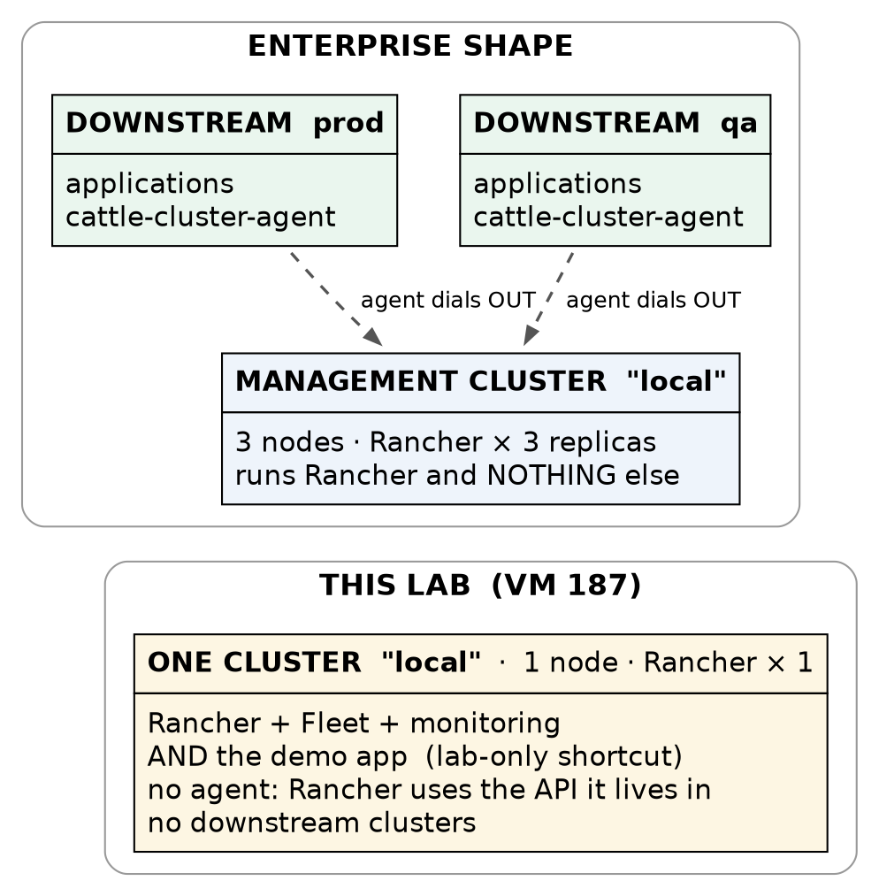
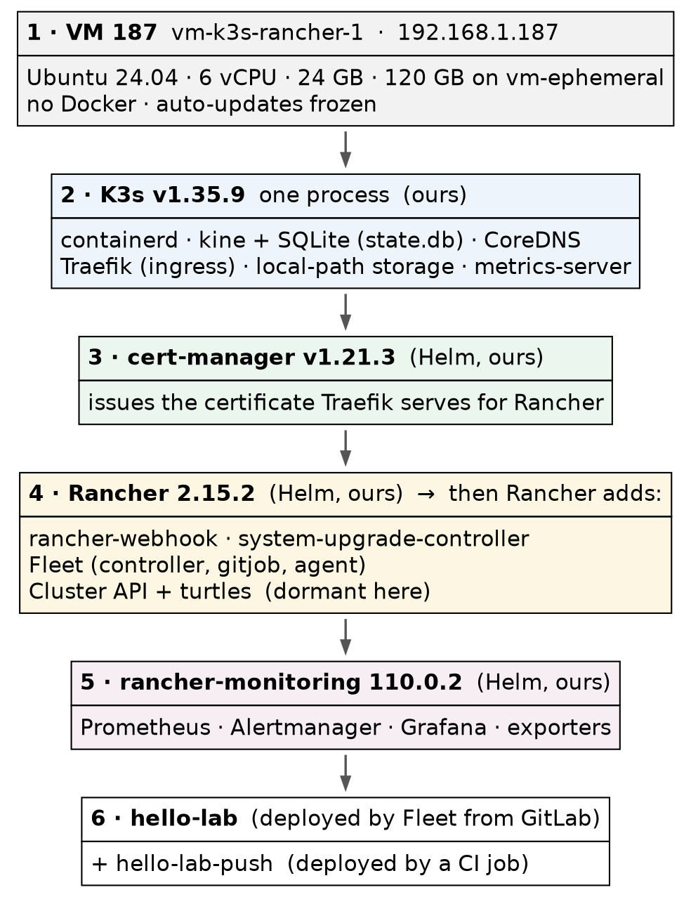

# Rancher on K3s · Chapter 1 — What Rancher Is, and Why It Gets Its Own Cluster

> **Series:** Home-Lab Education · Phase 20 (Rancher on K3s)
> **Built and verified:** October 27, 2026 on VM 187 `vm-k3s-rancher-1` (`192.168.1.187`); outputs re-captured read-only at 23:25 EDT the same night
> **Versions at time of writing:** Rancher 2.15.2 (community) · K3s v1.35.9+k3s1 · Traefik 3.7.13 · cert-manager v1.21.3 · Fleet 0.16.2 · Helm v3.22.1
> **Read this after:** nothing · **before:** Chapter 2

> 🤖 **DECLARATION — read this before you trust anything below.** Every command in this track was
> **executed** on VM 187, and every output quoted is real — recorded during the build on October 27, 2026
> or re-captured read-only from the running system the same night. But the whole track was
> **[run by the AI, not by Andrew]{custom-style="Key"}**, at his explicit instruction. The track's rule is
> *"only document what you actually ran"*, so these chapters are **one step weaker** than a hands-on
> track: [the commands are verified; the operator judgement was not earned at a keyboard]{custom-style="Key"}.
> The purpose, in Andrew's words: *"learn enough to know how it works."*

---

## What this chapter covers

Most confusion about Rancher comes from one wrong picture: that it is a kind of Kubernetes, or something
that sits *underneath* Kubernetes. It is neither. **[Rancher is an application that runs on a Kubernetes
cluster]{custom-style="Key"}**, installed with Helm like any other, and [its job is to manage clusters — usually]{custom-style="Key"}
other ones.

This chapter builds the right picture before Chapter 2 installs anything:

- what Rancher *is*, and where it keeps its data (the answer is surprising)
- the **management cluster** versus **downstream clusters**, and why this lab has only the first
- why Rancher gets a cluster of its own [instead of living inside one it manages]{custom-style="Key"}
- everything Rancher installed besides itself — about twenty pods before a single app
- how Rancher's vocabulary (projects, apps, workspaces) maps onto plain Kubernetes objects
- why the community edition commits you to upgrading every minor release

[Nothing in this chapter changes the system.]{custom-style="Key"} It is all inspection.

---

## 1. Rancher is a Deployment

Here is Rancher, running:

```bash
sudo kubectl get deploy -n cattle-system
```

```
NAME                        READY   UP-TO-DATE   AVAILABLE   AGE
rancher                     1/1     1            1           63m
rancher-webhook             1/1     1            1           60m
system-upgrade-controller   1/1     1            1           60m
```

[One Deployment, one pod, image `rancher/rancher:v2.15.2`.]{custom-style="Key"} It was installed by `helm install`
from a chart, it is reached through an ordinary Ingress, and Kubernetes restarts it if it dies. Everything
you know about running an application on Kubernetes applies to Rancher itself.

### Where Rancher keeps its data

There is no Rancher database. Ask the cluster how many object types it knows about:

```bash
sudo kubectl get crd --no-headers | wc -l
sudo kubectl get crd --no-headers | awk '{print $1}' | sed 's/^[^.]*\.//' | sort | uniq -c | sort -rn | head
```

```
153
     32 management.cattle.io
     15 hub.traefik.io
     14 fleet.cattle.io
     12 rke-machine.cattle.io
     10 traefik.io
     10 monitoring.coreos.com
     10 gateway.networking.k8s.io
      8 cluster.x-k8s.io
      6 rke.cattle.io
      6 rke-machine-config.cattle.io
```

**[Rancher stores everything as Kubernetes custom resources]{custom-style="Key"}** — users, clusters, projects,
settings, role bindings — in the API of the cluster it runs on. The `management.cattle.io` group alone
adds 32 types. A Rancher user is a real object you can `kubectl get`:

```bash
sudo kubectl get users.management.cattle.io -o custom-columns=NAME:.metadata.name,USER:.username,DISPLAY:.displayName
```

```
NAME           USER     DISPLAY
u-b4qkhsnliz   <none>   System account for Cluster local
u-mo773yttt4   <none>   <none>
user-4zgmb     admin    Default Admin
```

⭐ The consequence is the most important operational fact about Rancher: **[Rancher's database is the
cluster it runs on]{custom-style="Key"}**. On K3s with one server, that is a SQLite file:

```bash
sudo ls /var/lib/rancher/k3s/server/db/
```

```
state.db
state.db-shm
state.db-wal
```

[Lose that cluster and you lose Rancher's entire configuration]{custom-style="Key"} — every user, permission and
registered cluster. Backing up Rancher means backing up that cluster's state; there is no separate database
to dump. (Rancher ships a `rancher-backup` operator for exactly this. ⚠️ **It is not installed here and was
not tested** — this VM is rebuildable from scripts, which is its backup plan.)

---

## 2. The manager and the managed

Rancher's documentation uses three terms that this whole track depends on:

| Term | Meaning | In this lab |
|---|---|---|
| **Rancher server** (Rancher Manager) | The application from §1 | `deploy/rancher` in `cattle-system` |
| **Management cluster** — named **`local`** | The cluster Rancher is *installed on*. Rancher always registers it, under the name `local` | The single K3s node on VM 187 |
| **Downstream cluster** | Any *other* cluster Rancher manages — imported, provisioned by Rancher, or a cloud service such as EKS | **None.** Deliberately |

```bash
sudo kubectl get clusters.management.cattle.io
sudo kubectl get clusters.provisioning.cattle.io -A
```

```
NAME    AGE
local   62m

NAMESPACE     NAME    VERSION   CLUSTER NAME   AGE   KUBECONFIG         READY
fleet-local   local             local          62m   local-kubeconfig   true
```

[Rancher's real job is the downstream clusters.]{custom-style="Key"} In an enterprise, the management cluster runs
Rancher and nothing else, and [every cluster that runs applications is downstream of it]{custom-style="Key"}. Each downstream
cluster runs a `cattle-cluster-agent` that [**opens a connection outward to the Rancher server**]{custom-style="Key"}, so Rancher
does not need to be able to reach the cluster's API directly. ⚠️ **That agent model is recited from Rancher's
documentation, not run here** — there is no downstream cluster in this lab to observe it on.

What this lab *can* show is the special case. List the pods in `cattle-system` and there is no agent at all:

```
rancher-6f7f6f6977-lp9th                     1/1     Running     0             31m
rancher-webhook-7f55849f6c-pvdhl             1/1     Running     2 (34m ago)   60m
system-upgrade-controller-6f588b757b-wm9rx   1/1     Running     2 (34m ago)   60m
```

[Rancher manages `local` by talking to the API it is already inside]{custom-style="Key"}; an agent would be dialling
itself.



> **Why the CKA cluster is not downstream of this Rancher.** Importing a cluster installs Rancher's agent,
> its admission webhook and cluster-admin bindings *into* that cluster. The five-node CKA cluster exists for
> troubleshooting drills, and Rancher's components would become part of every symptom. So Rancher manages
> only itself here, and [the `local` cluster is the test-drive target]{custom-style="Key"}.

---

## 3. Why Rancher gets a cluster of its own

There are four places you could put Rancher. Three of them are wrong for a reason worth remembering:

| Option | Why not |
|---|---|
| **The single-container Docker install** (`docker run rancher/rancher`) | Documented for development and test only. [There is no upgrade path except migrating to a real install]{custom-style="Key"} via backup and restore |
| **A systemd service or a Proxmox LXC container** | Not a supported install at all. Rancher expects to be a Kubernetes workload; its own state lives in a Kubernetes API |
| **Inside a cluster it manages** | [If that cluster fails, the tool you would fix it with fails too]{custom-style="Key"} |
| ✅ **Helm, onto a Kubernetes cluster that runs only Rancher** | The supported production shape, and what this lab builds — scaled down to one node |

The third row is the principle. Rancher holds **[cluster-admin credentials to every cluster it
manages]{custom-style="Key"}**. That makes it the most privileged thing in the estate, and it belongs in its own
blast radius: its own cluster, its own upgrade schedule, its own access rules. Mixing it with workloads
[means any workload compromise is one step from everything]{custom-style="Key"}.

---

## 4. What Rancher installed besides itself

The Rancher chart installs **one** Deployment. Within minutes of it starting, Rancher had installed six
more Helm releases of its own — and **[`helm list` shows them alongside the ones you installed]{custom-style="Key"}**:

```bash
sudo -E env KUBECONFIG=/etc/rancher/k3s/k3s.yaml helm list -A
```

```
NAME                       NAMESPACE                  CHART                              APP VERSION
cert-manager               cert-manager               cert-manager-v1.21.3               v1.21.3
fleet                      cattle-fleet-system        fleet-110.0.2+up0.16.2             0.16.2
fleet-agent-local          cattle-fleet-local-system  fleet-agent-local-v0.0.0+s-a686…
fleet-crd                  cattle-fleet-system        fleet-crd-110.0.2+up0.16.2         0.16.2
hello-lab-fleet-hello-lab  hello-lab                  hello-lab-fleet-hello-lab-v0.0.0+git-0682a5dc00f4
rancher                    cattle-system              rancher-2.15.2                     v2.15.2
rancher-monitoring         cattle-monitoring-system   rancher-monitoring-110.0.2+up80.9.1-rancher.22
rancher-monitoring-crd     cattle-monitoring-system   rancher-monitoring-crd-110.0.2+up80.9.1-rancher.22
rancher-turtles            cattle-turtles-system      rancher-turtles-110.0.2+up0.27.2   0.27.2
rancher-webhook            cattle-system              rancher-webhook-110.0.3+up0.11.3   0.11.3
system-upgrade-controller  cattle-system              system-upgrade-controller-110.0.0  v0.20.1
traefik                    kube-system                traefik-40.1.5+up40.1.0            v3.7.1
traefik-crd                kube-system                traefik-crd-40.1.5+up40.1.0        v3.7.1
```

*(Columns trimmed for width. The full output also shows revision, update time and status — every release
`deployed`.)*

[Only four of those were installed deliberately]{custom-style="Key"}: `cert-manager`, `rancher`, and the two `rancher-monitoring`
charts (Chapter 3). K3s installed both `traefik` releases. Fleet installed `hello-lab-fleet-hello-lab`
(Chapter 4). **Rancher installed the other six:**

| Component | What it is for | Matters here? |
|---|---|---|
| `rancher-webhook` | An **admission webhook**: the API server asks it to validate changes to Rancher's own objects. 30 of its 35 rules are `failurePolicy: Fail`, so [if it is down, edits to Rancher resources are refused]{custom-style="Key"} | Yes — it is in every Rancher write path |
| `fleet` + `fleet-agent-local` | **Fleet**, Rancher's GitOps engine: a controller, a `gitjob` that watches Git, and an agent that applies changes | Yes — Chapter 4 is built on it |
| `system-upgrade-controller` | Upgrades K3s/RKE2 on a cluster from Rancher's UI | 🚨 **Yes, as a hazard** — see the warning below |
| `rancher-turtles` + `capi-controller-manager` | **Cluster API**: the machinery Rancher uses to *provision* new clusters | Dormant — nothing is provisioned here |

> 🚨 **`system-upgrade-controller` is a way around your version pin.** K3s here is pinned to v1.35.9 and is
> not managed by `apt`, so a routine OS update can never upgrade it. But [the Rancher UI can upgrade the
> `local` cluster's K3s through this controller]{custom-style="Key"} — one click, outside every process that is
> meant to control that change. Upgrades of the management cluster are a deliberate, tested procedure,
> never a casual click.

The finished system runs **29 pods** (31 listed — two are K3s's completed Traefik install jobs), three of
them application pods, and the node uses about a quarter of its memory:

```bash
sudo kubectl top node
```

```
NAME               CPU(cores)   CPU(%)   MEMORY(bytes)   MEMORY(%)
vm-k3s-rancher-1   505m         8%       6437Mi          26%
```

[The Rancher pod alone was using **863 MiB**]{custom-style="Key"}; Prometheus (Chapter 3) slightly more. [Budget memory for
Rancher's companions, not just Rancher]{custom-style="Key"} — the documented requirements describe the server,
[not the ecosystem it installs]{custom-style="Key"}.



---

## 5. Rancher's vocabulary, mapped to Kubernetes

Rancher's UI introduces words that sound like new concepts. Almost all of them are **[a Kubernetes object
with a Rancher label on it]{custom-style="Key"}**, and knowing which one is what lets you debug Rancher with
[`kubectl` when the UI is unhelpful]{custom-style="Key"} (Chapter 5 shows when that happens).

| Rancher says | What it actually is | Evidence on this cluster |
|---|---|---|
| **Cluster** | A `clusters.management.cattle.io` object, plus a provisioning twin in a Fleet workspace | `local`, shown in §2 |
| **Project** | [A group of namespaces that share permissions and quotas]{custom-style="Key"} — a Rancher-only idea; Kubernetes has no such object | `p-dshwt` = **System**, `p-xblrj` = **Default** |
| **Namespace** | A plain namespace, labelled with the project it belongs to | `hello-lab`, `cattle-system`, … |
| **App** (Apps menu) | **A Helm release**, mirrored as an `apps.catalog.cattle.io` object | 13 of them — the same 13 `helm list` shows |
| **Repository** (chart catalogue) | A `clusterrepos.catalog.cattle.io` — a Git or HTTP source of Helm charts | `rancher-charts` (branch `release-v2.15`), `rancher-partner-charts`, `rancher-rke2-charts` |
| **Fleet workspace** | A namespace that holds GitOps definitions. [`fleet-local` targets the `local` cluster only]{custom-style="Key"}; `fleet-default` targets downstream clusters | Our GitRepo lives in `fleet-local` |

```bash
sudo kubectl get projects.management.cattle.io -n local \
  -o custom-columns=NAME:.metadata.name,DISPLAY:.spec.displayName
```

```
NAME      DISPLAY
p-dshwt   System
p-xblrj   Default
```

This is also why a fresh Rancher creates a dozen namespaces you did not ask for. `local` is the cluster's
own management namespace, `p-dshwt` and `p-xblrj` back the two projects, and `user-4zgmb` belongs to the
admin user. **[The names look random because they are generated IDs]{custom-style="Key"}**; the display names
live inside the objects.

---

## 6. Why K3s, and why one node

**K3s** is a Kubernetes distribution packaged as [a single binary running a single process]{custom-style="Key"}:

```bash
ps -C k3s-server -o pid,rss,etime,cmd --no-headers
```

```
  19911 1588840     25:20 /usr/local/bin/k3s server
```

That one process (about 1.5 GB resident here) [is the API server, scheduler, controller manager, kubelet]{custom-style="Key"}
and container runtime supervisor at once. K3s also bundles the pieces a bare cluster lacks:

| Bundled | Role | Seen in |
|---|---|---|
| **containerd** | The container runtime — no Docker on this VM | `CONTAINER-RUNTIME containerd://2.2.7-k3s1` |
| **Traefik** | The ingress controller. [Rancher's docs: on K3s you do not install one]{custom-style="Key"} | Chapter 2 |
| **CoreDNS** | Cluster DNS | `kube-system` |
| **local-path-provisioner** | A default StorageClass that carves volumes out of the node's disk | Chapter 3 (Prometheus) |
| **metrics-server** | What makes `kubectl top` work | §4 above |
| **kine + SQLite** | [Stands in for etcd on a single server]{custom-style="Key"} — the `state.db` from §1 | — |

The choices behind this build, briefly:

- **K3s rather than the CKA track's `kubeadm`.** The CKA cluster exists to practise building Kubernetes
  by hand. This track is about Rancher, so [the cluster underneath should be the least interesting part]{custom-style="Key"}.
  K3s and RKE2 are SUSE's own distributions and the ones Rancher's install guide leads with (⚠️ recited
  from the docs; the two were not compared here).
- **v1.35.** Rancher 2.15.2's support matrix certifies K3s 1.34–1.36 for the management cluster, and 1.35
  is the CKA cluster's minor, [so what you learn transfers]{custom-style="Key"}.
- **One node.** A production management cluster runs three, with three Rancher replicas. One node teaches
  [everything except high availability]{custom-style="Key"} — and is honest about that below.

---

## 7. Community Rancher means upgrading every minor

This lab runs **community** Rancher, not SUSE's paid **Rancher Prime**. The difference that matters
[operationally is not features; it is the patch policy]{custom-style="Key"}:

Under SUSE's release policy (in force since August 2024, and checked when this build was planned on
October 27, 2026), [community users receive patch releases]{custom-style="Key"} **only for the newest minor version**. Once
2.16.0 ships, further 2.15.x patches go to Prime customers only.

**[On community Rancher, staying patched means upgrading every minor release]{custom-style="Key"}** — roughly
every few months, and each one may require a K3s upgrade to stay inside the support matrix, and a matching
[version of every Rancher-packaged chart]{custom-style="Key"} (Chapter 3's monitoring chart is tied to 2.15). The upgrade
[procedure is therefore not an occasional task]{custom-style="Key"}. ⚠️ **It has not been run here yet**: 2.15.2 was still the
newest community release on October 27, 2026, so the upgrade drill (D6) waits for 2.16.

---

## Where this lab differs from production

| Here | In production | Why it matters |
|---|---|---|
| **One node**, one Rancher replica | Three nodes, three replicas | Losing the node loses the management plane until the VM is back. Scale and availability — a table row, not a callout |
| SQLite (kine) | Embedded etcd across three servers | Same reason: single-server shortcut |
| No backup operator; rebuildable from scripts | `rancher-backup` to off-cluster storage | Rancher's config *is* the cluster state (§1) |
| **Applications run on the `local` cluster** | Applications run on downstream clusters only | See below — this one is wrong at any scale |

> **Lab vs PROD — applications on Rancher's own cluster.** *In the lab:* the demo app and its GitOps
> pipeline run on `local`, the cluster Rancher itself lives on. *Why it's acceptable here:* the purpose is to
> see Rancher manage *something*, and a separate downstream cluster was declined to keep the CKA cluster
> clean (§2); nothing here holds data that matters. *In production:* Rancher's documentation says the
> management cluster should run Rancher and nothing else; workloads go on downstream clusters. *If you carry
> the habit:* [an application compromise lands in the cluster that holds cluster-admin to every other
> cluster]{custom-style="Key"}, and an application's resource spike competes with the tool you need to diagnose it.

---

## Commands to know by heart

| Question | Command |
|---|---|
| Is Rancher running? | `kubectl get deploy -n cattle-system rancher` |
| Does the server answer? | `curl -sk https://<rancher-host>/ping` → `pong` |
| Which clusters does Rancher know about? | `kubectl get clusters.management.cattle.io` |
| What did Rancher install? | `helm list -A` (on K3s, with `KUBECONFIG` set — Chapter 2) |
| Which projects exist, by display name? | `kubectl get projects.management.cattle.io -n local -o custom-columns=NAME:.metadata.name,DISPLAY:.spec.displayName` |
| What Rancher-specific types exist? | `kubectl get crd \| grep cattle.io` |
| How much memory is the stack using? | `kubectl top node` · `kubectl top pods -A --sort-by=memory` |

---

## Glossary

**Rancher server / Rancher Manager** — [the Rancher application itself]{custom-style="Key"}: a Deployment in
`cattle-system`.

**management cluster (`local`)** — the cluster Rancher is installed on. Rancher always registers it as
`local`.

**downstream cluster** — [any other cluster Rancher manages]{custom-style="Key"}: imported, provisioned by Rancher,
or a hosted service.

**`cattle-cluster-agent`** — the agent in each downstream cluster that [connects outward to the Rancher server]{custom-style="Key"}.
"Cattle" is Rancher's historical name for its own components; it prefixes most of its namespaces.

**custom resource (CRD)** — a new object type added to the Kubernetes API. [Rancher keeps all of its state
in custom resources.]{custom-style="Key"}

**admission webhook** — [a service the API server consults before accepting a change]{custom-style="Key"}. `rancher-webhook`
validates Rancher's objects.

**project** — [Rancher's grouping of namespaces for shared permissions]{custom-style="Key"}; not a Kubernetes concept.

**Fleet** — Rancher's built-in GitOps engine. **Workspace** — the namespace a Fleet definition lives in,
which decides which clusters it targets.

**K3s** — [a single-binary Kubernetes distribution]{custom-style="Key"} with containerd, Traefik, CoreDNS,
local-path storage and metrics-server built in.

**kine** — [the layer that lets K3s store cluster state in SQLite instead of etcd]{custom-style="Key"}.

**Rancher Prime** — SUSE's paid edition. Same software; longer patch support.

---

## Check yourself

Answer these out loud. Section references, not answers.

1. Someone says "we run our apps on Rancher". What is the precise version of that sentence? (§1, §2)
2. Where is Rancher's list of users stored, and what has to be backed up to keep it? (§1)
3. Why does the `local` cluster have no `cattle-cluster-agent`? (§2)
4. Give the one-sentence reason Rancher should not run inside a cluster it manages. (§3)
5. `helm list -A` shows thirteen releases and you installed four. Where did the others come from? (§4)
6. Why is `system-upgrade-controller` a risk to a pinned K3s version? (§4)
7. In the UI you see a project called *Default*. How would you find it with `kubectl`? (§5)
8. What does K3s use instead of etcd on one server, and where is it on disk? (§1, §6)
9. Why does running community Rancher make the upgrade procedure a regular task? (§7)
10. Name the one shortcut in this lab that would be wrong even on a large cluster, and its consequence.
    (*Where this lab differs*)
