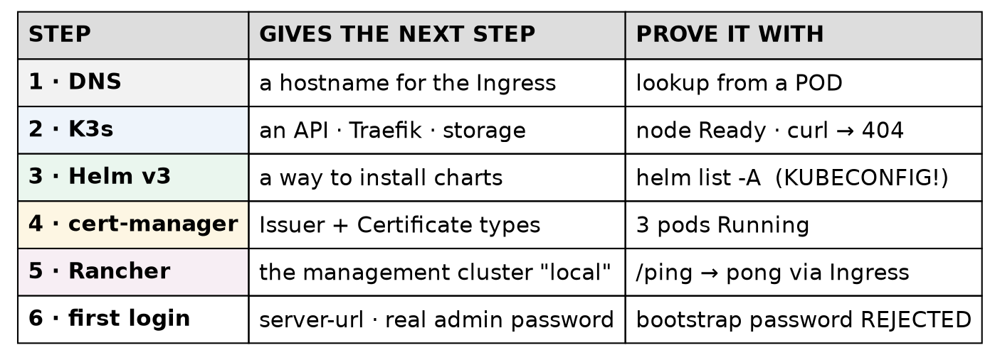
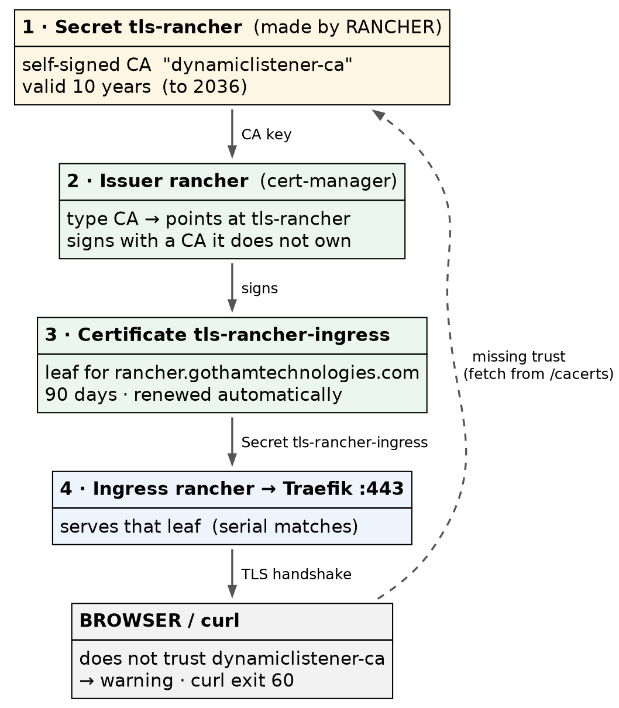

# Rancher on K3s · Chapter 2 — Installing It: K3s, Helm, cert-manager, Rancher

> **Series:** Home-Lab Education · Phase 20 (Rancher on K3s)
> **Built and verified:** October 27, 2026, 22:10–22:25 EDT on VM 187 `vm-k3s-rancher-1` (`192.168.1.187`); verification outputs re-captured read-only at 23:25–23:35 the same night
> **Versions at time of writing:** K3s v1.35.9+k3s1 · Traefik 3.7.13 · Helm v3.22.1 · cert-manager v1.21.3 · Rancher 2.15.2
> **Scripts:** `proxmox/build-scripts/rancher-k3s/` — `3-k3s.sh`, `4-rancher.sh` (run on the VM as root) · values file in [`manifests/rancher-values.yaml`](manifests/rancher-values.yaml)
> **Read this after:** Chapter 1 · **before:** Chapter 3

> 🤖 **DECLARATION — read this before you trust anything below.** Every command in this chapter was
> **executed** on VM 187 and every output quoted is real. But it was
> **[run by the AI, not by Andrew]{custom-style="Key"}**, at his explicit instruction — so the commands are
> verified, and the operator judgement behind them was not earned at a keyboard. Chapter 1 explains the
> rule this declaration exists to honour.

---

## What this chapter covers

The install is four layers, each depending on the one before. [The order is the lesson]{custom-style="Key"}:
every step that went wrong in someone's first Rancher install is a step done out of order, or a layer
assumed to be there that was not.

The steps below are **the sequence that worked**, each followed by how to confirm it took effect —
[checked from somewhere *other than* the tool that made the change]{custom-style="Key"}. The tripping points are at the step
where you could still act on them.

The build was scripted, and [every script was re-run until it reported **0 changes**]{custom-style="Key"}. The
commands shown are the ones inside those scripts, so you can read either.

---

## The order, and why



| Layer | Needs | Because |
|---|---|---|
| **DNS name** | nothing | The Rancher chart needs a hostname for its Ingress; there is no IP-only install |
| **K3s** | a VM | Everything else is a Kubernetes workload |
| **Helm** | a cluster to talk to | Rancher, cert-manager and monitoring are all Helm charts |
| **cert-manager** | Helm + cluster | It issues the certificate Rancher's Ingress serves (Step 7) |
| **Rancher** | all of the above | Its chart creates cert-manager objects; with no cert-manager, they have nothing to act on |

[Rancher's chart does not install cert-manager for you.]{custom-style="Key"} It assumes it, the same way it assumes
an ingress controller — which K3s provides and a bare `kubeadm` cluster does not.

---

## Step 0 — The VM (assumed)

Routine lab plumbing, already proven many times: VM 187 cloned from template 9000, sized to **6 vCPU,
24 GB RAM, 120 GB disk** on `vm-ephemeral`, personalised with `2-personalize.sh --freeze-updates`, added
to the lab's `refresh.sh` for OS patching, snapshot **`r01-os-ready`**.

Two choices in that step are about *this* build:

- **No Docker.** [K3s brings its own containerd]{custom-style="Key"}; a second runtime would add a second set of
  iptables rules and nothing else. So the VM was built with the Kubernetes-node personaliser, not the
  lab's Docker-host script.
- **`vm-ephemeral`, no backup job.** [The lab's placement rule is one question]{custom-style="Key"}: *can this project rebuild it?*
  [Yes — from the scripts in this chapter]{custom-style="Key"} — so it goes on the unmirrored pool.

---

## Step 1 — A name that pods can resolve

The Rancher chart needs a hostname. Two public Route53 A records were created, both pointing at the VM:

| Name | Points at | For |
|---|---|---|
| `rancher.gothamtechnologies.com` | `192.168.1.187` | the Rancher UI and API |
| `hello-rancher.gothamtechnologies.com` | `192.168.1.187` | the demo app (Chapter 4) |

[A private address in public DNS is existing lab practice]{custom-style="Key"} — `gitlab.gothamtechnologies.com`
already resolves publicly to `192.168.1.181`. It reveals an internal address and nothing more, and it means
every machine, and every pod, resolves the name with no special configuration.

⚠️ **Why not just `/etc/hosts`?** Because [pods do not read the node's `/etc/hosts`]{custom-style="Key"}. A pod
asks CoreDNS (`nameserver 10.43.0.10` below), and [CoreDNS forwards upstream]{custom-style="Key"}. A name that exists only in a
hosts file [works from your shell and fails from inside the cluster]{custom-style="Key"} — which is where Rancher's own
components need it.

**Confirm — from the node *and* from inside a pod:**

```bash
getent hosts rancher.gothamtechnologies.com
sudo kubectl exec -n hello-lab deploy/hello-lab -- \
  python -c "import socket; print(socket.gethostbyname('rancher.gothamtechnologies.com'))"
sudo kubectl exec -n hello-lab deploy/hello-lab -- cat /etc/resolv.conf
```

```
192.168.1.187   rancher.gothamtechnologies.com
192.168.1.187
search hello-lab.svc.cluster.local svc.cluster.local cluster.local myfiosgateway.com
nameserver 10.43.0.10
options ndots:5
```

*(The pod check needs a running pod, so on a fresh build it comes after Step 2. It is shown here because
it belongs to this step's question.)*

---

## Step 2 — K3s, pinned, from a file you can read

### 2a. Write the configuration before installing

K3s reads `/etc/rancher/k3s/config.yaml` at start. [Writing it first means the cluster is created right]{custom-style="Key"},
rather than created and then reconfigured:

```bash
sudo cat /etc/rancher/k3s/config.yaml
```

```yaml
write-kubeconfig-mode: "0600"
node-ip: 192.168.1.187
tls-san:
  - "rancher.gothamtechnologies.com"
  - "192.168.1.187"
  - "vm-k3s-rancher-1"
```

| Key | What it does | Why it matters |
|---|---|---|
| `write-kubeconfig-mode: "0600"` | The admin kubeconfig K3s writes is readable by root only | 🚨 That file is **cluster-admin**. An earlier lab track used `644` and made it world-readable |
| `node-ip` | Pins the address the node advertises | One NIC here, but it removes a guess |
| `tls-san` | Extra names written into the API server's certificate | [A client connecting by any name not in the certificate gets a TLS error]{custom-style="Key"} |

**The CIDRs were left at their defaults** — pods `10.42.0.0/16`, services `10.43.0.0/16` — after checking
that [neither overlaps the lab network `192.168.1.0/24`]{custom-style="Key"}. ⚠️ At work, check against the
corporate ranges: [a default CIDR is a guess about someone else's network]{custom-style="Key"}, and `10.x` is where corporate
networks live.

### 2b. Install from a pinned installer, saved to a file

```bash
K3S_VERSION="v1.35.9+k3s1"
curl -fsSL -o /root/k3s-install-${K3S_VERSION}.sh \
  "https://raw.githubusercontent.com/k3s-io/k3s/v1.35.9%2Bk3s1/install.sh"
INSTALL_K3S_VERSION="$K3S_VERSION" sh /root/k3s-install-${K3S_VERSION}.sh server
```

Three deliberate differences from the one-liner on K3s's home page:

- **[Never `curl … | sh`]{custom-style="Key"}.** The installer is saved, so it can be read and its checksum
  recorded, and [what ran is what is on disk afterwards]{custom-style="Key"}.
- **The installer comes from the pinned tag, not from `get.k3s.io`.** The script and the binary are the
  same release.
- **`INSTALL_K3S_VERSION` pins the binary.** [K3s is not managed by `apt`]{custom-style="Key"}, so routine OS
  patching can never upgrade it. [Upgrades are a deliberate act: change the version, re-run.]{custom-style="Key"}

### 2c. Confirm

```bash
sudo kubectl get node -o wide
sudo kubectl get pods -n kube-system
```

```
NAME               STATUS   ROLES           AGE   VERSION        INTERNAL-IP     EXTERNAL-IP   OS-IMAGE             KERNEL-VERSION      CONTAINER-RUNTIME
vm-k3s-rancher-1   Ready    control-plane   73m   v1.35.9+k3s1   192.168.1.187   <none>        Ubuntu 24.04.5 LTS   6.8.0-147-generic   containerd://2.2.7-k3s1

NAME                                     READY   STATUS      RESTARTS      AGE
coredns-b644fd95b-fczl9                  1/1     Running     2 (41m ago)   73m
helm-install-traefik-bjjs7               0/1     Completed   2             73m
helm-install-traefik-crd-svcwn           0/1     Completed   0             73m
local-path-provisioner-d9d8769b6-v5f8s   1/1     Running     2 (41m ago)   73m
metrics-server-7f4b6d9bd7-gd4pq          1/1     Running     2 (41m ago)   73m
svclb-traefik-b40a9fc0-927hh             2/2     Running     4 (41m ago)   72m
traefik-5869c87968-wm585                 1/1     Running     2 (41m ago)   72m
```

*(Captured after two reboot drills, hence the restart counts of 2.)*

Read three things in that output:

1. **`helm-install-traefik` is a Completed job with 2 restarts.** K3s installs Traefik by running Helm
   *inside the cluster*, through its own Helm controller. On first boot the job raced the CRDs it needed and
   retried. [Completed with restarts is normal here]{custom-style="Key"}; it is not a crash to chase.
2. **`svclb-traefik`** is K3s's built-in load balancer. Traefik's Service is type `LoadBalancer`, and on a
   bare-metal cluster [nothing would ever give it an address]{custom-style="Key"}. K3s runs a small pod that binds ports 80 and 443
   on the node, so [the Service gets the node's own IP as its external address]{custom-style="Key"}:

   ```
   NAME      TYPE           CLUSTER-IP      EXTERNAL-IP     PORT(S)                      AGE
   traefik   LoadBalancer   10.43.132.182   192.168.1.187   80:31808/TCP,443:31191/TCP   65m
   ```

3. **No application pods, and nothing `Pending`.** [A fresh cluster with something `Pending` has a scheduling]{custom-style="Key"}
   or storage problem *before* you have added anything.

Then test the ingress from outside Kubernetes: `curl http://192.168.1.187/` returns **404**. [A 404 from
Traefik is success]{custom-style="Key"}: the controller is answering, and nothing has asked it to route
anything yet.

> ⚠️ **Read the running image, not the chart's label.** `helm list` reports Traefik's *app version* as
> `v3.7.1`; the running image is `rancher/mirrored-library-traefik:3.7.13`. K3s's packaging sets the
> image itself. [When a version matters, ask the Deployment what it is running]{custom-style="Key"}:
> `kubectl get deploy -n kube-system traefik -o jsonpath='{.spec.template.spec.containers[0].image}'`.

> ⛔ **The kubeconfig stays on the VM.** All of this is run over SSH, on the node. Copying
> `/etc/rancher/k3s/k3s.yaml` to the workstation would put a second cluster-admin context next to the CKA
> cluster's, and [one wrong context is a drill command run against the wrong cluster]{custom-style="Key"}.

---

## Step 3 — Helm v3, and the `sudo` trap

```bash
HELM_VERSION="v3.22.1"
curl -fsSLo helm.tgz "https://get.helm.sh/helm-${HELM_VERSION}-linux-amd64.tar.gz"
curl -fsSLo helm.sha "https://get.helm.sh/helm-${HELM_VERSION}-linux-amd64.tar.gz.sha256sum"
[ "$(sha256sum helm.tgz | cut -d' ' -f1)" = "$(cut -d' ' -f1 helm.sha)" ] && echo verified
tar -xzf helm.tgz && sudo install -m 0755 linux-amd64/helm /usr/local/bin/helm
```

**Why v3 when Helm 4 exists:** [Rancher's install documentation assumes Helm 3]{custom-style="Key"}, and its
version-requirements page defines only a v3 rule. When a vendor documents one major version, use that one
for their product.

🚨 **The trap you will hit the first time you use it.** [`kubectl` on K3s is a wrapper that knows where the]{custom-style="Key"}
admin kubeconfig lives. **Helm is not**, and `sudo` drops your environment:

```bash
sudo helm list -n cattle-system
```

```
Error: Kubernetes cluster unreachable: Get "http://localhost:8080/version": dial tcp [::1]:8080: connect: connection refused
```

[`localhost:8080` means "I found no kubeconfig at all"]{custom-style="Key"} — it is Kubernetes clients' last-resort
default, not a sign that the API server is down. Point Helm at the file explicitly:

```bash
sudo -E env KUBECONFIG=/etc/rancher/k3s/k3s.yaml helm list -A
```

The build scripts run as root and `export KUBECONFIG=/etc/rancher/k3s/k3s.yaml` at the top for this reason.

**Confirm:** `helm version --short` → `v3.22.1+gd6c1a0e`.

---

## Step 4 — cert-manager

```bash
helm repo add jetstack https://charts.jetstack.io
helm upgrade --install cert-manager jetstack/cert-manager --version v1.21.3 \
  -n cert-manager --create-namespace --set crds.enabled=true --wait --timeout 10m
```

- **`crds.enabled=true`** installs cert-manager's custom resource types (`Issuer`, `Certificate`, …) with
  the chart. Rancher's chart creates an `Issuer`, and [without the CRD the cluster does not know that type
  exists]{custom-style="Key"}.
- **`--wait`** matters more than it looks. cert-manager runs its own admission webhook; [an install that
  returns before the webhook is ready can make the *next* install fail]{custom-style="Key"} with an error about a
  webhook it cannot reach. ⚠️ A well-known failure, **not hit here** — `--wait` is what prevented it.
- **`upgrade --install`** is the idempotent form: [it installs if absent and does nothing if already at that]{custom-style="Key"}
  version. Re-running the script is safe.

**Confirm:**

```bash
sudo kubectl get pods -n cert-manager
```

```
NAME                                       READY   STATUS    RESTARTS      AGE
cert-manager-7b64759498-dxnlw              1/1     Running   2 (41m ago)   70m
cert-manager-cainjector-5d85cc9c99-lt4l4   1/1     Running   2 (41m ago)   70m
cert-manager-webhook-674b6c7468-r5ltq      1/1     Running   2 (41m ago)   70m
```

Three pods: the controller, the CA injector, and the webhook.

---

## Step 5 — Rancher

### 5a. The values file is part of the system

```yaml
# Rancher Helm values for vm-k3s-rancher-1 (Phase 20). Upgrades MUST reuse these.
# bootstrapPassword is deliberately absent — it is passed from a root-only file at install time
hostname: rancher.gothamtechnologies.com
replicas: 1
ingress:
  tls:
    source: rancher
```

| Value | Why |
|---|---|
| `hostname` | The Ingress host, and the name Rancher will tell agents to dial |
| `replicas: 1` | [The chart defaults to **3**]{custom-style="Key"} — sized for a three-node management cluster |
| `ingress.tls.source: rancher` | Rancher generates its own CA and cert-manager issues the certificate from it (Step 7). The alternatives are `letsEncrypt` and `secret` (bring your own) |

⭐ **Keep this file, in version control.** Rancher's docs say it plainly: upgrades need the same options.
[A `helm upgrade` without the original values silently reverts every setting to the chart default]{custom-style="Key"}
— here that would mean three replicas and a different certificate source. The file is in the repo; the
only thing missing from it is the password, by design.

### 5b. Install, keeping the password out of sight

```bash
helm repo add rancher-latest https://releases.rancher.com/server-charts/latest
# first install only: the bootstrap password goes in a temporary values file, mode 600
printf 'bootstrapPassword: "%s"\n' "$BOOTSTRAP_PASSWORD" > "$BS"
helm upgrade --install rancher rancher-latest/rancher --version 2.15.2 \
  -n cattle-system --create-namespace -f rancher-values.yaml -f "$BS"
rm -f "$BS"
```

[The password goes in a file, not `--set`]{custom-style="Key"}, because command-line arguments are visible to every
user on the machine in the process list. `$BOOTSTRAP_PASSWORD` is read from a root-only file that is
deleted once the install is done.

### 5c. Confirm — from outside the cluster

```bash
sudo kubectl -n cattle-system rollout status deploy/rancher
curl -sk https://rancher.gothamtechnologies.com/ping; echo
```

```
deployment "rancher" successfully rolled out
pong
```

[`/ping` answering `pong` through the Ingress is the real test]{custom-style="Key"}: it proves DNS, Traefik, the
certificate, the Service and the pod in one request. `rollout status` alone proves only the last of those.

---

## Step 6 — First login: settings, and retiring the bootstrap password

A fresh Rancher waits for someone to open the UI, accept the terms and set the server URL. The script does
the same through Rancher's own objects — [settings are Kubernetes resources]{custom-style="Key"}, as Chapter 1
showed:

```bash
kubectl patch settings.management.cattle.io server-url --type merge \
  -p '{"value":"https://rancher.gothamtechnologies.com"}'
kubectl patch settings.management.cattle.io first-login --type merge -p '{"value":"false"}'
```

**`server-url` matters more than it looks:** [it is the address Rancher gives every downstream agent to
dial back to]{custom-style="Key"}. ⚠️ Changing it after downstream clusters are registered is documented as
disruptive — recited, not tested; there are no downstream clusters here.

🚨 **Tripping point — a setting that does not exist.** The script also tried to set `telemetry-opt`, a
setting that appears in older Rancher guides. On 2.15.2:

```
Error from server (NotFound): settings.management.cattle.io "telemetry-opt" not found
```

[Settings come and go between Rancher versions]{custom-style="Key"}, and a script written from an older guide
stops dead. [The fix was to check that a setting exists before patching it]{custom-style="Key"}, and skip it with a warning if not.
List what your version actually has with `kubectl get settings.management.cattle.io`.

**The bootstrap password must stop working.** The script logs in with it once, through Rancher's API, and
changes the admin password to the real one. Then it proves both halves: [the new password logs in, and
the bootstrap value is rejected]{custom-style="Key"}. Until the second half is true, [anyone who saw the install]{custom-style="Key"}
command can log in as admin.

**Confirm — the management cluster is up:**

```bash
sudo kubectl get clusters.management.cattle.io local \
  -o jsonpath='{.status.conditions[?(@.type=="Ready")].status}'; echo
sudo kubectl get settings.management.cattle.io first-login eula-agreed \
  -o custom-columns=NAME:.metadata.name,VALUE:.value
```

```
True

NAME          VALUE
first-login   false
eula-agreed   2026-10-28T02:22:58.000Z
```

`local` `Ready=True` is what the UI shows as **Active**. Snapshot **`r02-rancher-up`**.

---

## Step 7 — Follow the certificate

The browser warns when it opens `https://rancher.gothamtechnologies.com`. It is worth knowing exactly why,
because [the warning is about trust, not about a broken certificate]{custom-style="Key"}. With
`ingress.tls.source: rancher`, four objects form a chain:



**1. Rancher generates its own CA** and stores it in the Secret `tls-rancher`:

```bash
sudo kubectl get secret -n cattle-system tls-rancher -o jsonpath='{.data.tls\.crt}' \
  | base64 -d | openssl x509 -noout -subject -issuer -dates
```

```
subject=O = dynamiclistener-org, CN = dynamiclistener-ca@1793154155
issuer=O = dynamiclistener-org, CN = dynamiclistener-ca@1793154155
notBefore=Oct 28 01:22:35 2026 GMT
notAfter=Oct 25 01:22:35 2036 GMT
```

Subject equals issuer: [a self-signed CA, valid for ten years]{custom-style="Key"}. (*dynamiclistener* is the
TLS library Rancher and K3s share; the name is not a misconfiguration.)

**2. cert-manager's `Issuer` points at that CA** — it does not own one of its own:

```
$ kubectl get issuer -n cattle-system rancher -o jsonpath='{.spec}'
{"ca":{"secretName":"tls-rancher"}}
```

**3. A `Certificate` asks for a leaf for the hostname**, and the Ingress names the Secret it produces:

```
$ kubectl get certificate -n cattle-system tls-rancher-ingress -o jsonpath='{.spec}'
{"dnsNames":["rancher.gothamtechnologies.com"],"issuerRef":{"group":"cert-manager.io","kind":"Issuer","name":"rancher"},"secretName":"tls-rancher-ingress","usages":["digital signature","key encipherment"]}
$ kubectl get ingress -n cattle-system rancher -o jsonpath='{.spec.tls}'
[{"hosts":["rancher.gothamtechnologies.com"],"secretName":"tls-rancher-ingress"}]
```

**4. Traefik serves that leaf.** [Prove it by comparing serial numbers]{custom-style="Key"} — the certificate on the wire against
the one in the Secret:

```bash
echo | openssl s_client -connect rancher.gothamtechnologies.com:443 \
  -servername rancher.gothamtechnologies.com 2>/dev/null | openssl x509 -noout -serial -ext subjectAltName
```

```
serial=25B9DC7AC20E2BF790DC76CD7439720AA7CBD2E6
X509v3 Subject Alternative Name: critical
    DNS:rancher.gothamtechnologies.com
```

Same serial as `tls-rancher-ingress`. The leaf is valid for **90 days** (Oct 28, 2026 → Jan 26, 2027),
and [cert-manager renews it automatically, signed by the same ten-year CA]{custom-style="Key"}.

**So why the warning?** [No browser trusts `dynamiclistener-ca`]{custom-style="Key"}. Give a client that CA and the error
disappears:

```bash
curl -s -o /dev/null -w '%{http_code} %{ssl_verify_result}\n' https://rancher.gothamtechnologies.com/ping; echo exit=$?
curl -s -o /dev/null -w '%{http_code}\n' \
  --cacert <(sudo kubectl get secret -n cattle-system tls-rancher -o jsonpath='{.data.tls\.crt}' | base64 -d) \
  https://rancher.gothamtechnologies.com/ping
curl -sk https://rancher.gothamtechnologies.com/cacerts | openssl x509 -noout -subject -issuer
```

```
000 20
exit=60
200
subject=O = dynamiclistener-org, CN = dynamiclistener-ca@1793154155
issuer=O = dynamiclistener-org, CN = dynamiclistener-ca@1793154155
```

Exit 60 is curl's "peer certificate cannot be authenticated", and verify result 20 is OpenSSL's "unable to
get local issuer certificate" — no trusted CA. Hand curl the CA from `tls-rancher` and the same request
returns 200. [Rancher also publishes that CA at `/cacerts`]{custom-style="Key"}, which is how a client that is
not on the cluster can obtain it. ⚠️ Fetching it with `-k`, as the last command does, trusts whatever
answered — fine for a demonstration, wrong as the way to establish trust; [verify the CA out of band]{custom-style="Key"}.

> **Lab vs PROD — a self-signed CA, and clicking through the warning.** *In the lab:* Rancher's UI is served
> under a CA that Rancher generated itself, so every browser warns and every visit starts with "proceed
> anyway". *Why it's acceptable here:* one administrator, on a home network, where the name and address are
> known; the alternative (Let's Encrypt) needs the server reachable from the internet. *In production:* the
> certificate comes from the organisation's CA or a public one (`ingress.tls.source: secret` or
> `letsEncrypt`), and the browser shows no warning at all. ⚠️ *Recited from Rancher's documentation; only
> `rancher` was tested here.* *If you carry the habit:* [clicking through a certificate warning becomes
> reflex]{custom-style="Key"}, and the one day the warning means someone is intercepting the admin login — to the
> tool that holds cluster-admin everywhere — you click through that one too.

---

## Step 8 — Prove it is re-runnable

Each script has a `--check` mode that reports without changing anything. Run against the finished system:

```bash
sudo bash 4-rancher.sh --check
```

```
━━━ HELM v3.22.1
  ok   helm v3.22.1
━━━ CERT-MANAGER v1.21.3
  ok   cert-manager v1.21.3 deployed
━━━ RANCHER 2.15.2
  ok   rancher 2.15.2 deployed
━━━ WAIT FOR RANCHER
deployment "rancher" successfully rolled out
  ok   deploy/rancher rolled out (1 available)
  ok   https://rancher.gothamtechnologies.com/ping -> pong
━━━ FIRST-LOGIN SETTINGS
  ok   setting server-url = https://rancher.gothamtechnologies.com
  ok   setting eula-agreed = 2026-10-28T02:22:58.000Z
  ok   setting first-login = false
━━━ VERIFY THE local CLUSTER
  ok   management cluster 'local' Ready=True (Active in the UI)

  0 change(s) made. Re-run to confirm it reports 0.
```

*(Abridged: the repository, pod-list and per-namespace lines are omitted.)*

[**0 changes** on a re-run is the test of an install script]{custom-style="Key"}. A script that reports changes
on a system it already built [is either not idempotent or is fighting something else that changes the same]{custom-style="Key"}
thing — and either is a problem you want to know about now, not during an outage.

---

## Where this lab differs from production

| Here | In production | Why it matters |
|---|---|---|
| One node, `replicas: 1` | Three nodes, three replicas | Availability — a table row (Chapter 1) |
| Rancher-generated CA | Organisation or public CA | **Callout in Step 7** |
| Public DNS record with a private address | Internal DNS, or the same pattern by policy | Discloses one internal address; acceptable here |
| Install scripts run as root on the node, kubeconfig on the node | The same, or a bastion with audited access | Kept deliberately — it is the safe pattern, not a shortcut |

---

## Commands to know by heart

| Question | Command |
|---|---|
| Is the node up, and what is it running? | `kubectl get node -o wide` |
| Did K3s's bundled components start? | `kubectl get pods -n kube-system` (Completed `helm-install-*` jobs are normal) |
| Why does `sudo helm` say `localhost:8080`? | It found no kubeconfig: `sudo -E env KUBECONFIG=/etc/rancher/k3s/k3s.yaml helm …` |
| Is Rancher up, end to end? | `curl -sk https://<host>/ping` → `pong` |
| What image is actually running? | `kubectl get deploy -n <ns> <name> -o jsonpath='{.spec.template.spec.containers[0].image}'` |
| Which certificate is on the wire? | `openssl s_client -connect <host>:443 -servername <host> \| openssl x509 -noout -serial -issuer` |
| What is Rancher's CA? | `curl -sk https://<host>/cacerts` |
| Which settings does this Rancher version have? | `kubectl get settings.management.cattle.io` |
| Is the management cluster Active? | `kubectl get clusters.management.cattle.io local -o jsonpath='{.status.conditions[?(@.type=="Ready")].status}'` |

---

## Glossary

**`tls-san`** — Subject Alternative Names: [extra names and addresses written into the API server's
certificate]{custom-style="Key"}, so clients can connect by any of them.

**ServiceLB (`svclb-*`)** — K3s's built-in load balancer: [it gives a `LoadBalancer` Service the node's IP]{custom-style="Key"} by
binding the ports on the node.

**K3s Helm controller** — the component inside K3s that installs bundled charts (Traefik) by running Helm
jobs in the cluster. ⚠️ Changing Traefik's settings on K3s is done with a `HelmChartConfig` object rather
than `helm upgrade` — standard K3s practice, **not exercised here**.

**idempotent** — [safe to run again: a second run changes nothing]{custom-style="Key"}. `helm upgrade --install`
is the idempotent form of `helm install`.

**bootstrap password** — the one-time admin password set at install. [It must be replaced and then]{custom-style="Key"}
rejected.

**`server-url`** — [the address Rancher gives agents to dial back to]{custom-style="Key"}.

**CA issuer** — a cert-manager `Issuer` that signs certificates with a CA stored in a Secret. [It renews
leaves; it does not own or rotate the CA.]{custom-style="Key"}

**leaf certificate** — the certificate for one hostname, signed by a CA. Here: `tls-rancher-ingress`, 90 days.

**`/cacerts`** — Rancher's endpoint publishing its CA certificate.

---

## Check yourself

Answer these out loud. Section references, not answers.

1. Why must cert-manager be installed before Rancher, and what fails if it is not? (*The order*, Step 4)
2. A name resolves on the node but Rancher's pods cannot reach it. What is the likely cause? (Step 1)
3. What does `tls-san` protect you from, and when would you discover you had left a name out? (Step 2a)
4. `helm-install-traefik` shows 2 restarts. Do you investigate? (Step 2c)
5. `curl http://<node>/` returns 404 before Rancher is installed. Good or bad? (Step 2c)
6. `sudo helm list` reports `localhost:8080 … connection refused`. Is the API server down? (Step 3)
7. Why is the Rancher values file kept in version control, and what happens on an upgrade without it? (Step 5a)
8. Why is `/ping` a better test than `rollout status`? (Step 5c)
9. Which two things must be true about passwords before Step 6 is finished? (Step 6)
10. The browser warns about Rancher's certificate. Name the four objects in the chain and say which one the
    browser is objecting to. (Step 7)
11. What does it mean when a script's `--check` reports a change on a finished system? (Step 8)
