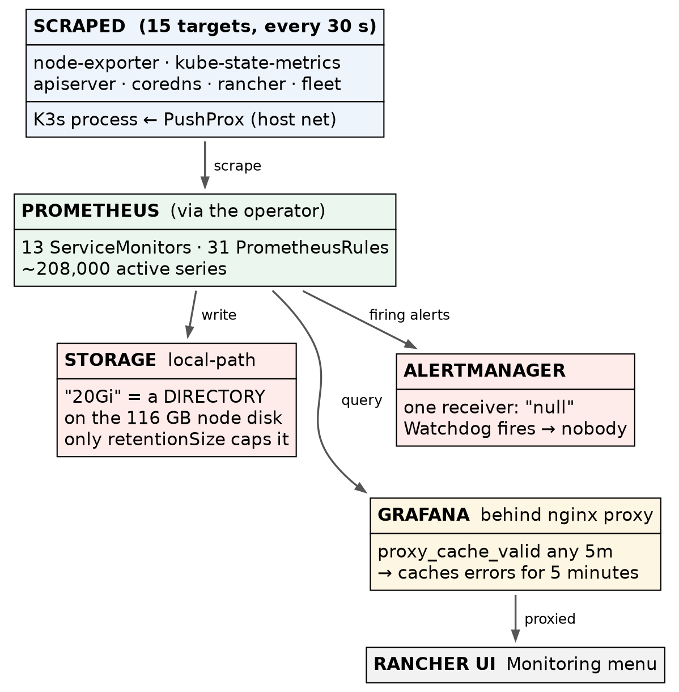

# Rancher on K3s · Chapter 3 — Seeing It: rancher-monitoring

> **Series:** Home-Lab Education · Phase 20 (Rancher on K3s)
> **Built and verified:** October 27, 2026, 22:26–22:30 EDT on VM 187 `vm-k3s-rancher-1` (`192.168.1.187`); outputs re-captured read-only at 23:35–23:45 the same night
> **Versions at time of writing:** rancher-monitoring 110.0.2+up80.9.1-rancher.22 (Prometheus Operator v0.87.1 · Grafana 12.3.1) · Rancher 2.15.2 · K3s v1.35.9+k3s1
> **Script:** `proxmox/build-scripts/rancher-k3s/5-monitoring.sh` · values in [`manifests/monitoring-values.yaml`](manifests/monitoring-values.yaml)
> **Read this after:** Chapter 2 · **before:** Chapter 4

> 🤖 **DECLARATION — read this before you trust anything below.** Every command in this chapter was
> **executed** on VM 187 and every output quoted is real. But it was
> **[run by the AI, not by Andrew]{custom-style="Key"}**, at his explicit instruction — so the commands are
> verified, and the operator judgement behind them was not earned at a keyboard. ⚠️ The Grafana dashboards
> were **not opened in a browser**; everything here was verified through Prometheus's own API.

---

## What this chapter covers

Rancher has a **Monitoring** menu, and installing it is one Helm chart. [What that chart actually deploys]{custom-style="Key"} —
and what it quietly does *not* do — is the subject of this chapter:

- what `rancher-monitoring` is, and why it is two charts
- how to choose its version ([Rancher decides, not you]{custom-style="Key"})
- why K3s needs special settings to be monitored at all
- 🚨 why the retention limit is [the *only* thing stopping Prometheus filling the disk]{custom-style="Key"} —
  the volume's size is not
- how a five-minute-old error kept being served after Grafana had recovered
- why the alerting pipeline, as installed, [tells nobody anything]{custom-style="Key"}

---

## 1. What rancher-monitoring is

It is the community **kube-prometheus-stack** — Prometheus, Alertmanager, Grafana and the exporters —
[repackaged by Rancher with Rancher's images and Rancher's defaults]{custom-style="Key"}. The chart says so in
its own metadata:

```bash
sudo kubectl get apps.catalog.cattle.io -n cattle-monitoring-system rancher-monitoring \
  -o jsonpath='{.spec.chart.metadata.annotations}' | tr ',' '\n' \
  | grep -E 'rancher-version|kube-version|upstream|display-name|certified'
```

```
"catalog.cattle.io/certified":"rancher"
"catalog.cattle.io/display-name":"Monitoring"
"catalog.cattle.io/kube-version":"\u003e= 1.34.0-0 \u003c 1.37.0-0"
"catalog.cattle.io/rancher-version":"\u003e= 2.15.0-0 \u003c 2.16.0-0"
"catalog.cattle.io/upstream-version":"80.9.1"}
```

*(`\u003e` and `\u003c` are `>` and `<`, escaped by JSON.)* The version string itself encodes the same thing:
**`110.0.2+up80.9.1-rancher.22`** reads as *Rancher's chart line 110, built on upstream 80.9.1*.

It is built on the **operator pattern**. [You do not configure Prometheus by editing its config file]{custom-style="Key"}; you
create Kubernetes objects and an operator turns them into config:

| Object | Meaning | Count here |
|---|---|---|
| `Prometheus` | "run a Prometheus with these settings" | 1 |
| `ServiceMonitor` | [what to scrape, found by Service labels]{custom-style="Key"} | 13 |
| `PrometheusRule` | alerting and recording rules | 31 |
| `Alertmanager` | "run an Alertmanager" (its routing lives in a Secret) | 1 |

And the pods that result, as the install script's `--check` mode lists them:

```
       alertmanager-rancher-monitoring-alertmanager-0 2/2 Running
       prometheus-rancher-monitoring-prometheus-0 3/3 Running
       pushprox-k3s-server-client-c6kgg 1/1 Running
       pushprox-k3s-server-proxy-cfd8ddbc7-hqlv2 1/1 Running
       rancher-monitoring-grafana-7ff7db6cd-4cmmf 3/3 Running
       rancher-monitoring-kube-state-metrics-c8f675d4c-r644m 1/1 Running
       rancher-monitoring-operator-6969495657-bt9vk 1/1 Running
       rancher-monitoring-prometheus-adapter-776b98d674-h8lgf 1/1 Running
       rancher-monitoring-prometheus-node-exporter-qbm44 1/1 Running
  ok   all cattle-monitoring-system pods Running
       pvc prometheus-rancher-monitoring-prometheus-db-prometheus-rancher-monitoring-prometheus-0 Bound 20Gi local-path
  ok   Prometheus retention: 7d 15GiB
  ok   Prometheus targets: 15 targets; none down
```

| Pod | Job |
|---|---|
| `operator` | Watches the objects above and writes Prometheus and Alertmanager configuration |
| `prometheus-…-0` | Scrapes and stores metrics; evaluates rules |
| `alertmanager-…-0` | Receives firing alerts and routes them to people (§6) |
| `grafana` | Dashboards — three containers, one of which is the proxy in §5 |
| `node-exporter` | Node metrics: CPU, memory, disk, network |
| `kube-state-metrics` | Object metrics: *how many replicas are ready*, rather than *how much CPU* |
| `prometheus-adapter` | Serves Prometheus data through the Kubernetes metrics API |
| `pushprox-…` | Reaches K3s's control plane (§3) |



---

## 2. Install the CRDs, then the chart — at the version Rancher allows

### 2a. Choose the version from the annotation, not from "latest"

The `rancher-version` annotation above is a constraint: [**this chart works with Rancher 2.15.x only.**]{custom-style="Key"}
Chart line 110 belongs to Rancher 2.15; Rancher 2.16 will need chart line 111. ⭐ [Upgrading Rancher means
upgrading every Rancher-packaged chart with it]{custom-style="Key"} — this is part of why Chapter 1 called the
upgrade a regular procedure rather than an event.

### 2b. Two charts, in order

```bash
helm repo add rancher-charts https://charts.rancher.io
helm upgrade --install rancher-monitoring-crd rancher-charts/rancher-monitoring-crd \
  --version 110.0.2+up80.9.1-rancher.22 -n cattle-monitoring-system --create-namespace --wait --timeout 15m
helm upgrade --install rancher-monitoring rancher-charts/rancher-monitoring \
  --version 110.0.2+up80.9.1-rancher.22 -n cattle-monitoring-system \
  -f monitoring-values.yaml --wait --timeout 15m
```

The custom resource types come in their own chart so that [their lifecycle is separate from the
workloads']{custom-style="Key"}: Helm treats CRDs cautiously (deleting one deletes every object of that type),
and splitting them out lets the main chart be removed or reinstalled without touching the definitions.
⚠️ That rationale is the general Helm practice, recited; what was run here is the two installs, in that order.

---

## 3. K3s needs its own monitoring settings

On a `kubeadm` cluster, the scheduler and controller manager are separate pods, each with a metrics
endpoint Prometheus can scrape. [On K3s they are all inside the one `k3s server` process]{custom-style="Key"}
(Chapter 1, §6), with their metrics bound to the node's localhost — where a pod cannot reach them.

The values file handles both halves of that:

```yaml
k3sServer:
  enabled: true                 # deploy PushProx to reach the K3s process
kubeControllerManager:
  jobNameOverride: k3s-server   # the dashboards' queries look for this job name instead
kubeScheduler:
  jobNameOverride: k3s-server
kubeProxy:
  jobNameOverride: k3s-server
```

**PushProx** is the trick. A client runs **on the node's own network** and connects outward to a proxy
inside the cluster; [Prometheus scrapes *through* the proxy]{custom-style="Key"}, and the client fetches from localhost on its
behalf:

```bash
sudo kubectl get ds -n cattle-monitoring-system pushprox-k3s-server-client \
  -o jsonpath='{.spec.template.spec.hostNetwork} {.spec.template.spec.containers[0].args}'
```

```
true ["--fqdn=$(HOST_IP)","--proxy-url=$(PROXY_URL)","--allow-port=10250","--use-localhost","--insecure-skip-verify","--token-path=/var/run/secrets/kubernetes.io/serviceaccount/token"]
```

`hostNetwork: true` and `--use-localhost` are the two halves. The `jobNameOverride` lines matter just as much:
[without them the targets are scraped, but the dashboards query job names that do not exist]{custom-style="Key"},
[and the control-plane panels sit empty with no error]{custom-style="Key"}. ⚠️ That failure is inferred from how the dashboards
select data; it was not provoked here.

**Confirm — every target up, from Prometheus's own API:**

```bash
sudo kubectl exec -n cattle-monitoring-system prometheus-rancher-monitoring-prometheus-0 -c prometheus -- \
  wget -qO- 'http://localhost:9090/api/v1/targets?state=active' | python3 -c '…count by job and health…'
```

```
  1  up    apiserver
  1  up    coredns
  3  up    k3s-server
  1  up    kube-state-metrics
  1  up    monitoring-fleet-controller
  1  up    monitoring-gitjob
  1  up    node-exporter
  1  up    rancher
  1  up    rancher-monitoring-alertmanager
  1  up    rancher-monitoring-grafana
  1  up    rancher-monitoring-operator
  2  up    rancher-monitoring-prometheus
```

*(The Python one-liner that counts targets by job is abbreviated here; the full command is in
[`COMMANDS.md`](COMMANDS.md).)*

15 targets, none down, three of them `k3s-server` through PushProx. ⭐ [Check the targets page, not a
dashboard tile]{custom-style="Key"}: a dashboard with no data looks identical whether the target is down, the job
name is wrong, or nothing has happened yet. [The targets API says which.]{custom-style="Key"}

---

## 4. Retention — and the size limit that is not a limit

### 4a. What was set, and why

```yaml
prometheus:
  prometheusSpec:
    retention: 7d
    retentionSize: 15GiB
    storageSpec:
      volumeClaimTemplate:
        spec:
          storageClassName: local-path
          resources:
            requests:
              storage: 20Gi
```

The reason is the storage underneath. The VM's disk sits on a **thin-provisioned** ZFS pool shared by
many VMs, and [a thin pool that fills stalls every VM on it at once]{custom-style="Key"}. Prometheus, left alone,
[grows until something stops it]{custom-style="Key"}. So retention was set explicitly — [by age (7 days) *and* by size (15 GiB)]{custom-style="Key"},
whichever comes first.

### 4b. 🚨 The 20 Gi on the volume claim enforces nothing

The volume claim asks for 20 Gi, and Kubernetes reports it bound at 20 Gi. Now ask the filesystem:

```bash
sudo kubectl exec -n cattle-monitoring-system prometheus-rancher-monitoring-prometheus-0 -c prometheus -- \
  df -h /prometheus | tail -1
sudo kubectl get pv -o custom-columns=NAME:.metadata.name,CAP:.spec.capacity.storage,PATH:.spec.hostPath.path,LPATH:.spec.local.path,NODE:.spec.nodeAffinity.required.nodeSelectorTerms[0].matchExpressions[0].values[0]
sudo sh -c 'du -sh /var/lib/rancher/k3s/storage/*'
```

```
/dev/sda1               115.2G     12.8G    102.4G  11% /prometheus

NAME                                       CAP    PATH     LPATH                                                          NODE
pvc-8c511a4c-1b0c-4188-bf29-d840c51850f8   20Gi   <none>   /var/lib/rancher/k3s/storage/pvc-8c511a4c-…_cattle-monitoring-…   vm-k3s-rancher-1

94M	/var/lib/rancher/k3s/storage/pvc-8c511a4c-…_cattle-monitoring-…
```

*(The long directory names are truncated with `…` and the column padding shortened to match.)*

Prometheus sees **the node's entire 115 GB root disk**. `local-path` does not create a 20 GB volume; [it
creates a directory on the node's disk and labels it 20 Gi]{custom-style="Key"}. [Nothing enforces the label.]{custom-style="Key"}

[So the guard that actually protects the disk is **`retentionSize: 15GiB`**]{custom-style="Key"} — Prometheus deleting its own
oldest data when it passes that size. [If that setting were missing, the "20Gi" would not save
you]{custom-style="Key"}; Prometheus would grow until the VM's 120 GB disk was full. *(Found while writing this
chapter, not during the build — the plan had assumed the claim size was a second line of defence.)*

**Confirm the setting the operator actually applied** — [read it from the `Prometheus` object, not the]{custom-style="Key"}
values file:

```bash
sudo kubectl get prometheus -n cattle-monitoring-system rancher-monitoring-prometheus \
  -o jsonpath='{.spec.retention} {.spec.retentionSize} {.spec.scrapeInterval}'; echo
```

```
7d 15GiB 30s
```

**Measured growth so far:** 44.3 MB at 22:59, 75.9 MB at 23:24 — about 208,000 active series, scraped every
30 seconds. Early growth includes the write-ahead log and is not a rate to extrapolate. ⚠️ **Whether
`retentionSize` is honoured has not been tested yet**: that is drill D5, due after 24 hours of data
(Chapter 5).

---

## 5. Reaching Grafana — and the five-minute ghost

Grafana's pod has three containers:

```
grafana-sc-dashboard rancher/appco-k8s-sidecar:2.1.2-1.10
grafana              rancher/appco-grafana:12.3.1-1.12
grafana-proxy        rancher/mirrored-library-nginx:1.31.3-alpine
```

The sidecar loads dashboards from ConfigMaps. **`grafana-proxy` is an nginx** that sits in front of Grafana
so it can be served through Rancher's UI, and it caches what it serves:

```bash
sudo kubectl get cm -n cattle-monitoring-system grafana-nginx-proxy-config -o jsonpath='{.data}' \
  | tr ',' '\n' | grep -o -E 'proxy_cache[a-z_]*[^;]*;' | sort -u
```

```
proxy_cache         my_zone;
proxy_cache_bypass  $http_cache_control;
proxy_cache_path            /var/cache/nginx/cache levels=1:2 keys_zone=my_zone:100m inactive=1d max_size=10g;
proxy_cache_valid   200 302 1d;
proxy_cache_valid   301 30d;
proxy_cache_valid   any 5m;
```

🚨 **`proxy_cache_valid any 5m` caches errors too.** Immediately after the install, Prometheus reported the
Grafana target **down with HTTP 502** for about five minutes — although Grafana itself had finished
starting. While Grafana was still coming up, the proxy got no good answer from it and returned a 502 —
and with `any 5m`, [the proxy cached that 502 and served it for five minutes]{custom-style="Key"}. It then
cleared by itself, with no change made.

⭐ The lesson is general: **[a cache in front of a service can keep reporting a failure after the failure is
over]{custom-style="Key"}**. When something "stays broken" [for a suspiciously round number of minutes]{custom-style="Key"}, look for a
cache before you start restarting things. [Asking the backend directly — past the proxy — tells you which.]{custom-style="Key"}
The same proxy, with the same settings, sits in front of Prometheus.

---

## 6. Alerts that go nowhere

Prometheus evaluates 31 rule sets and can fire alerts. Alertmanager's job is to route them to a person.
Look at where it routes them (structure only — this file can hold credentials):

```bash
sudo kubectl get secret -n cattle-monitoring-system alertmanager-rancher-monitoring-alertmanager \
  -o jsonpath='{.data.alertmanager\.yaml}' | base64 -d | grep -nE 'receiver|name:|_configs|route'
```

```
26:receivers:
27:- name: "null"
28:route:
33:  receiver: "null"
35:  routes:
38:    receiver: "null"
```

**One receiver, named `"null"`, on every route.** And what is firing right now, from Prometheus's alerts API
(the same `wget … | python3` pattern as the targets check, against `/api/v1/alerts`):

```
1 alerts; [('Watchdog', 'firing')]
```

`Watchdog` is the alert that is *designed to fire forever* — [its only purpose is to prove that alerts reach
someone]{custom-style="Key"}. Here it is delivered to `"null"`. [The whole pipeline works up to the last step,]{custom-style="Key"}
[and the last step is a black hole.]{custom-style="Key"}

> **Lab vs PROD — monitoring with no alert route.** *In the lab:* rancher-monitoring is installed with its
> default Alertmanager configuration, whose only receiver is `"null"`; rules evaluate and alerts fire, and
> nobody is told. *Why it's acceptable here:* one person, looking at the system directly; the purpose is to
> see the stack, not to be paged by it. *In production:* receivers (email, chat, a pager) are configured —
> through `AlertmanagerConfig` objects or the chart's values — and `Watchdog` is wired to a dead-man's switch
> that alerts when it *stops* arriving. ⚠️ *Recited practice; no receiver was configured or tested here.*
> *If you carry the habit:* [a green Monitoring menu becomes evidence that someone would be told]{custom-style="Key"},
> and the first real outage is discovered by a user.

---

## 7. What monitoring costs

```bash
sudo kubectl top pods -A --sort-by=memory | head -5
```

```
NAMESPACE                   NAME                                                     CPU(cores)   MEMORY(bytes)
cattle-monitoring-system    prometheus-rancher-monitoring-prometheus-0               50m          884Mi
cattle-system               rancher-6f7f6f6977-lp9th                                 19m          863Mi
cattle-monitoring-system    rancher-monitoring-prometheus-adapter-776b98d674-h8lgf   2m           501Mi
cattle-monitoring-system    rancher-monitoring-grafana-7ff7db6cd-4cmmf               11m          313Mi
```

[The monitoring stack uses more memory than Rancher itself]{custom-style="Key"} — about 1.7 GiB for Prometheus, its
adapter and Grafana against Rancher's 0.85 GiB — on a cluster that runs one demo app. Prometheus's memory
[grows with the number of active series]{custom-style="Key"} (here ~208,000), not with the number of apps. Size the management
cluster for its monitoring, not just for Rancher.

---

## Where this lab differs from production

| Here | In production | Why it matters |
|---|---|---|
| Alertmanager receiver `"null"` | Real receivers + a dead-man's switch on `Watchdog` | **Callout in §6** |
| Prometheus on `local-path` — a directory on one node's disk, no backup | Network or replicated storage; long-term metrics shipped off the cluster | Metrics lost with the node. Acceptable for a lab; a table row, because losing metrics is rarely the incident |
| Size held by `retentionSize` alone (§4b) | The same setting, plus storage that enforces a quota | Both should exist; here only one does |
| 7 days of retention | Longer, or tiered | Scale |

---

## Commands to know by heart

| Question | Command |
|---|---|
| Which monitoring chart versions fit this Rancher? | the `catalog.cattle.io/rancher-version` annotation |
| Are all targets up? | Prometheus API `…/api/v1/targets?state=active` (or the Targets page) |
| What retention is really applied? | `kubectl get prometheus -n cattle-monitoring-system -o jsonpath='{.items[0].spec.retention} {.items[0].spec.retentionSize}'` |
| How big is the data really? | `kubectl exec … prometheus-…-0 -c prometheus -- du -sh /prometheus` |
| Is the volume's size enforced? | `df -h` **inside** the pod, against the claim's size |
| Where do alerts go? | the `receiver` lines of the Alertmanager Secret |
| What is firing? | Prometheus API `…/api/v1/alerts` |
| Is something cached? | the proxy's `proxy_cache_valid` lines; then ask the backend directly |

---

## Glossary

**kube-prometheus-stack** — the community Helm chart bundling Prometheus, Alertmanager, Grafana and the
exporters. `rancher-monitoring` is Rancher's packaging of it.

**operator** — [a controller that turns custom objects into running configuration]{custom-style="Key"}. The
Prometheus Operator reads `ServiceMonitor` and `PrometheusRule` objects.

**ServiceMonitor** — an object saying "scrape the Services with these labels, on this port".

**target** — one endpoint Prometheus scrapes. `up` or `down` per target.

**PushProx** — [a client on the node's network that fetches metrics on Prometheus's behalf]{custom-style="Key"},
for endpoints a pod cannot reach.

**retention / retentionSize** — how long, and how much, Prometheus keeps before deleting its oldest data.

**local-path** — K3s's default storage class: a directory on the node's disk. [Its size field is a label,
not a quota]{custom-style="Key"}.

**receiver** — an Alertmanager destination (email, chat, pager). `"null"` discards.

**Watchdog** — an alert that always fires, to prove that alert delivery works.

---

## Check yourself

Answer these out loud. Section references, not answers.

1. What is `rancher-monitoring`, in one sentence, and what does `+up80.9.1` in its version mean? (§1)
2. You upgrade Rancher to 2.16. What happens to the monitoring chart? (§2a)
3. Why does K3s need PushProx when a `kubeadm` cluster does not? (§3)
4. The control-plane dashboards are empty but every target is up. What do you suspect? (§3)
5. Why is the targets API a better check than a Grafana panel? (§3)
6. The claim says 20 Gi. What actually stops Prometheus filling the disk, and how would you prove it? (§4b)
7. Grafana showed a 502 for exactly five minutes and then recovered without anyone touching it. Explain. (§5)
8. Everything in Monitoring is green and an outage happens. Who is told? Why? (§6)
9. Which uses more memory here, Rancher or its monitoring — and what drives Prometheus's memory? (§7)
