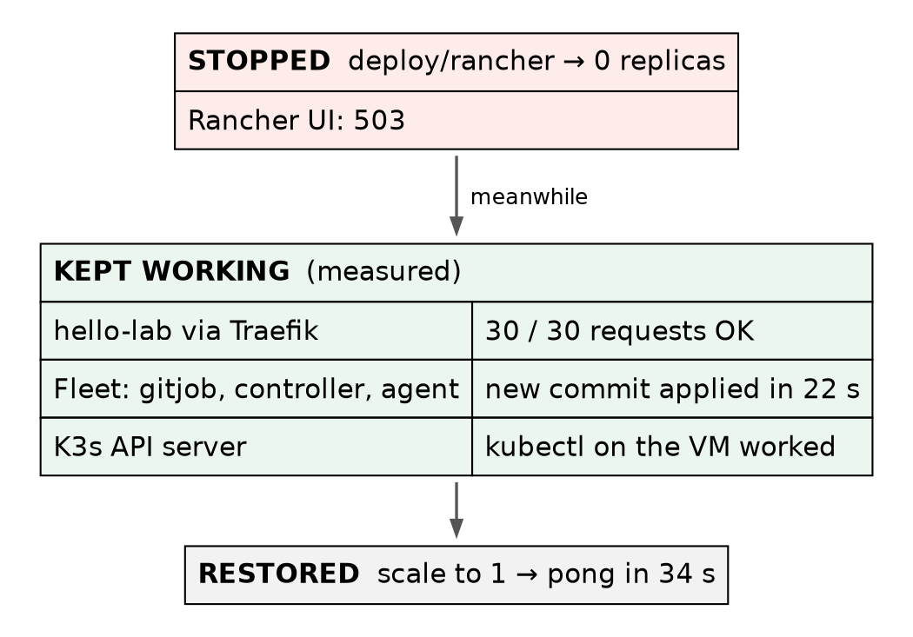

# Rancher on K3s · Chapter 5 — Breaking It: Four Drills

> **Series:** Home-Lab Education · Phase 20 (Rancher on K3s)
> **Drills run:** October 27, 2026, about 22:45–23:00 EDT on VM 187 `vm-k3s-rancher-1` (`192.168.1.187`), measured from the workstation `.195`
> **Versions at time of writing:** K3s v1.35.9+k3s1 · Rancher 2.15.2 · Fleet as bundled · Ubuntu 24.04.5, systemd defaults
> **Script:** none — each drill was a one-off command sequence, quoted (abbreviated) below
> **Read this after:** Chapter 4 · **before:** the hand-built cluster that comes next

> 🤖 **DECLARATION — read this before you trust anything below.** Every drill in this chapter was
> **executed** on VM 187, and every number is measured. But it was
> **[run by the AI, not by Andrew]{custom-style="Key"}**, at his explicit instruction — so the outcomes are
> verified, and the operator judgement behind them was not earned at a keyboard. ⚠️ The drills' raw terminal
> output was not kept in full; numbers and error strings are quoted from the build record, and where the
> record abridges an error string, so does this chapter (`…`).

---

## What this chapter covers

A system you have only seen working is a system you do not understand yet. Each drill here
[breaks one thing on purpose and measures what happens]{custom-style="Key"}, in the same four parts:

1. **Prediction** — written down *before* the drill ran.
2. **Run** — what was done, as commands.
3. **Measured** — what actually happened, with numbers.
4. **At 3am** — what this teaches you to do when it happens for real.

| Drill | What was broken | The lesson in one line |
|---|---|---|
| D1 | The whole VM rebooted | One container that ignores SIGTERM costs every reboot 90 seconds |
| D2 | Rancher scaled to zero | [The apps and GitOps do not need Rancher to keep running]{custom-style="Key"} |
| D3 | A broken manifest committed to Git | The old version keeps serving; alert on `Ready`, not `Stalled` |
| D4 | The registry password made wrong | Rancher's summary hides the 401; the pod's Events do not |
| D5 | *(not yet run)* Prometheus disk after 24 h | Is `retentionSize` really enforced? |
| D6 | *(not yet run)* upgrade Rancher | Waits for a newer community release |

⚠️ A prediction that came true is still worth recording, and one that did not is worth more:
[D1's first run missed its prediction by over a minute, and that miss found a real bug]{custom-style="Key"}.

---

## How the drills were measured

From outside. Every timing was taken from the workstation `.195`, polling every 2 seconds, so a number
means "[a user could have seen it]{custom-style="Key"}" — not "a log line said so". The reboot drill's loop, abbreviated:

```bash
T0=$(date +%s); ssh agamache@192.168.1.187 'sudo systemctl reboot'
while [ $(( $(date +%s) - T0 )) -lt 600 ]; do
  E=$(( $(date +%s) - T0 ))
  [ -z "$SSH" ]     && ssh -o ConnectTimeout=2 -o BatchMode=yes agamache@192.168.1.187 true && SSH=$E
  [ -z "$HELLO" ]   && curl -s --max-time 2 http://hello-rancher.gothamtechnologies.com/ | grep -q '"version"' && HELLO=$E
  [ -z "$RANCHER" ] && [ "$(curl -sk --max-time 2 https://rancher.gothamtechnologies.com/ping)" = pong ] && RANCHER=$E
  [ -z "$UI" ]      && [ "$(curl -sk -o /dev/null -w '%{http_code}' --max-time 3 https://rancher.gothamtechnologies.com/dashboard/)" = 200 ] && UI=$E
  ...
  sleep 2
done
```

*(Abbreviated: the `2>/dev/null` redirections and the exit test are removed.)*

[A poll from outside is the only clock that includes everything]{custom-style="Key"} — DNS, Traefik, the pod,
the network. The availability checks in D2–D4 work the same way: `curl` the app once a second, count
successes and failures.

---

## D1 — Reboot the VM

**Prediction:** SSH back in about 40 s; the app serving within 90 s; Rancher's `/ping` within 3 minutes;
nothing needs restarting by hand.

**Run:** `sudo systemctl reboot`, then the loop above.

**Measured — first run:**

| | Predicted | Run 1 |
|---|---|---|
| SSH | ~40 s | **109 s** |
| App serving | ≤ 90 s | **139 s** |
| Rancher `/ping` | ≤ 180 s | **151 s** |

Nothing needed a hand restart — but SSH was 70 seconds late, and [SSH does not depend on Kubernetes at all]{custom-style="Key"}.
[When the first thing back is late, look at the shutdown, not the startup]{custom-style="Key"}. The previous
boot's journal:

```bash
sudo journalctl -b -1 --no-pager -o short-precise \
  | grep -iE "timed out|killing process|stop job|Stopped k3s|Stopping k3s|reached target.*(shutdown|final)|systemd-shutdown|containerd-shim" | tail -15
```

It contained, abridged in the record: `cri-containerd-…scope: Stopping timed out. Killing … (python)`.
[**Shutdown alone had taken 87 seconds.**]{custom-style="Key"} systemd's limit is visible directly:

```bash
systemctl show -p DefaultTimeoutStopUSec
```

```
DefaultTimeoutStopUSec=1min 30s
```

**The cause.** One Python container ignored SIGTERM, so systemd waited out its full 90-second limit and
then killed it. As Chapter 4 explained, [Python running as PID 1 gets no default SIGTERM action]{custom-style="Key"}.
The Fleet copies of `hello-lab` already ran the fixed image; [the culprit was the **push-model copy**]{custom-style="Key"}, still on
the older image from before the fix, because nobody had re-run its manual job.

**The fix:** re-run `deploy_push`, so the push copy gets the image with the handler. Then the drill again:

| | Predicted | Run 1 | **Run 2 (after fix)** |
|---|---|---|---|
| Shutdown | — | 87 s | **4 s** |
| SSH | ~40 s | 109 s | **27 s** |
| App serving | ≤ 90 s | 139 s | **47 s** |
| Rancher `/ping` + dashboard | ≤ 180 s | 151 s | **63 s** |

**At 3am:**

- ⭐ [One badly built container slows the reboot of the whole machine]{custom-style="Key"} — not just its own
  pod. On a node with fifty images from fifty teams, one is enough.
- If a node takes about 90 seconds longer than usual to reboot, read the previous boot's journal for
  *Stopping timed out*.
- [A manually triggered deploy path drifts]{custom-style="Key"}: the Fleet copy got the fix automatically, the push copy did not.
- **Side finding:** right after the first reboot, Fleet showed the app *NotReady* for about four minutes
  while it was healthy. That is the status lag from Chapter 4, Step 4 — [check `rollout status` before
  believing Fleet]{custom-style="Key"}.

---

## D2 — Scale Rancher to zero

**Prediction:** the app keeps serving, [and Fleet keeps delivering commits, with Rancher gone]{custom-style="Key"} — because
neither runs inside the Rancher pod.

**Run** (abbreviated):

```bash
sudo kubectl -n cattle-system scale deploy/rancher --replicas=0
sudo kubectl -n cattle-system wait --for=delete pod -l app=rancher --timeout=120s
# from .195: 30 requests to the app, one per second
for i in $(seq 1 30); do curl -sf --max-time 2 http://hello-rancher.gothamtechnologies.com/ >/dev/null && OK=$((OK+1)) || FAIL=$((FAIL+1)); sleep 1; done
# commit a real change while Rancher is down: replicas 2 -> 3
sed -i 's/^  replicas: 2$/  replicas: 3/' fleet/hello-lab/deployment.yaml
git commit -qam "D2: replicas 3 while Rancher is scaled to 0" && git push …
# poll readyReplicas until 3; then scale Rancher back to 1 and poll /ping until pong
```

**Measured:**

| Check | Result |
|---|---|
| Rancher UI | **503** — Rancher is gone |
| App, 30 requests during the outage | **30 / 30 OK** |
| Fleet applies the new commit (replicas → 3) | **22 s** after the push, Rancher still at 0 |
| Rancher back after scaling to 1 | **34 s** to `pong` |



**At 3am:**

- ⭐ [**Rancher down is not an outage of the apps.**]{custom-style="Key"} It is an outage of the *management* — the UI, the Rancher
  API, and anything people do through them. [Your workloads are run by Kubernetes, not by
  Rancher]{custom-style="Key"} (Chapter 1, §2).
- GitOps keeps working because Fleet's controllers are their own Deployments (Chapter 4, Step 3). So
  [a fix can still ship through Git while the Rancher UI is down]{custom-style="Key"}.
- What you lose is the convenience layer. [`kubectl` on the cluster still works]{custom-style="Key"} — which is why the cluster's
  own kubeconfig must stay reachable, on the VM, independent of Rancher.
- ⚠️ Not tested here: a *downstream* cluster with Rancher down. There is none in this lab. The same
  principle is expected to hold — its agent loses its connection to the manager while its workloads keep
  running — but that is recited, not measured.

---

## D3 — Commit a broken manifest

**Prediction:** Fleet shows an error naming the problem; the old version keeps serving; `git revert`
recovers.

**Run:** a manifest that is valid YAML but invalid Kubernetes — a number written as a word:

```bash
sed -i 's/^  replicas: 3$/  replicas: three/' fleet/hello-lab/deployment.yaml
git commit -qam "D3: deliberately broken manifest (replicas: three)" && git push …
sleep 30
sudo kubectl get gitrepo -n fleet-local hello-lab -o jsonpath="{range .status.conditions[*]}{.type}={.status} {.message}{\"\n\"}{end}"
sudo kubectl get bundle -n fleet-local hello-lab-fleet-hello-lab -o jsonpath="{range .status.conditions[*]}{.type}={.status} {.message}{\"\n\"}{end}"
sudo kubectl get deploy -n hello-lab hello-lab
# from .195: 15 requests, one per second
```

*(Abbreviated: output truncation with `cut` removed.)*

**Measured:**

| Check | Result |
|---|---|
| Fleet's state | **`ErrApplied`**, carrying the API server's own error, abridged in the record as `.spec.replicas: expected numeric … got string` |
| The Deployment | still **3/3**, on the last good spec |
| App, 15 requests while broken | **15 / 15 OK** |
| GitRepo condition `Stalled` | **`False`** — throughout |
| Recovery after `git revert` | **Ready in 21 s** |

Notice *why* the old version kept serving. Fleet rendered the manifest and handed it to the API server,
which rejected it, so [nothing about the running Deployment was ever changed]{custom-style="Key"}. A bad
[commit of this kind fails closed.]{custom-style="Key"}

**The surprise:** [`Stalled` stayed `False` the whole time.]{custom-style="Key"} The word sounds like exactly the condition to
alert on, and it would never have fired. [`Ready` went `False`, with the error in its message.]{custom-style="Key"}

🚨 **Tripping point — reverting more than one commit.** After the first revert (of D3), the plan was to
revert D2 with `git revert HEAD~1`. But [after a revert, `HEAD~1` is the commit you just reverted]{custom-style="Key"},
not the one before it: the command targeted the D3 commit again and stopped on a conflict. A diagnostic
command then re-applied the broken commit locally. Neither was pushed; the fix was `git reset` to the good
commit, then `git revert b778273` — **by hash**. You can see the final result at the top of the history in
Chapter 4, Step 2.

**At 3am:**

- ⭐ [Alert on the GitRepo's `Ready` condition, not on `Stalled`]{custom-style="Key"}.
- A rejected manifest leaves the running version alone. You have time; read Fleet's error, which is the API
  server's error, and fix Git.
- [Revert by hash, never by relative position]{custom-style="Key"}, when more than one commit is involved.
- ⚠️ This was a manifest the API server *rejects*. [A manifest that is accepted but wrong]{custom-style="Key"} — a bad image tag,
  a broken config — gets rolled out, and protection then depends on readiness probes and the rolling-update
  strategy. That case was not drilled here.

---

## D4 — Break the registry credential

**Prediction:** a new pod goes to `ImagePullBackOff` with a 401; the surviving pod keeps serving; restoring
the credential recovers.

**Run** (abbreviated — the backup of the good file and the restore are shown as comments):

```bash
# backup: sudo install -m 600 /etc/rancher/k3s/registries.yaml /root/registries.yaml.good
sudo sed -i -E "s/(password: \").{4}/\1XXXX/" /etc/rancher/k3s/registries.yaml   # spoil 4 characters
sudo systemctl restart k3s                     # registries.yaml is read only at start (Chapter 4)
P=$(sudo kubectl get pods -n hello-lab -o name | head -1)
sudo kubectl delete -n hello-lab $P --wait=false
sudo crictl rmi "$IMG"                         # remove the cached image, or the node never needs the password
```

🚨 **The step that makes the drill honest: `crictl rmi`.** [The node already had the image cached.]{custom-style="Key"} A
replacement pod would have started from the cache and [the broken credential would never have been
used]{custom-style="Key"}. That is also the real-world trap: [a credential can be wrong for weeks, unnoticed,]{custom-style="Key"}
until a node needs an image it has never pulled — a new node, a new tag, a cleaned cache.

**Measured:**

| Check | Result |
|---|---|
| New pod | **`ImagePullBackOff`** |
| The pod's Events | abridged in the record: `failed to fetch oauth token: … GET http://gitlab…/jwt/auth?… 401 Unauthorized` |
| App, 15 requests during | **15 / 15 OK** — the surviving pod served |
| Rancher's view of the same pod | state `imagePullBackOff`, message *"containers with unready status"*, **`error: false`**, **`transitioning: true`** |
| Recovery after restoring the file + K3s restart | **Running in 16 s**, no pod deleted by hand |

*(Rancher's view was read from its own API — the "Steve" API the dashboard renders from — not from a
screenshot of the UI.)*

**Read the error carefully.** `401 Unauthorized` came from GitLab's **token endpoint** (`/jwt/auth`). So DNS
worked, the network worked, the registry answered and sent the client to log in — and
[the login was refused]{custom-style="Key"}. [Every layer below the credential is ruled out by that one line.]{custom-style="Key"}

**Rancher's summary did not paint it as an error.** `error: false`, `transitioning: true` — the pod looks
like it is on its way somewhere. [The 401 appears only in the pod's Events]{custom-style="Key"}.

The recovery is still visible in the cluster's event log, read-only, about 25 minutes later:

```bash
sudo kubectl get events -n hello-lab --sort-by=.lastTimestamp | tail -5
```

```
26m         Warning   Failed              pod/hello-lab-66b58bbb5f-kk2sj    Error: ImagePullBackOff
25m         Normal    Pulling             pod/hello-lab-66b58bbb5f-kk2sj    Pulling image "gitlab.gothamtechnologies.com:5050/production/rancher-k3s/hello-lab:3a2687e8"
25m         Normal    Pulled              pod/hello-lab-66b58bbb5f-kk2sj    Successfully pulled image "gitlab.gothamtechnologies.com:5050/production/rancher-k3s/hello-lab:3a2687e8" in 589ms (589ms including waiting). Image size: 16944113 bytes.
25m         Normal    Created             pod/hello-lab-66b58bbb5f-kk2sj    Container created
25m         Normal    Started             pod/hello-lab-66b58bbb5f-kk2sj    Container started
```

Kubernetes kept retrying the pull on its own back-off schedule; once K3s restarted with the good
credential, the next retry succeeded.

**At 3am:**

- ⭐ For `ImagePullBackOff`, [go straight to `kubectl describe pod` or the Events tab]{custom-style="Key"}. The
  summary tells you *that* it failed; the Events tell you *why*.
- [`401` from a token endpoint = the credential.]{custom-style="Key"} Timeouts or "no such host" = network or DNS. Read which
  one it is before changing anything.
- On K3s, a fixed `registries.yaml` [needs a K3s restart, and then patience]{custom-style="Key"} — no pods need deleting.
- [Clearing a node's image cache is how you test a credential.]{custom-style="Key"} It is also how a hidden bad credential
  surfaces in production.

---

## D5 and D6 — not yet run

**D5 — is `retentionSize` enforced?** [Chapter 3 showed that `retentionSize: 15GiB` is the only thing]{custom-style="Key"}
stopping Prometheus filling the node's disk. Baseline at 22:59 on October 27: **44.3 MB** on disk,
**~207,000** active series. Due after 24 hours of data (October 28, 23:00 or later), re-measured with:

```bash
sudo kubectl exec -n cattle-monitoring-system prometheus-rancher-monitoring-prometheus-0 -c prometheus -- du -sh /prometheus
```

A day of data is unlikely to reach 15 GiB, so [D5 mainly checks the growth rate; it does not prove the cap]{custom-style="Key"}. Proving the cap
means waiting for it, or temporarily setting a much smaller `retentionSize` and watching old blocks go.

**D6 — upgrade Rancher.** Rancher 2.15.2 was still the newest community release when this was written.
When a newer one exists, the drill is: the same `rancher-values.yaml`, `helm upgrade` to the new version,
and [the matching `rancher-monitoring` chart line]{custom-style="Key"} (Chapter 3, §2a). It is the procedure Chapter 1, §7 said
community users are pushed into regularly.

---

## Where this lab differs from production

| Here | In production | Why it matters |
|---|---|---|
| Drills run once each, by the AI, at a quiet time | Game days, repeated, by the people on call | Judgement comes from repetition, and from people |
| One node — a reboot takes everything down | Several nodes, drained one at a time | D1's numbers are the whole-site outage here, and a single-node event at work |
| Rancher at 0 for under a minute, no downstream clusters | Rancher outages measured in hours, with downstream agents disconnected | D2 proves the principle, not the long-outage behaviour |
| Availability measured by `curl` from one workstation | Synthetic checks from several places, with alerting | Chapter 3: alerts here go to `"null"` |

---

## Commands to know by heart

| Question | Command |
|---|---|
| Why was the last shutdown slow? | `journalctl -b -1 \| grep -i "timed out"` |
| What is systemd's stop limit? | `systemctl show -p DefaultTimeoutStopUSec` |
| Take Rancher away (drill) | `kubectl -n cattle-system scale deploy/rancher --replicas=0` |
| Is Fleet really failing? | the GitRepo's `Ready` condition and its message (not `Stalled`) |
| Why won't the image pull? | `kubectl describe pod <pod>` → Events · `kubectl get events -n <ns> --sort-by=.lastTimestamp` |
| What images does this node have cached? | `sudo crictl images` |
| Force a real pull (drill) | `sudo crictl rmi <image>`, then delete the pod |
| Measure from outside | a `curl` loop from another machine, counting successes |

---

## Glossary

**drill** — breaking something on purpose, with a written prediction, to learn how it fails.

**`DefaultTimeoutStopSec`** — [how long systemd waits for a unit to stop before it kills it]{custom-style="Key"}. 90 s by default.

**`ErrApplied`** — [Fleet's state when the API server rejected what Fleet tried to apply]{custom-style="Key"}.

**`Ready` / `Stalled`** — GitRepo conditions. [Only `Ready` reflected the failure in D3]{custom-style="Key"}.

**`ImagePullBackOff`** — the kubelet failed to pull an image and is retrying with growing delays.

**token endpoint** — the URL a registry sends clients to for a login token; for GitLab, `/jwt/auth`.

**Steve API** — Rancher's Kubernetes proxy API, which the dashboard reads; it adds summary fields such as
`state`, `error` and `transitioning`.

**`crictl`** — the command-line client for the node's container runtime (containerd); it sees images and
containers below Kubernetes.

---

## Check yourself

Answer these out loud. Section references, not answers.

1. SSH came back 70 seconds late after a reboot. Why did that point at the shutdown? What did you read to confirm it? (D1)
2. Why did the push-model copy still have the bug when the Fleet copy did not? (D1)
3. Rancher is down. Name what still works, and how you would ship an urgent fix. (D2)
4. You are writing the alert for "GitOps is failing". Which condition, and why not the obvious one? (D3)
5. Why did the broken manifest not take the app down? What kind of bad commit *would*? (D3)
6. You need to undo the last two commits. Why is `git revert HEAD~1` after the first revert wrong? (D3)
7. Why was `crictl rmi` necessary in D4, and what does that tell you about a real bad credential? (D4)
8. An image pull fails with a `401` from `/jwt/auth`. What has that ruled out? (D4)
9. Rancher's pod view shows `error: false`. Where do you look instead? (D4)
10. What exactly will D5 prove after 24 hours, and what will it not prove? (D5)
